# Training-free underwater object segmentation with DINOv2

**Version 1.2 · last updated 2026-11-03 · datasets: USOD (300 images, Sec. 1-18), SUIM test set (110 images, Sec. 5.2 and 19)**

A study of how far *frozen* DINOv2 features can go in separating "something is there" (foreground object)
from "just water / background" in underwater images, **without training anything**, as a first perception
building block for an Autonomous Underwater Vehicle (AUV).

> **Scope in one sentence.** This is **binary foreground/background segmentation**, *not* semantic segmentation:
> the output says *where* a salient object is in the image, not *what* it is, and not *how far* it is.

---

## Table of contents

1. [TL;DR](#1-tldr)
2. [Problem statement](#2-problem-statement)
3. [Why this problem matters](#3-why-this-problem-matters)
4. [Applications when solved (AUV perception)](#4-applications-when-solved-auv-perception)
5. [Dataset](#5-dataset)
6. [DINOv2 in depth](#6-dinov2-in-depth)
7. [Our approach end to end](#7-our-approach-end-to-end)
8. [Methods in detail (with the maths)](#8-methods-in-detail-with-the-maths)
9. [Experiment history: what we tried, what worked, what we changed](#9-experiment-history-what-we-tried-what-worked-what-we-changed)
10. [Results and comparisons](#10-results-and-comparisons)
11. [Figures and failure analysis](#11-figures-and-failure-analysis)
12. [AUV deployment feasibility](#12-auv-deployment-feasibility)
13. [Improvements and roadmap](#13-improvements-and-roadmap)
14. [Limitations, threats to validity and safety note](#14-limitations-threats-to-validity-and-safety-note)
15. [Conclusion](#15-conclusion)
16. [Reproducibility and environment](#16-reproducibility-and-environment)
17. [Glossary](#17-glossary)
18. [References, citations and licenses](#18-references-citations-and-licenses)
19. [Dendrogram (hierarchical) clustering instead of k-means](#19-dendrogram-hierarchical-clustering-instead-of-k-means)
20. [Changelog](#20-changelog)

---

## 1. TL;DR

* **What:** take a frozen self-supervised **DINOv2 ViT-B/14**, extract one feature vector per image patch,
  cluster the patches (k-means, 2 to 6 clusters), merge clusters into one *foreground* group and one
  *background* group, and compare with the ground-truth masks of **USOD** (300 underwater images).
* **No training anywhere.** Everything is PCA, k-means and simple rules on top of pre-trained features.
* **Headline numbers (mean IoU over 300 images, stride-3 dense features, k up to 6):**

| Setting | Features | Mean IoU |
|---|---|---|
| Realistic: foreground chosen **without** ground truth (border rule) | raw 768-D patch features | **0.523** |
| Realistic: border rule | 3-D PCA-RGB | 0.467 |
| **Oracle upper bound**: best fg/bg union chosen **using** ground truth | raw 768-D | 0.702 |
| Oracle upper bound | 3-D PCA-RGB | 0.671 |
| First baseline (k=2, PCA mask / k-means, border rule) | PC1 / 768-D | 0.418 / 0.490 |

* **Key findings**
  1. The features are semantically meaningful: PCA-RGB maps visibly separate diver, water, reef and objects
     (Sec. 11), without any underwater training.
  2. Raw 768-D features beat the 3-D PCA-RGB reduction in every comparison.
  3. The big gap between oracle (0.70) and realistic (0.52) IoU shows the *clusters are mostly right*; the
     weak link is **deciding which clusters are the foreground**.
  4. **Overlapping windows (stride 3) make the PCA-RGB map visibly smoother but barely change IoU** (oracle
     difference ≤ 0.003 on average): the bottleneck is not the feature resolution.
  5. Not yet real time: the deployable path runs at about 2.5 to 6.5 FPS on a desktop RTX A2000 (Sec. 12),
     and was **not** tested on a Jetson or on empty-water frames.
  6. **Where the errors come from** (Sec. 10.8): the border rule matches the oracle when silhouette picks 2 clusters
     (0.75 vs 0.76) and collapses when it must merge 3-6 (0.36-0.49); 30 of the 34 images where even the oracle fails are
     objects under 10% of the image.
  7. **New (Sec. 19): replacing k-means by a dendrogram (hierarchical clustering) and choosing the cut with the
     merge-height gap raises the label-free IoU from 0.52 to 0.65 on USOD** (stride 3, 768-D, average linkage),
     and from 0.43 to 0.55 on SUIM with the Saliency masks, both clearly beyond sampling noise. The oracle
     itself does not change much (0.70 to 0.71), so what improves is the *choice* of foreground, which was the
     weak link. The gain does not carry over to the SUIM "everything except water" labels, and about 20% of the
     images get worse (Sec. 19.6, 19.8).

---

## 2. Problem statement

**Given** a single RGB image taken underwater, **produce a binary mask** that marks the pixels belonging to
salient objects (divers, fish, wrecks, robots, rocks and reef in front of the camera) versus the
background (open water), **without training or fine-tuning a segmentation network**.

Formally, for image $I\in\mathbb{R}^{H\times W\times3}$ we want $\hat Y\in\{0,1\}^{H\times W}$ close to the
ground truth $G\in\{0,1\}^{H\times W}$, measured by IoU, F-measure and MAE (Sec. 8.9), using only:

* a frozen pre-trained feature extractor (DINOv2), and
* unsupervised grouping of its patch features (PCA, k-means).

**What this is not**

| Not this | Why it matters |
|---|---|
| Semantic segmentation | No class labels (fish vs. diver vs. wreck). The USOD masks are binary. SUIM, a semantic dataset, is used here only through two derived binary masks (Sec. 5.2). |
| Depth / distance estimation | A single image mask says *where in the picture*, not *how far*. |
| Object detection with boxes or tracks | No instances, no tracking over time. |
| A trained model | There are no learned weights of ours; only pre-trained DINOv2. |

---

## 3. Why this problem matters

1. **Underwater vision is hard.** Water absorbs and scatters light: colour cast (red vanishes first), low contrast,
   haze and backscatter, uneven lighting and caustics (see `usod_test219` in Sec. 11). Models trained on
   terrestrial images degrade, and handcrafted rules (e.g. colour thresholds) break easily.
2. **Labels are scarce.** Pixel-level annotation of underwater scenes is expensive and the datasets are small
   (USOD: 300 images; SUIM: 1,525 + 110). Methods that need little or no labelled underwater data are valuable.
3. **Foundation-model features might transfer.** DINOv2 learned from 142M curated images without labels
   and is known for strong dense (patch-level) features. Testing how much of that transfers to underwater scenes,
   *without* training, tells us how much annotation effort an AUV project can save.
4. **Safety and autonomy.** An AUV that cannot tell that something is ahead cannot avoid it, inspect it
   or follow it. A cheap image-based cue complements sonar and depth sensors (Sec. 4).

---

## 4. Applications when solved (AUV perception)

### 4.1 Primary target: "there is something in front of the vehicle"

The intended use is the **forward-looking camera of an AUV**. A foreground mask gives a fast visual cue that an
object occupies some part of the field of view:

| Application | How the mask helps |
|---|---|
| Obstacle awareness | Foreground pixels in the central region of the image suggest something ahead. |
| Target approach / inspection | Centre and extent of the mask give a bearing and a rough apparent size. |
| Diver following / human-robot interaction | Salient blob tracking as an attention cue. |
| Docking, pipe / hull / reef inspection | Region-of-interest proposals for a heavier classifier. |
| Sampling and monitoring | Attention for deciding where to look or sample; reduces data to store. |
| ROV assistance / data triage | Automatically flag frames that contain objects. |

### 4.2 How the mask could drive an "object ahead" decision (proposed, **not tested**)

A simple rule could be: *let ROI be a central window of the image (for example the middle third in both
directions); if the fraction of foreground pixels inside ROI exceeds a threshold $\tau$ for a few consecutive
frames, raise an "object ahead" flag.* We have **not** implemented or evaluated this rule. Two things must be measured
first (Sec. 13): (a) a metric on what the AUV actually needs (image-level detection and ROI overlap, not just IoU)
and (b) false alarms on **empty-water** frames. Every USOD image contains at least one salient object, so false-alarm
behaviour is currently **unmeasured**.

### 4.3 Sensor assumptions and fusion

Assumed platform (from project requirements): a **forward-looking monocular camera**, plus **sonar, DVL and a
depth sensor**, an **onboard embedded GPU (Jetson class)** and a **real-time target of at least 5 to 10 FPS**.

* The camera mask provides *direction and extent* (bearing, apparent size) but **not range**.
* Range can come from imaging/forward sonar; the mask can be used to select the sonar returns that belong to the
  visually detected object (camera-to-sonar association), and DVL/depth give vehicle motion and altitude context.
* Fusion is **not implemented** here; it is a design direction.

### 4.4 What the output does not give

No distance, no object class, no velocity, no uncertainty estimate. The border-rule foreground choice can also be
wrong (Sec. 11), so the mask should be treated as a *cue* feeding other modules, not as a safety-critical output (Sec. 14).

---

## 5. Dataset

### 5.1 What we used: USOD (Underwater Salient Object Detection test set)

| Item | Value |
|---|---|
| Name | USOD |
| Introduced in | *SVAM: Saliency-guided Visual Attention Modeling by Autonomous Underwater Robots*, M. J. Islam, R. Wang, J. Sattar (arXiv:2011.06252; RSS 2022 according to the search results consulted) |
| Content | 300 natural underwater images with annotated salient pixels |
| Sources (per the paper summary found online) | Subsets of USR-248, UIEB and EUVP, plus field-trial data from the Caribbean Sea (Barbados), selected for diversity in object category, water body, optical distortion and object aspect ratio |
| Local files | `data/USOD/images/usod_test*.jpg` (640×480), `data/USOD/masks/usod_test*.png` (480×640, single channel), `data/USOD/checkpoints/` (SVAM-Net weights, **never run by us**), `USOD/eval_data.zip` |
| Label type | **Binary** salient-object masks (not semantic classes) |
| Mask quirk | Some masks hold values like 1-7 and 247-248 besides 0 and 255 (compression noise). We binarise: $G=[\text{mask}>128]$ |

* **Project page:** <https://irvlab.cs.umn.edu/visual-attention-modeling/svam> (returned HTTP 403 when I tried
  to fetch it, so **the dataset download link and licence are unverified** here; check the page before redistributing).
* **Name collision:** *USOD10K* is a different, larger underwater SOD benchmark. This README is about the 300-image USOD test set
  from the SVAM paper.
* **Caveat about "salient":** the ground truth marks what annotators considered salient. In `usod_test1` the
  annotators included the reef around the diver as foreground; our features cannot know that convention (Sec. 11).

### 5.2 SUIM (second dataset, test split only)

SUIM was added on 2026-10-28. Only its **110 test images** were used; nothing was trained and nothing was run on the
1,525 train/val images.

| Item | USOD | SUIM (test split) |
|---|---|---|
| Paper | Islam, Wang, Sattar, SVAM, 2020/2022 | Islam, Edge, Xiao, Luo, Mehtaz, Morse, Enan, Sattar, *Semantic Segmentation of Underwater Imagery: Dataset and Benchmark*, IROS 2020 (arXiv:2004.01241) |
| Size | 300 test images | 1,525 train/val + **110 test images (used)** |
| Labels | Binary salient object | 8 semantic classes: BW (background waterbody), HD (human divers), PF (plants/sea-grass), WR (wrecks/ruins), RO (robots/instruments), RI (reefs/invertebrates), FV (fish/vertebrates), SR (sea-floor/rocks); plus a separate binary *Saliency* mask |
| Links | see above | <https://irvlab.cs.umn.edu/resources/suim-dataset> · <https://github.com/IRVLab/SUIM> |

**What the files in `data/SUIM/TEST/masks/` mean.** Every image has the same file name in several places:

* `masks/<name>.bmp` is the **combined label map**: one colour per class (BW black, HD blue, PF green, WR cyan, RO red,
  RI magenta, FV yellow, SR white). The colour code is SUIM's documented scheme; the colours seen in the files are consistent with it.
* `masks/FV/`, `HD/`, `PF/`, `RI/`, `RO/`, `SR/`, `WR/` hold one black/white mask **per class**. A class that is absent from an image
  gives an all-black file (for example 90 of the 110 `PF` masks and 98 of the 110 `RO` masks are empty), so "blank" files there are normal.
* `masks/Saliency/` is a separate black/white **salient-object** mask (about 20% of the image on average).
* There is no folder for water (BW): it is everything the class masks do not cover.

**Two binary ground truths were derived** (`src/common/gt_utils.py`, flag `--gt`):

| GT | Definition | Foreground share (mean) | Images used | Role |
|---|---|---|---|---|
| `suim_saliency` | the Saliency mask | about 20% | **108** (2 masks are empty: `f_r_1450_`, `f_r_478_`) | **primary**: like USOD, the target is a salient object, so it is the like-for-like comparison |
| `suim_nonwater` | every pixel that is not BW | about 60% | **92** (see below) | secondary: "anything except open water"; reef and sea-floor count as foreground |

**Images without water.** For 18 of the 110 test images (`d_r_129_`, `d_r_144_`, `f_r_392_`, `f_r_403_`, `f_r_644_`, `f_r_1033_`, `f_r_1319_`, ... full list in
`excluded_images.txt`) at most 1% of the pixels are water, so the "not water" ground truth is an all-white mask. No file is
corrupt, the label simply says "everything is foreground". For such images the question "which clusters are foreground?" has no answer, and
the border rule and the oracle become degenerate, so they are **excluded** from the `suim_nonwater` runs (`--min-water-frac 0.02`; the next
image has more than 5% water, so the threshold separates them cleanly). Because 15 images have exactly 0% water and 3 have stray pixels only, the
filter is by water fraction and not by "any black pixel".

**k-means results on SUIM** (mean IoU; same code as Sec. 10, only the data and the GT change; oracle / border rule):

| GT | Setting | 768-D oracle / border | PCA-RGB oracle / border |
|---|---|---|---|
| SUIM-Saliency (108) | stride 14, k ≤ 4 | 0.571 / 0.445 | 0.570 / 0.385 |
| SUIM-Saliency (108) | stride 14, k ≤ 6 | 0.584 / 0.424 | 0.573 / 0.385 |
| SUIM-Saliency (108) | stride 3, k ≤ 6 | 0.595 / 0.429 | 0.575 / 0.375 |
| SUIM-not-water (92) | stride 14, k ≤ 4 | 0.757 / 0.502 | 0.773 / 0.504 |
| SUIM-not-water (92) | stride 14, k ≤ 6 | 0.766 / 0.491 | 0.776 / 0.505 |
| SUIM-not-water (92) | stride 3, k ≤ 6 | 0.774 / 0.475 | 0.778 / 0.513 |

* **Measured:** SUIM-Saliency is harder than USOD (oracle 0.57-0.60 vs 0.66-0.70; border rule 0.38-0.45 vs 0.45-0.56). The same pattern as on USOD holds: the border rule is far below the oracle, and stride 3 barely helps.
* **Measured, partly different from USOD:** on SUIM-Saliency raw 768-D still beats PCA-RGB with the border rule (0.42-0.45 vs 0.38), as on USOD. On SUIM-not-water the two feature sets are about equal, PCA-RGB slightly ahead in some settings.
* **Not comparable with USOD:** the "not water" numbers, because the foreground is much larger and is defined differently.
* **Unverified:** that SUIM's Saliency masks follow exactly the same annotation convention as USOD's (both come from the same research group).
* **Reference point:** predicting *everything* as foreground scores IoU 0.224 on USOD, 0.199 on SUIM-Saliency and **0.520 on SUIM-not-water**, so the realistic (border-rule) scores of 0.48-0.51 on SUIM-not-water are close to a trivial guess.
* No confidence intervals were computed for the k-means SUIM numbers; with 92-108 images, differences of about 0.01 are noise.

---

## 6. DINOv2 in depth

### 6.1 The DINOv2 family and its variants

DINOv2 is a family of Vision Transformers (ViT) pre-trained **without labels** on a curated set of 142M images
(called LVD-142M in the paper). The released backbones differ in size. "/14" means each patch is 14×14 pixels.

| Variant | Params | Embedding dim | Blocks | Attention heads | ImageNet k-NN / linear (no registers) | with registers (k-NN / linear) | Notes |
|---|---|---|---|---|---|---|---|
| **ViT-S/14** | 21M | 384 | 12 | 6 | 79.0 / 81.1 | 79.1 / 80.9 | Smallest/fastest; **distilled** from ViT-g |
| **ViT-B/14** (**we use this**) | 86M | 768 | 12 | 12 | 82.1 / 84.5 | 82.0 / 84.6 | Good quality/speed trade-off; distilled from ViT-g |
| **ViT-L/14** | 300M | 1024 | 24 | 16 | 83.5 / 86.3 | 83.8 / 86.7 | Distilled from ViT-g |
| **ViT-g/14** | 1,100M | 1536 | 40 | 24 | 83.5 / 86.5 | 83.7 / 87.1 | The "teacher"; trained from scratch; uses a SwiGLU feed-forward |

(Params and ImageNet figures: official repository README; dims/blocks/heads, SwiGLU in ViT-g and the 4 register tokens:
verified in the model code of the cached repository, `dinov2/models/vision_transformer.py` and `dinov2/hub/backbones.py`.)

**Brief explanation of the variants**

* **Size S / B / L / g.** Same recipe, different width and depth. Bigger models give better features and cost more
  memory and time. S, B and L are *distilled* from the g model, which is why they are much better than a model of that
  size trained alone.
* **With registers (`_reg`).** Follow-up *Vision Transformers Need Registers* (Darcet, Oquab, Mairal, Bojanowski,
  arXiv:2309.16588) found that large ViTs create a few high-norm "artifact" tokens in low-information patches and
  fixed it by adding extra learnable **register tokens** (4 in the released models) that the network can use as scratch space.
  Feature maps become cleaner, which helps dense tasks. We did **not** use the register models (possible improvement, Sec. 13).
* **Backbone vs. heads.** The repo also provides linear-probe heads for ImageNet classification, depth and
  segmentation. We use **only the frozen backbone**.

### 6.2 The paper and how DINOv2 is trained

**Paper:** M. Oquab, T. Darcet, T. Moutakanni, H. Vo, M. Szafraniec, V. Khalidov, P. Fernandez, D. Haziza, F. Massa,
A. El-Nouby, M. Assran, N. Ballas, W. Galuba, R. Howes, P.-Y. Huang, S.-W. Li, I. Misra, M. Rabbat, V. Sharma,
G. Synnaeve, H. Xu, H. Jegou, J. Mairal, P. Labatut, A. Joulin, P. Bojanowski.
*DINOv2: Learning Robust Visual Features without Supervision.* arXiv:2304.07193 (v1 14 Apr 2023; v2 2 Feb 2024).
(The arXiv page lists no venue, so only the arXiv identifier is cited here.)

Summary of the training recipe. **Note on sourcing:** the abstract, the model table and the configs were checked
online or in the code; the method description below is from my knowledge of the paper and was **not** re-read line by line in this
session, so check the paper for exact details. Values marked "repo default config" were read from the cached repository.

1. **Curated data (LVD-142M).** Instead of using raw web images, the authors build a dataset automatically: start from
   curated sources and retrieve visually similar images from a very large uncurated pool using image embeddings,
   which removes duplicates and rebalances concepts. Result: 142M images, no labels.
2. **Image-level objective (DINO).** A student network sees different crops (multi-crop: a few large "global" crops and
   several small "local" crops) of the same image and must predict the *teacher's* output distribution over learned
   prototypes for the **CLS token**. The teacher is an exponential moving average of the student. Centering
   (Sinkhorn-Knopp) prevents collapse. (Repo default config: 65,536 prototypes, bottleneck 256; default crops 224 px global,
   96 px local, 8 local crops.)
3. **Patch-level objective (iBOT).** Some patches of the student's input are masked; the student must predict the
   teacher's *patch-token* distribution for the masked patches. This is what makes **patch features** carry local semantics,
   which is exactly what we exploit. DINO and iBOT use separate (untied) projection heads.
4. **KoLeo regulariser.** Encourages features within a batch to spread uniformly (weight 0.1 in the repo default config).
5. **Scaling and stabilisation tricks.** Fast memory-efficient attention, sequence packing, distributed training, LayerScale,
   stochastic depth, etc.
6. **High-resolution phase.** Training ends with a short phase at 518×518 so features work at higher resolution
   (the hub models therefore default to `img_size=518`).
7. **Distillation.** The huge ViT-g is trained first; S, B and L are obtained by distilling it.

**Why it suits our use.** The paper reports strong results on pixel-level tasks (segmentation, depth) with a *frozen*
backbone plus a light head, i.e. the features already encode "what is where". Our experiment asks the harder, label-free
version: can simple clustering on those features separate object from water *underwater*?

### 6.3 The exact model we used: DINOv2 ViT-B/14

Loaded with `torch.hub.load("facebookresearch/dinov2", "dinov2_vitb14", skip_validation=True)`, put in `eval()` mode,
cast to **fp16**, run on the GPU, **no gradient, no fine-tuning**.

| Component | Detail |
|---|---|
| Patch embedding | A convolution with kernel 14×14, stride 14, 3→768 channels. Each non-overlapping 14×14×3 = 588-number patch becomes one 768-D token |
| Special tokens | One learnable **CLS** token prepended. (No register tokens in this model.) |
| Positional embedding | Learned, for a 37×37 grid (518/14). For other sizes it is **bicubically interpolated** to our grid (32×42), with a small offset (`interpolate_offset=0.1`) used in the code |
| Transformer blocks | 12 identical pre-norm blocks: $z' = z+\text{LayerScale}\cdot\text{MHSA}(\text{LN}(z))$, then $z''=z'+\text{LayerScale}\cdot\text{MLP}(\text{LN}(z'))$ |
| Self-attention | 12 heads, head dimension 64 (12×64 = 768), full global attention over all tokens |
| MLP | 768 → 3072 → 768 (ratio 4) with GELU |
| Final LayerNorm | Applied to all tokens at the output → the "normed" tokens |
| Parameters | ≈ 86M |
| Attention implementation | xFormers is not installed here, so the standard PyTorch attention is used (a harmless warning is printed) |

Self-attention for one head:

$$\text{Attn}(Q,K,V)=\mathrm{softmax}\!\left(\frac{QK^\top}{\sqrt{d_h}}\right)V,\qquad d_h=64 .$$

Because every token attends to every other token, the final feature of a patch depends on the whole image,
not just on its own 14×14 pixels. This "context" is what lets a patch on a diver's arm look similar to a patch
on the diver's head.

### 6.4 Input → processing → output (with exact shapes in our pipeline)

**Input**

1. Original image: 640×480 RGB (W×H), values 0-255.
2. Resize (bicubic) to **W=588, H=448**: both are multiples of 14 (588 = 42·14, 448 = 32·14). Aspect ratio changes slightly (1.333 → 1.3125).
3. Scale to [0,1], normalise with ImageNet mean (0.485, 0.456, 0.406) and std (0.229, 0.224, 0.225), cast to fp16.
4. Tensor shape: `(1, 3, 448, 588)`.

**Processing**

1. Patchify → 32 rows × 42 columns = **1,344 patches**; project each to 768-D.
2. Prepend CLS → **1,345 tokens × 768**. Add (interpolated) positional embeddings.
3. 12 transformer blocks (attention + MLP, residuals).
4. Final LayerNorm.

**Output** of `model.forward_features(x)` (a dictionary):

| Key | Shape here | Meaning | Used by us? |
|---|---|---|---|
| `x_norm_patchtokens` | `(1, 1344, 768)` | LayerNorm-ed feature of each patch | **Yes**: reshaped to `(32, 42, 768)`; the basis of everything |
| `x_norm_clstoken` | `(1, 768)` | Global image descriptor | No (useful for image-level tasks such as "is there an object?") |
| `x_norm_regtokens` | `(1, 0, 768)` | Register tokens (empty for this model) | No |
| `x_prenorm` | `(1, 1345, 768)` | Tokens before the final LayerNorm | No |
| `masks` | `None` | Masking info (only used in training) | No |

So **each patch (a 14×14 px square of the resized image, about 20×20 px of the original) is described by a 768-number
vector**, and the whole image becomes a `32 × 42 × 768` feature map. All later steps (PCA, k-means) work on this
map; the model itself never outputs a mask.

### 6.5 Why patch features help segmentation, and a caveat

* Training with the iBOT patch objective and multi-crop invariance makes patches of the same object or part land close
  together in feature space, while different objects or stuff (water vs. reef) separate. PCA of the patch features
  therefore often looks like a "coloured segmentation" (Sec. 8.4).
* **Caveat (not tested):** DINOv2's training set is general-purpose web imagery. Underwater photos are probably
  under-represented, and colour cast, haze and caustics are domain shifts. We have no experiment that isolates this effect;
  the results (Sec. 10) show it works reasonably on USOD but fails on small objects, caustics and haze (Sec. 11).

---

## 7. Our approach end to end

```
image (480x640)
  └─ resize to 448x588, normalise                                         (8.1)
      └─ DINOv2 ViT-B/14, frozen → patch features
            ├─ stride 14: one pass            → 32 x 42 grid x 768       (8.2)
            └─ stride 3 : 25 shifted passes   → 145 x 192 grid x 768     (8.8)
                  ├─ features A: raw 768-D vectors
                  └─ features B: PCA → 3 scores → "PCA RGB" vectors      (8.4)
                        └─ k-means for k = 2..kmax, silhouette picks k*   (8.5, 8.6)
                              └─ merge clusters into 1 foreground + 1 background
                                    ├─ border rule (no ground truth)     (8.7)
                                    └─ oracle union (uses ground truth)  (8.7)
                                          └─ upsample to 480x640 → IoU / F / MAE   (8.9)
```

**Design principles**

1. **No training.** Everything is a deterministic function of the frozen features, with fixed random seeds.
2. **Two foreground-selection modes.** A *realistic* one (border rule: no labels needed) and an *oracle* (uses labels; an upper bound
   that tells us whether the clusters contain a good answer).
3. **Same evaluation everywhere.** All variants are scored on the same 300 images with the same metrics.

---

## 8. Methods in detail (with the maths)

### 8.1 Preprocessing

Resize to $W=588$, $H=448$ (bicubic), scale to $[0,1]$, normalise per channel

$$\tilde{x}_c=\frac{x_c-\mu_c}{\sigma_c},\quad \mu=(0.485,0.456,0.406),\ \sigma=(0.229,0.224,0.225),$$

and run in fp16 on the GPU. Features are cast back to float32 for PCA and k-means (CPU, scikit-learn).

### 8.2 Patch features

With patch size $P=14$, the feature map is $F\in\mathbb{R}^{g_h\times g_w\times D}$ with $g_h=H/P=32$, $g_w=W/P=42$,
$D=768$. Flattened: $X\in\mathbb{R}^{N\times D}$, $N=g_hg_w=1344$, rows $f_i$. Patch $i$ is centred at pixel
$(P/2+P\,r_i,\ P/2+P\,c_i)$ of the resized image.

### 8.3 Border rule (choosing the foreground without labels)

PCA signs and cluster IDs are arbitrary, so we need a label-free rule to decide which group is foreground. Heuristic:
*the foreground is the group that touches the image border least* (backgrounds such as water surround the frame; the subject
is usually inside).

Let $B$ be the patches on the outer ring of the grid. For a binary mask $M$ over patches:

$$\text{bs}(M)=\frac{|M\cap B|}{\max(|M|,1)},\qquad
M_{fg}=\begin{cases}M&\text{if }\text{bs}(M)\le\text{bs}(\lnot M)\\ \lnot M&\text{otherwise.}\end{cases}$$

For **more than two clusters** (Sec. 8.7) a cluster $c$ is foreground if its border fraction is below the global border
fraction $|B|/N$; if none or all qualify, the single cluster with the lowest border fraction is used. At stride 3 the ring is
$\mathrm{round}(14/3)=5$ cells wide so it still covers 14 px.

### 8.4 PCA and the "PCA RGB" image

PCA is fit **separately for every image** on $X$:

1. Centre: $\mu=\frac1N\sum_i f_i$, $X_c=X-\mathbf 1\mu^\top$.
2. Covariance: $C=\frac1{N-1}X_c^\top X_c\in\mathbb{R}^{D\times D}$.
3. Eigen-decomposition $Cv_k=\lambda_kv_k$, $\lambda_1\ge\lambda_2\ge\dots$ (scikit-learn uses the SVD $X_c=USV^\top$; scores $=US$).
4. Scores: $z_{ik}=(f_i-\mu)^\top v_k$, for $k=1,2,3$.

**PC1 is the direction along which this image's patches differ most.** In underwater photos that is often "object vs.
water" or "water vs. sea floor".

**The PCA RGB image** (second and third columns of every panel):

$$\text{RGB}_i=(\hat z_{i1},\hat z_{i2},\hat z_{i3}),\qquad \hat z_{ik}=\frac{z_{ik}-\min_jz_{jk}}{\max_jz_{jk}-\min_jz_{jk}}\in[0,1].$$

* Each patch becomes **one pixel** coloured by its first three PCA scores (R=PC1, G=PC2, B=PC3, each stretched to 0-1).
* **The colour is not the photo's colour.** It encodes what DINOv2 "thinks" the patch is. Similar colour = similar
  features in the top-3 principal subspace = same kind of content. Uniform colour regions with crisp borders are objects.
* Colours are only comparable **within one image**: PCA signs and order vary between images. Min-max stretching exaggerates contrast.
  Only 3 of 768 dimensions are shown (the kept information is $(\lambda_1+\lambda_2+\lambda_3)/\sum_k\lambda_k$, not printed).
* **Worked example, `usod_test5`:** the diver appears **magenta** (high PC1 and PC3, low PC2), the rock on the right in blue-green and the
  surrounding water in pale yellow/white tones. The PCA RGB map is **only a visualisation**; none of the masks use it directly, except the
  "RGB clustering" variants of Sec. 8.5, which cluster the three numbers per patch.

**PCA mask (first baseline):** $M_i=[z_{i1}>0]$ followed by the border rule. Because the data are centred, $z_{i1}=0$ is the plane through the
mean feature, perpendicular to $v_1$; the split is therefore "above vs. below average along the dominant axis". It uses only one of 768 directions.

### 8.5 k-means

Minimises the within-cluster sum of squares

$$J=\sum_{i=1}^{N}\lVert x_i-\mu_{c(i)}\rVert_2^2,$$

by Lloyd's iterations (assign each point to the nearest centroid; recompute centroids), k-means++ initialisation,
`n_init=4`, `random_state=0`. It is run on either
(A) the raw **768-D** features, or (B) the **3-D PCA-RGB** vectors. A 2-means boundary is the perpendicular bisector of the two
centroids: it uses all dimensions, unlike the 1-D PC1 threshold. For the dense stride-3 grid (27,840 points) k-means is **fit on a fixed random
5,000-patch subsample** and every patch is then assigned to its nearest centroid (full k-means for several k, two feature sets and 300 images was too slow).

### 8.6 Choosing the number of clusters: silhouette score

For each $k\in\{2,\dots,k_{\max}\}$ we cluster, then compute the mean silhouette

$$s=\frac1N\sum_i\frac{b_i-a_i}{\max(a_i,b_i)}$$

($a_i$ mean distance to the own cluster, $b_i$ mean distance to the nearest other cluster) and keep $k^*=\arg\max_ks$.
For the dense grid the silhouette uses a fixed random sample of 3,000 points. This is unsupervised.

### 8.7 Merging clusters into foreground and background

With $k>2$ clusters we must form one foreground and one background group.

* **Oracle union (uses the ground truth).** Try every non-empty proper subset $S$ of clusters as foreground
  ($2^k-2$ candidates: 2, 6, 14, 30, 62 for $k=2..6$; complements are distinct because IoU is asymmetric). Upsample each, compute IoU
  with the ground truth, and keep the best. This is an **upper bound**: it tells us whether *some* grouping of the clusters is right, not whether
  we could find it without labels. Implementation speed-up: bilinear upsampling is linear, so each cluster's indicator map is upsampled once and a union is
  the sum of its clusters' maps.
* **Border-rule union (no ground truth).** The rule of Sec. 8.3. This is the number that would be achievable in deployment (with this selector).

### 8.8 Dense features with overlapping windows (stride 3)

**Goal.** At stride 14 the feature map is only 32×42 and visibly blocky. Using overlapping windows gives a feature
every 3 px.

**How (and why not the obvious way).** The obvious approach, setting the patch-embedding convolution stride to 3,
would produce $145\times192=27{,}840$ tokens in a single pass. That is far outside the 1,369-token regime DINOv2 was trained at (518/14 = 37 per side),
the positional-embedding interpolation assumes a 14-px grid, and without xFormers the attention matrix ($27{,}840^2$ per head)
would not fit on a 12 GB GPU. Instead we **run the unchanged model on shifted crops** and interleave:

1. After resizing to 448×588, take crops starting at offsets $(d_y,d_x)\in\{0,3,6,9,12\}^2$ (**25 passes**), each cropped down to a multiple of 14.
2. Token $(i,j)$ of pass $(d_y,d_x)$ is centred at pixel $(d_y+7+14i,\ d_x+7+14j)$.
3. The dense grid has centres at $7+3m$: $g_h^{\text{dense}}=\lfloor(448-14)/3\rfloor+1=145$, $g_w^{\text{dense}}=\lfloor(588-14)/3\rfloor+1=192$.
   Each cell takes the token whose centre is nearest. Because 14 is not a multiple of 3 there is up to ±1 px jitter (and one 2-px gap per 14 px).
4. The offset-$(0,0)$ pass is exactly the stride-14 grid, so the "stride 14" PCA-RGB in each panel is free.
5. Mapping a grid back to full-resolution pixels is done by bilinear `grid_sample` with the coordinate
   $m=\big((y+0.5)\,H/H_{gt}-7\big)/\text{stride}$ (clamped at the borders). For stride 14 this equals the standard `interpolate` used earlier
   (verified: the stride-14 mode reproduces the earlier k≤4 results exactly).

### 8.9 Upsampling and metrics

The binary patch mask is bilinearly upsampled to 480×640, giving a soft map $p\in[0,1]$, and thresholded at 0.5 for the binary prediction $P$.
With binarised ground truth $G$, per image, then averaged over 300 images:

* IoU $=\dfrac{|P\cap G|}{|P\cup G|}$ (1 if both are empty).
* Precision $=\dfrac{|P\cap G|}{\max(|P|,1)}$, Recall $=\dfrac{|P\cap G|}{\max(|G|,1)}$.
* F-measure with $\beta^2=0.3$ (standard in salient-object detection, favouring precision):
  $F_\beta=\dfrac{(1+\beta^2)\,\text{Prec}\cdot\text{Rec}}{\beta^2\text{Prec}+\text{Rec}}$.
* MAE $=\dfrac1{HW}\sum_{x,y}|p(x,y)-G(x,y)|$ on the **soft** map (lower is better).

---

## 9. Experiment history: what we tried, what worked, what we changed

| # | Experiment | What changed from before | Outcome |
|---|---|---|---|
| E0 | Setup | Created env, loaded DINOv2 | Two obstacles solved (below) |
| E1 | Training-free PCA mask and k-means (k=2) on 768-D, border rule | First baseline | PCA 0.418, k-means 0.490 mean IoU |
| E2 | Cluster **PCA-RGB vs raw 768-D**, k from 2 to 4 (silhouette), oracle union + border rule | Answered "does clustering on the RGB map work?" and "what is the ceiling?" | Oracle 0.662 / 0.676; border rule 0.456 / 0.560 |
| E3 | **Stride 3** dense features, k up to 6 | Overlapping windows for a smoother PCA-RGB; more clusters | Oracle 0.671 / 0.702; border rule 0.467 / 0.523 |
| E4 | Stride-14 control, k up to 6 | Separates the effect of stride from the effect of k≤6 | Oracle 0.668 / 0.703; border rule 0.448 / 0.531 |

(Numbers are PCA-RGB / 768-D, mean IoU over 300 images.)

### E0: setup issues and fixes

1. `python3-venv` was missing: the venv was created with `--without-pip` and pip bootstrapped with `get-pip.py`.
2. `torch.hub.load` raised `KeyError: 'Authorization'` (no GitHub token): fixed with `skip_validation=True`.

### E1: first baseline (k=2, one split)

* **Did:** PCA mask ($z_1>0$) and 2-means on the 768-D features, foreground by the border rule.
* **Result:** mean IoU 0.418 (PCA) and 0.490 (k-means). k-means is more reliable than a threshold on PC1.
* **Observation:** the PCA-RGB maps separated scenes much better than the masks (e.g. `usod_test1`: diver, amphora, water and reef
  clearly differ, while the masks scored 0.34 / 0.42; `usod_test5`: 0.16 / 0.15): a 2-way split cannot express a three- or four-region scene.
* **Change made:** allow more than two clusters and merge them.

### E2: more clusters + oracle union + both feature types

* **Did:** k-means with $k\in\{2,3,4\}$, silhouette picks $k^*$, evaluate (a) every foreground/background union against the ground
  truth (oracle) and (b) the border rule; on PCA-RGB (3-D) and raw 768-D.
* **Worked:** the clusters usually contain a good answer (oracle 0.66-0.68): 242 (PCA-RGB) and 252 (768-D) of the 300 images exceed 0.5 IoU at the oracle.
* **Did not work:** picking the foreground without labels loses a lot (border rule 0.46 / 0.56), and 3-D PCA-RGB is worse than 768-D.
* **Note:** the oracle grows with $k$ partly because more clusters give more unions to choose from.

### E3: overlapping windows (stride 3) and k up to 6

* **Did:** 25 shifted passes → 145×192 dense features (Sec. 8.8); k from 2 to 6; same evaluation. The panels gained a stride-14 vs. stride-3 PCA-RGB comparison.
* **Worked:** the PCA-RGB maps are visibly smoother and boundaries sharper (fish eye and spots in `usod_test106`; diver outline in `usod_test1`).
* **Did not:** IoU barely moved (below).

### E4: control (stride 14, k up to 6)

* **Did:** the same code with `--stride 14 --kmax 6`, to separate the effect of the stride from the effect of allowing six clusters.
* **Finding:** nearly all the oracle gain of E3 over E2 for 768-D comes from allowing more clusters (0.676 → 0.703 in E4), **not** from the stride (0.703 → 0.702).

---

## 10. Results and comparisons

All numbers: mean over the 300 USOD images (median in brackets where useful), ViT-B/14, input 448×588.
Per-image files: `results/kmeans/usod/metrics.csv` (E1) and `results/kmeans/usod/*/metrics_union.csv` (E2-E4).

### 10.1 E1: single split (k=2)

| Method | IoU | F (β²=0.3) | MAE | Median IoU | Images IoU>0.5 | Images IoU<0.2 |
|---|---|---|---|---|---|---|
| PCA mask (PC1>0) + border rule | 0.418 | 0.466 | 0.312 | 0.421 | 130 | 97 |
| k-means (k=2) + border rule | 0.490 | 0.537 | 0.275 | 0.593 | 162 | 87 |

### 10.2 Master table: clustering with oracle union vs border rule

| Run | Features | Oracle IoU | Oracle F | Oracle MAE | Border-rule IoU | Border-rule F | Border-rule MAE | Mean k* |
|---|---|---|---|---|---|---|---|---|
| E2: stride 14, k≤4 | PCA-RGB | 0.662 | 0.727 | 0.099 | 0.456 | 0.519 | 0.290 | 3.78 |
| E2: stride 14, k≤4 | 768-D | 0.676 | 0.736 | 0.098 | 0.560 | 0.618 | 0.214 | 2.94 |
| E4: stride 14, k≤6 | PCA-RGB | 0.668 | 0.733 | 0.095 | 0.448 | 0.511 | 0.296 | 4.05 |
| E4: stride 14, k≤6 | 768-D | 0.703 | 0.762 | 0.083 | 0.531 | 0.591 | 0.233 | 3.84 |
| **E3: stride 3, k≤6** | PCA-RGB | 0.671 | 0.735 | 0.090 | 0.467 | 0.531 | 0.270 | 4.06 |
| **E3: stride 3, k≤6** | 768-D | 0.702 | 0.761 | 0.081 | 0.523 | 0.586 | 0.232 | 3.82 |

Medians of IoU (oracle / border rule): E2 PCA-RGB 0.707 / 0.408, E2 768-D 0.733 / 0.637; E4 PCA-RGB 0.714 / 0.404, E4 768-D 0.741 / 0.596;
E3 PCA-RGB 0.719 / 0.455, E3 768-D 0.744 / 0.560.

### 10.3 Oracle IoU for each fixed number of clusters

| Run | Features | k=2 | k=3 | k=4 | k=5 | k=6 |
|---|---|---|---|---|---|---|
| E2: stride 14 | PCA-RGB | 0.519 | 0.633 | 0.662 | – | – |
| E2: stride 14 | 768-D | 0.528 | 0.652 | 0.699 | – | – |
| E4: stride 14 | PCA-RGB | 0.519 | 0.633 | 0.662 | 0.682 | 0.697 |
| E4: stride 14 | 768-D | 0.528 | 0.652 | 0.699 | 0.726 | 0.729 |
| E3: stride 3 | PCA-RGB | 0.511 | 0.632 | 0.664 | 0.684 | 0.701 |
| E3: stride 3 | 768-D | 0.529 | 0.657 | 0.703 | 0.724 | 0.734 |

### 10.4 Distribution of IoU (number of images out of 300)

| Run | Features | Oracle IoU > 0.5 | Oracle IoU < 0.2 | Border-rule IoU > 0.5 | Border-rule IoU < 0.2 |
|---|---|---|---|---|---|
| E2 (k≤4) | PCA-RGB | 242 | 13 | 128 | 71 |
| E2 (k≤4) | 768-D | 252 | 12 | 195 | 53 |
| E4 (stride 14, k≤6) | PCA-RGB | 245 | 9 | 125 | 71 |
| E4 (stride 14, k≤6) | 768-D | 269 | 6 | 174 | 56 |
| E3 (stride 3, k≤6) | PCA-RGB | 245 | 10 | 129 | 66 |
| E3 (stride 3, k≤6) | 768-D | 266 | 7 | 168 | 54 |

### 10.5 Selected number of clusters $k^*$ (count of images)

| Run | Features | k*=2 | 3 | 4 | 5 | 6 |
|---|---|---|---|---|---|---|
| E2 (k≤4) | PCA-RGB | 16 | 33 | 251 | – | – |
| E2 (k≤4) | 768-D | 119 | 81 | 100 | – | – |
| E4 (stride 14, k≤6) | PCA-RGB | 12 | 28 | 206 | 42 | 12 |
| E4 (stride 14, k≤6) | 768-D | 100 | 51 | 27 | 42 | 80 |
| E3 (stride 3, k≤6) | PCA-RGB | 10 | 27 | 211 | 40 | 12 |
| E3 (stride 3, k≤6) | 768-D | 102 | 48 | 32 | 38 | 80 |

Silhouette on the 3-D PCA-RGB vectors prefers k=4 for most images. On 768-D it is **bimodal** (2 or 6 for most images).
I did not investigate why.

### 10.6 Direct comparisons and what they say

**(a) PCA-RGB vs raw 768-D (same stride, same k range).** 768-D is better in all settings: oracle about +0.01 (E2) to +0.03 (E3/E4), border rule
about +0.06 to +0.11 (e.g. stride 3: 0.523 vs 0.467). Reducing to 3 dimensions throws away information the clustering can use.

**(b) Stride 3 vs stride 14 (E3 vs E4, both k≤6).**

| | PCA-RGB | 768-D |
|---|---|---|
| Oracle IoU | 0.671 vs 0.668 (+0.003) | 0.702 vs 0.703 (−0.001) |
| Border-rule IoU | 0.467 vs 0.448 (+0.019) | 0.523 vs 0.531 (−0.009) |
| Mean absolute per-image difference in oracle IoU | 0.016 | 0.022 |
| Images where stride 3 gave a higher oracle IoU | 60.3% | 55.3% |

Differences are tiny and of both signs: per image the change is roughly symmetric noise. Overlapping windows improve the *look* of the
PCA-RGB map, **not the IoU**. A paired test (Sec. 10.8) shows the 768-D differences are not significant, while the +0.019 for PCA-RGB with the
border rule is small but consistent; runs with other seeds have still not been done. Note also that the stride-3 runs use sub-sampled k-means, a
small methodological difference.

**(c) Allowing up to 6 clusters (E4 vs E2).** The oracle rises (768-D: 0.676 → 0.703; PCA-RGB: 0.662 → 0.668), but the **realistic border-rule score falls** (768-D: 0.560 →
0.531; PCA-RGB: 0.456 → 0.448). More clusters give the ground-truth-based selector more options, but make it harder for the label-free border rule to choose correctly.

**(d) Oracle vs border rule.** The gap is 0.15 to 0.22 IoU. The clusters often contain a good answer; the foreground selection is the weak link.

**(e) Versus the first baseline.** k-means with the border rule at k=2 (E1, 0.490) is about as good as the best realistic setting later (0.560 for 768-D in E2, 0.531 in E4, 0.523 in E3). Most of the later gain is therefore in the oracle (ceiling), not in what we can currently get without labels.

### 10.7 Honest reading of the numbers

* "Oracle" results use the ground truth to choose the foreground and are **not** a performance claim for a deployed system.
* The oracle increases with $k$ partly by construction (more subsets to choose from).
* One dataset (USOD), one model (ViT-B/14), one input size, one seed for k-means, no confidence intervals.
* One sanity check had a small exception: for `usod_test124` the oracle at k=2 was 0.003 below the earlier plain k-means IoU (0.843 vs 0.846);
  a k-means or fp16 difference between runs is the likely cause but I did not confirm it.

### 10.8 Visual summary and statistics

Everything in this subsection is produced by `src/analysis/analyze_results.py` (CPU only, about 10 s, no model needed) from the CSVs above and the
USOD masks. Figures go to `docs/figures/analysis/`, tables to `results/analysis/` (`summary.csv`, `significance.csv`,
`per_image.csv`, and `summary.json` with `--export-json`). Confidence intervals are 95% bootstrap intervals over images (2,000 resamples,
seed 0); paired tests are Wilcoxon signed-rank tests on the per-image IoU.

**All methods with confidence intervals.** The oracle and border-rule groups do not overlap anywhere; within each group, the 768-D vs PCA-RGB gap is
larger than the CI width, while the differences between runs (E2/E3/E4) mostly are not.

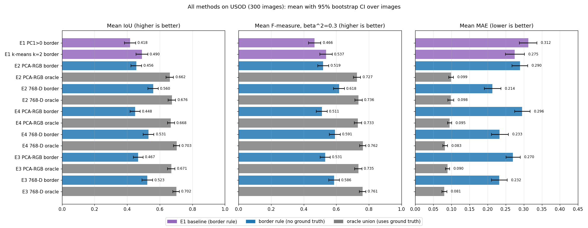

**Where the IoU is lost.** Each dot is one image. Images on the diagonal lose nothing to the label-free choice. With 768-D features at stride 3,
168 images succeed (border-rule IoU ≥ 0.5), **98 are selection failures** (the oracle reaches ≥ 0.5 but the border rule does not) and 34 are cluster
failures (no union of clusters reaches 0.5).

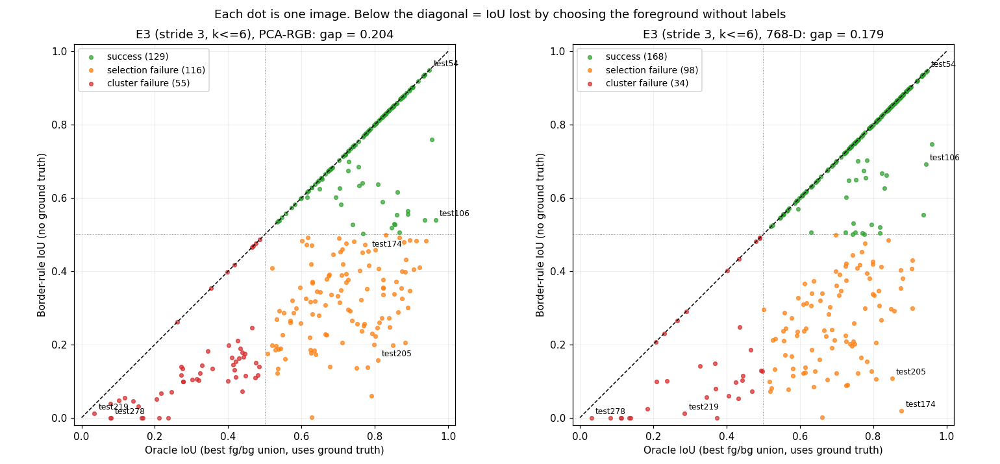
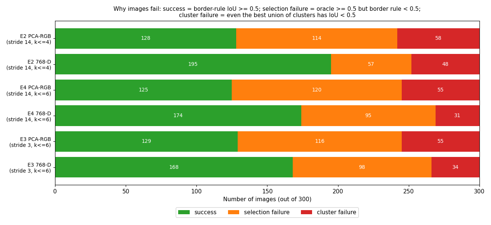

**The selection problem is specifically the multi-cluster rule.** When silhouette picks k\*=2, the border rule is essentially at the oracle
(768-D: 0.748 vs 0.759, 1 selection failure in 102 images). With k\* ≥ 3 it falls to 0.36-0.49, and k\*=6 alone accounts for 45 of the 98 selection
failures. The rule "every cluster with a below-average border fraction is foreground" (Sec. 8.7) is what needs replacing.

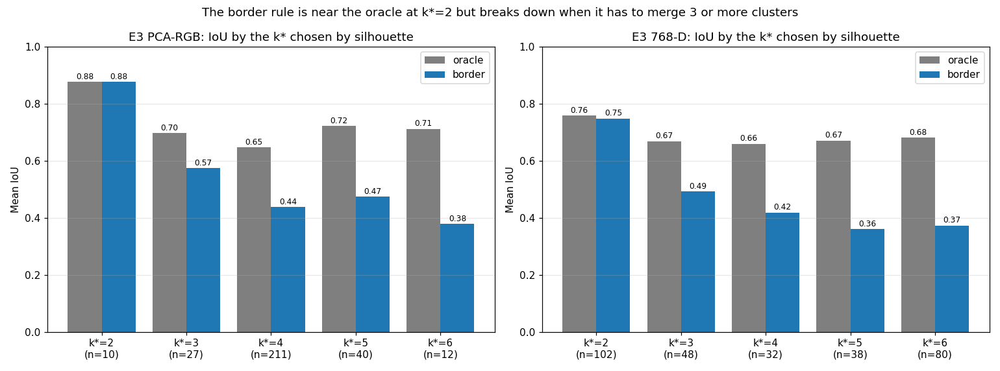

**Object size explains the cluster failures.** Of the 34 cluster failures (768-D, E3), 30 are objects covering less than 10% of the image. Mean
border-rule IoU is 0.01 for tiny objects (< 2%, n=5), 0.21 for small (2-10%, n=59), 0.56 for medium and 0.70 for large. Contrary to the
intuition in Sec. 11.3, objects that touch the image edge (n=142) do **not** score worse on average (border rule 0.54 vs 0.50).

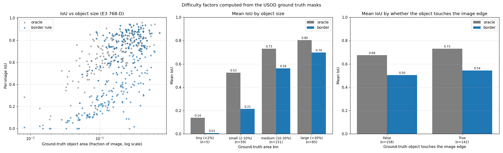

**Other figures:** `iou_distribution.png` (survival curve and violins: the border-rule IoU is bimodal, with a cluster of images near 0),
`oracle_vs_k.png` (oracle vs k and the k\* histogram), `stride_paired.png` (paired stride 3 vs 14 differences), and
`gallery_{best,median,worst}.png` (six panels each, ranked by border-rule IoU, 768-D, E3).

**Paired significance tests (IoU).**

| Comparison (A vs B) | Mean diff A−B | 95% CI | Wilcoxon p | Images A better / B better |
|---|---|---|---|---|
| E3 768-D vs PCA-RGB, border rule | +0.056 | [+0.031, +0.079] | < 0.001 | 175 / 122 |
| E3 768-D vs PCA-RGB, oracle | +0.031 | [+0.018, +0.043] | < 0.001 | 188 / 112 |
| Stride 3 vs 14 (E3 vs E4), 768-D, border rule | −0.009 | [−0.023, +0.006] | 0.061 | 171 / 126 |
| Stride 3 vs 14 (E3 vs E4), 768-D, oracle | −0.002 | [−0.008, +0.004] | 0.061 | 166 / 134 |
| Stride 3 vs 14 (E3 vs E4), PCA-RGB, border rule | +0.019 | [+0.003, +0.035] | < 0.001 | 203 / 91 |
| k ≤ 6 vs k ≤ 4 (E4 vs E2), 768-D, border rule | −0.029 | [−0.042, −0.016] | 0.004 | 54 / 68 |
| k ≤ 6 vs k ≤ 4 (E4 vs E2), 768-D, oracle | +0.028 | [+0.019, +0.037] | < 0.001 | 89 / 31 |
| Oracle vs border rule, E3 768-D | +0.179 | [+0.155, +0.204] | < 0.001 | 147 / 0 |
| E3 768-D border vs E1 k-means k=2 | +0.033 | [+0.008, +0.055] | < 0.001 | 196 / 99 |

Full table: `results/analysis/significance.csv`. This updates Sec. 10.6(b): for **768-D** the stride makes no significant difference, but for
**PCA-RGB with the border rule** the +0.019 gain from stride 3 is small yet statistically consistent (CI excludes 0). Multiple comparisons are not corrected.

**Qualitative observation from the worst-case gallery.** In several of the worst images (hazy open water, small robots and divers) the PCA-RGB map of
the background shows a regular grid/checkerboard texture, and the 768-D clusters follow this texture rather than the object. This looks like the
known artifact of DINOv2 feature maps that the register models (Sec. 6.1) were designed to remove; testing `dinov2_vitb14_reg` is therefore a
cheap, well-motivated next experiment (see `docs/ROADMAP.md`).

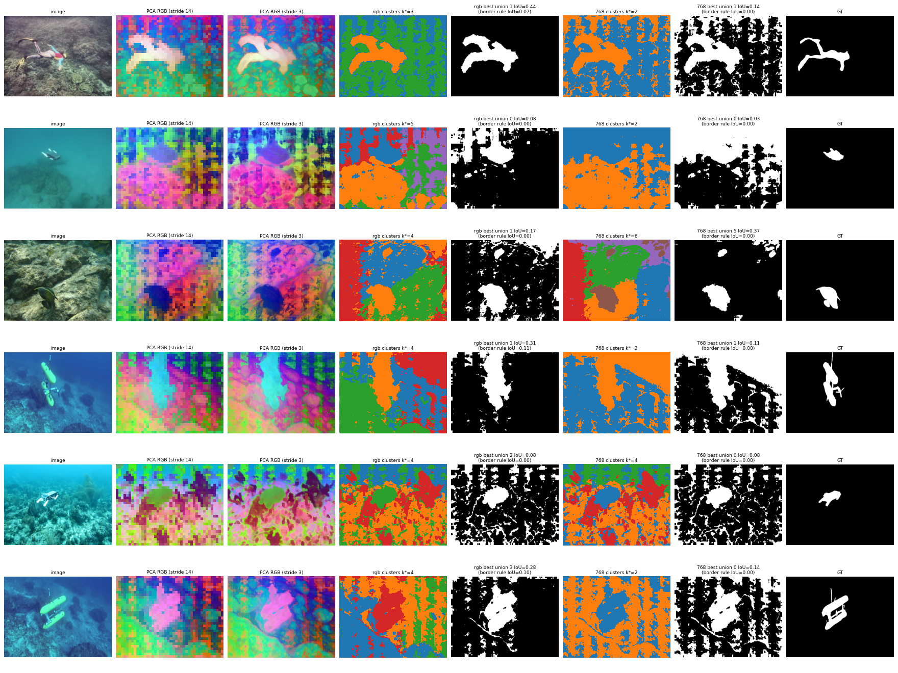

An interactive version of these results (filterable per-image table, scatter with hover) is available as a Cursor canvas,
`usod-dinov2-results.canvas.tsx`, in the project's canvases folder; it embeds the data from `summary.json`.

---

## 11. Figures and failure analysis

Each panel shows, left to right: the image; PCA-RGB at stride 14; PCA-RGB at stride 3; the PCA-RGB clusters ($k^*$); the best union for PCA-RGB; the 768-D clusters;
the best union for 768-D; the ground truth. Titles give the IoU of the oracle union and, in brackets, the border-rule IoU. (First-baseline panels for E1 are in
`results/kmeans/usod/panels/` and two are copied below.)

### 11.1 PCA-RGB, stride 14 vs 3

**`usod_test1`** (diver with an amphora over a reef): the stride-3 map shows a clean diver outline and amphora, while the stride-14 map is blocky.
Oracle and border rule both give IoU 0.56 for both feature sets, because the ground truth marks the reef around the diver as foreground too, which the feature clusters keep as
separate stuff.

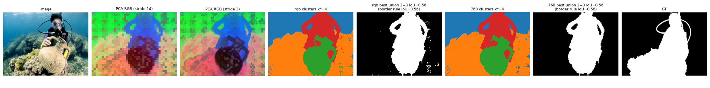

**`usod_test5`** (diver, rock, water): the diver appears magenta in PCA-RGB. With $k^*=3$ the oracle union and the border-rule union coincide: IoU 0.46 (PCA-RGB) and 0.55 (768-D),
versus 0.16 / 0.15 for the E1 baseline masks on the same image, a concrete example of the benefit of more than two clusters. The masks
cover the diver plus a margin; thin limbs and the camera are not resolved.

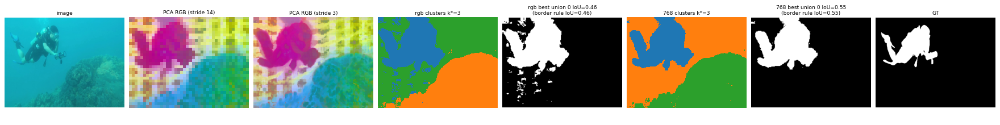

First baseline (E1) panels for the same two images (PCA mask and k=2 k-means masks, border rule):

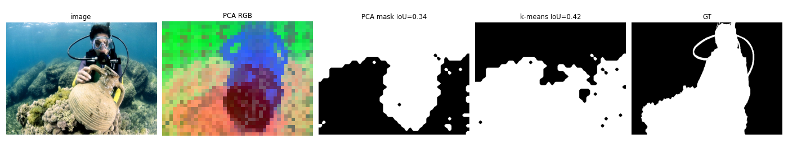
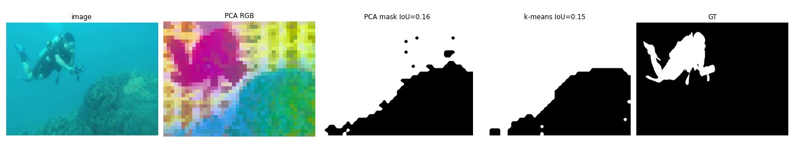

### 11.2 Success cases

**`usod_test106`** (close-up of a fish on a black background): oracle IoU 0.97 (PCA-RGB) and 0.94 (768-D), border rule 0.54 and 0.69. The stride-3 PCA-RGB map also shows the eye and spots.
**`usod_test54`**: oracle and border-rule IoU 0.95 for both feature sets. Large, compact objects on a plain background are the easy case.

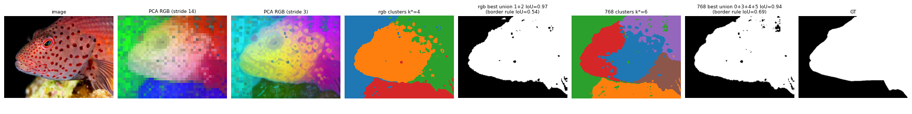
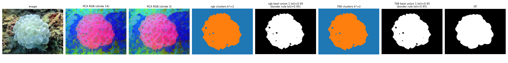

### 11.3 Failure cases and probable causes

| Image | Oracle IoU (PCA-RGB / 768-D) | Border-rule IoU | What we see | Probable cause (what I observed; not all verified) |
|---|---|---|---|---|
| `usod_test174` | 0.78 / 0.88 | 0.46 / **0.02** | Coral reef along the bottom/right is the "foreground" in the ground truth | The correct cluster exists (oracle 0.88) but the reef **touches the border**, so the border rule picks the wrong side |
| `usod_test205` | 0.81 / 0.85 | **0.16 / 0.11** | A butterflyfish is isolated cleanly by the clusters (indigo blob in PCA-RGB) | **Selection failure only**: the clusters are right but the rule does not choose them. A plausible reason (not checked per cluster) is that with k>2 the rule marks every cluster with below-average border fraction as foreground, which can include reef clusters |
| `usod_test219` | 0.03 / 0.29 | 0.01 / 0.01 | Starfish on sand with bright light patterns (caustics); the clusters follow the caustic texture | **Thin, small object plus strong lighting texture**; the starfish is a blob in PCA-RGB but coarser than the thin arms of the ground truth |
| `usod_test278` | 0.08 / 0.03 | 0.00 / 0.00 | Tiny robot above a dark reef in hazy water | **Small object** (a few patches) and a larger, more distinct reef cluster that dominates |

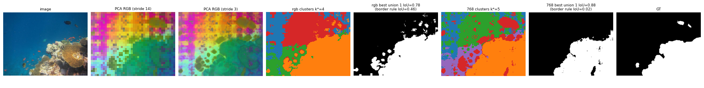
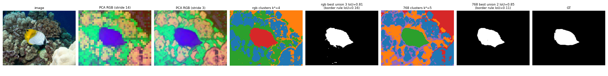
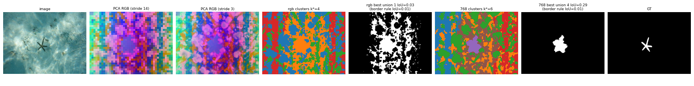
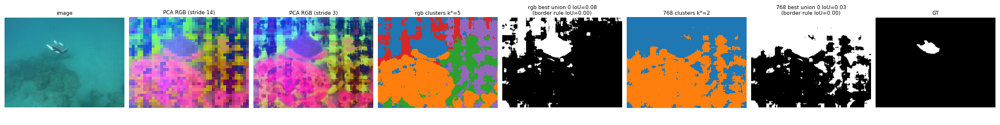

**Summary of failure modes**

1. **Foreground selection (border rule).** Largest single weakness: oracle 0.70 vs border rule 0.52 on 768-D (`usod_test174`, `usod_test205`). Individual images fail when the
   object touches the border or the background does not, but on average edge-touching objects are not worse (Sec. 10.8); the measured driver is the number of clusters
   to merge (border rule ≈ oracle at k\*=2, far below it at k\* ≥ 3).
2. **Small and thin objects.** A 14×14 patch is about 20×20 px of the original image; objects smaller than a few patches are lost, and stride 3 does not fix this because each
   token still summarises a 14-px patch. Measured in Sec. 10.8: 30 of the 34 cluster failures are objects under 10% of the image.
3. **Strong texture or lighting (caustics) and haze.** Clusters follow lighting rather than objects (`usod_test219`).
4. **Annotation convention.** "Salient" in the ground truth sometimes includes large background-like regions (reef in `usod_test1` and `usod_test174`).
5. **Multi-region scenes.** Water, sea floor, reef and object coexist; a 2-way split cannot represent them (E1), which is why E2 merges more clusters.

---

## 12. AUV deployment feasibility

All timings below were measured on **one desktop machine (NVIDIA RTX A2000 12GB, fp16)**, **not** on a Jetson or any
embedded device. They are from single runs of a few repetitions on one image and are indicative only.

### 12.1 Backbone only (one forward pass, median of 20 runs after warm-up)

| Model | Input 448×588 | Input 224×294 |
|---|---|---|
| ViT-S/14 | 7.3 ms | 1.9 ms |
| ViT-B/14 | 17.3 ms | 4.4 ms |

### 12.2 Deployable path: stride 14, border rule, no ground truth (median of 5 runs, image `usod_test5`)

| Variant | Backbone (incl. preprocessing) | PCA / feature prep | k-means + border rule + upsample | Total | FPS |
|---|---|---|---|---|---|
| PCA-RGB, k=2 | 25 ms | 57 ms | 88 ms | 169 ms | 5.9 |
| PCA-RGB, k=3 | 25 ms | 46 ms | 83 ms | 154 ms | 6.5 |
| 768-D, k=2 | 25 ms | 0 | 360 ms | 385 ms | 2.6 |
| 768-D, k=3 | 25 ms | 0 | 381 ms | 407 ms | 2.5 |

### 12.3 Research pipeline stages (includes the ground-truth-based oracle union search, **not deployable**)

| Setting | Features | PCA | Cluster + union, PCA-RGB | Cluster + union, 768-D |
|---|---|---|---|---|
| stride 14, k≤4 | 26 ms | 107 ms | 315 ms | 1,468 ms |
| stride 14, k≤6 | 25 ms | 130 ms | 494 ms | 2,357 ms |
| stride 3, k≤6 | 435 ms (25 passes) | 2,002 ms | 660 ms | 3,894 ms |

### 12.4 What this means

* The **backbone is not the bottleneck**: about 25 ms at stride 14 (about 40 FPS on this GPU for the backbone alone) and about 0.44 s for the 25 passes of stride 3.
  The **CPU clustering (scikit-learn) and PCA** dominate.
* The *best realistic variant of those timed* (768-D, border rule) runs at roughly 2.5 FPS here, below the 5-10 FPS target; the PCA-RGB variant is around 6 FPS but is less accurate (0.467 vs 0.523 IoU at stride 3 with the border rule).
  On a Jetson, CPU-side steps will likely be slower; **this has not been measured**.
* Stride 3 is far too slow for real time and brings no IoU gain, so it should **not** be used on the vehicle.

### 12.5 Ways to reach real time (none of these has been tried yet)

1. Use **ViT-S/14** (about 2.4× faster than B/14 here) and/or a **smaller input** (224×294 gives about 4× faster backbone).
2. Replace scikit-learn with **GPU k-means / PCA in PyTorch**, or cluster on a sub-sampled grid, fewer iterations, `n_init=1`.
3. **Temporal reuse:** warm-start centroids from the previous frame; run every 2nd or 3rd frame; smooth masks over time.
4. **TensorRT / ONNX / INT8** for the backbone on Jetson.
5. Replace clustering with a **tiny trained head (linear probe)** on the frozen features: one 1×1 convolution, no clustering and no foreground-selection heuristic.
6. **Sensor fusion** with sonar/DVL/depth to gate or confirm detections.

---

## 13. Improvements and roadmap

| Priority | Improvement | Why / expected benefit | Effort |
|---|---|---|---|
| 1 | **Linear probe** (1×1 conv/linear head) on frozen patch features, trained with USOD masks (train/test split) | Removes the foreground-selection problem (the biggest gap: oracle 0.70 vs 0.52) and the clustering cost | Low |
| 2 | **Run on SUIM** (binary "not water" plus per-class evaluation) | Larger data, semantic labels, a proper train/val/test split | Medium. **Partly done (Sec. 5.2, 19):** test split only (110 images), two binary GTs; per-class evaluation and the train/val split are still open |
| 3 | **Better label-free foreground selector**: centre prior, cluster size/compactness, saliency, a small learned selector over cluster statistics | Closes part of the oracle-vs-realistic gap without full supervision | Medium. **Partly done (Sec. 19):** dendrograms plus the merge-height gap rule close about two thirds of the oracle gap on USOD; the size/centre score and border-subtree rules did not help |
| 4 | **Evaluation that matches the AUV need**: image-level "object ahead" detection, ROI overlap, and **false alarms on empty-water frames** | IoU does not measure what the vehicle needs | Medium |
| 5 | **DINOv2 with registers** and **ViT-S/L/g** comparison | Cleaner dense features; quantify the speed/accuracy trade-off | Low |
| 6 | **Edge refinement** (CRF, guided filter, or a lightweight upsampler) | Sharper masks, better on thin objects | Medium |
| 7 | **Real-time engineering** (Sec. 12.5) and **Jetson benchmark** | Meet the 5-10 FPS target | Medium |
| 8 | **Temporal consistency** on video | Stable masks, fewer flickering false alarms | Medium |
| 9 | **Domain adaptation** (LoRA or last-block fine-tuning) and underwater **image enhancement** pre-processing | Address colour cast, haze and caustics | High |
| 10 | **Run the SVAM-Net baseline** (checkpoints already in `data/USOD/checkpoints`) | A fair comparison with a method trained for underwater salient-object detection | Low-Medium |
| 11 | **Statistical rigour**: multiple seeds, bootstrap confidence intervals, paired tests | Know which differences (e.g. stride 3) are real | Low. **Partly done:** bootstrap CIs and Wilcoxon tests for the dendrogram runs (Sec. 19); not for the k-means tables; still a single seed |
| 12 | **Sonar/DVL/depth fusion** | Range, plus a safety-oriented redundancy | High |
| 13 | **Minimum-cluster-size guard for the dendrogram gap rule**, and a held-out check of the best variant | The gap rule picks k = 2 on an outlier split in about 20% of images (Sec. 19.8); the best variant was chosen on the same images it is reported on (Sec. 19.10). **Not tried yet** | Low |

(Effort and benefit are my estimates, not measurements.)

A detailed, phased GPU experiment plan (feature caching, evaluation protocol, label-free selectors, better features, refinement, light supervision,
real-time deployment), with concrete scripts, commands and success criteria, is in [`docs/ROADMAP.md`](docs/ROADMAP.md); the matching actionable checklist is [`todo.md`](docs/todo.md).

---

## 14. Limitations, threats to validity and safety note

* **Oracle ≠ performance.** Oracle numbers use ground truth to choose the foreground and are upper bounds.
* **Two datasets, one model, one setting.** 300 USOD images (all contain objects) and 108 / 92 SUIM test images; only ViT-B/14 at one input size. SUIM labels (Saliency or "not water") are derived binary masks, and the SUIM-Saliency convention is not verified to match USOD's.
* **Little uncertainty information.** Single run, fixed seeds. Only the dendrogram comparison (Sec. 19) has bootstrap confidence intervals and Wilcoxon tests; the k-means tables do not. Small differences (e.g. stride 3) should not be over-interpreted.
* **Selection on the evaluation data.** In Sec. 19 the best of 64 variant/rule combinations is picked on the same images it is reported on, so its gain over k-means is somewhat optimistic. The same variant wins on USOD and SUIM-Saliency, which is reassuring but is not a held-out test.
* **Task mismatch.** USOD ground truth = *salient* object as annotated; an AUV needs *obstacles/targets ahead*. These overlap but are not the same.
* **No distance.** A mask is not a range; the method alone cannot say whether an object is 1 m or 20 m away.
* **Domain shift untested.** Whether DINOv2's web-image pre-training limits underwater accuracy is not isolated by any experiment here.
* **Method-detail differences across runs.** The stride-3 runs use sub-sampled k-means/silhouette, and feature positions have up to ±1 px jitter.
* **Dataset licence and download link unverified** (project page returned HTTP 403 during my check).
* **Safety.** This is a research prototype and **not** a safety-certified collision-avoidance system. An AUV must not rely on it alone; it
  should be fused with other sensors and tested extensively (including empty-water frames, turbidity, low light) before any in-water use.

---

## 15. Conclusion

* Frozen DINOv2 ViT-B/14 patch features, with **no training**, already separate objects, water and reef in underwater images: PCA-RGB maps show this
  clearly, and clustering plus the best fg/bg union reaches **0.70 mean IoU on USOD** (oracle, 768-D).
* Without labels, choosing the foreground with a simple **border rule** gives **0.52** (768-D, stride 3) and 0.45-0.56 across settings: **the clusters are mostly right, the
  selection is the problem**. A linear probe or a better selector is the most promising next step.
* **Raw 768-D features beat 3-D PCA-RGB** consistently. **Overlapping windows (stride 3) improve the appearance of the PCA-RGB map but not IoU**, and cost about 17× more
  backbone time (25 passes); allowing more clusters (k≤6) raises the oracle but lowers the realistic score.
* **Replacing k-means by a dendrogram and cutting at the largest merge-height gap (Sec. 19)** raises the label-free IoU from 0.52 to 0.65 on USOD and from 0.43 to 0.55 on SUIM-Saliency (stride 3, raw 768-D, average linkage), against an oracle of about 0.71 / 0.64. It helps about half of the images and hurts about a fifth; it did not help on SUIM "not water" labels.
* For AUV use the main gaps are: **real-time operation on embedded hardware** (currently about 2.5 to 6.5 FPS on a desktop GPU), **small/thin objects**, **false alarms on empty water (unmeasured)**
  and **range** (needs sonar/DVL fusion). The next iteration is a trained linear head on SUIM/USOD plus an AUV-relevant evaluation.

---

## 16. Reproducibility and environment

**Hardware / software** (as measured in this project): Linux 6.8, Python 3.10.12, NVIDIA RTX A2000 12GB (driver 580.178.04),
torch 2.14.1 (CUDA build), torchvision 0.29.1, numpy 2.2.6, scikit-learn 1.7.2, scipy 1.15.3, pillow 12.3.0, matplotlib 3.10.9, tqdm 4.70.1.
Weights: `dinov2_vitb14_pretrain.pth` (330 MB), downloaded by `torch.hub` into `~/.cache/torch/hub/`.

**Layout**

```
unsupervised_clustering_for_underwater_images/
├── README.md                    # this file
├── CLAUDE.md                    # working conventions for the assistant ("(*)" questions: max 50 words)
├── LICENSE
├── src/                         # all code, one folder per approach
│   ├── kmeans/                          # k-means pipeline (Sec. 7-10)
│   │   ├── dinov2_seg.py                    # E1: PCA mask + k-means (k=2)
│   │   ├── dinov2_cluster_union.py          # E2: k=2..4, PCA-RGB and 768-D, oracle union + border rule
│   │   └── dinov2_cluster_union_stride.py   # E3/E4: dense (overlapping-window) features, k up to --kmax
│   ├── dendrogram/                      # hierarchical clustering (Sec. 19): dendro_cluster.py, dinov2_dendro.py, summarize_dendro.py
│   ├── analysis/analyze_results.py      # CPU-only statistics on the k-means CSVs: CIs, paired tests, failure analysis (Sec. 10.8)
│   └── common/gt_utils.py               # shared: ground-truth loading (--gt usod | suim_saliency | suim_nonwater), blank-GT filter
├── data/                        # datasets (never modified)
│   ├── USOD/                            # images/, masks/, checkpoints/ (large files git-ignored)
│   └── SUIM/                            # git-ignored (4.9 GB); TEST/ used, train_val/ not used
├── results/                     # all experiment outputs, one folder per approach
│   ├── kmeans/
│   │   ├── usod/                        # k-means on USOD
│   │   │   ├── panels/ masks_pca/ masks_kmeans/ metrics.csv      # E1
│   │   │   ├── cluster_union_stride14_k4/                        # E2 (panels/, masks_rgb/, masks_768/, metrics_union.csv)
│   │   │   ├── cluster_union_stride3_k6/                         # E3
│   │   │   └── cluster_union_stride14_k6/                        # E4
│   │   ├── suim_saliency/               # same sub-folders, SUIM test, Saliency GT (108 images)
│   │   └── suim/                        # same sub-folders, SUIM test, "not water" GT (92 images)
│   ├── dendrogram/                      # Sec. 19
│   │   ├── usod/  suim_saliency/  suim_nonwater/   # each: metrics_s14.csv, metrics_s3.csv, summary_s*.md/.csv, stats_s*.csv,
│   │   │                                           #       compare/, dendrograms/, panels_best/, (excluded_images.txt)
│   │   └── _cache/                                 # per-image masks of every variant (git-ignored)
│   └── analysis/                        # summary.csv, significance.csv, per_image.csv, summary.json (Sec. 10.8)
├── docs/
│   ├── figures/ (and figures/analysis/)  # curated panels used in this README
│   ├── DENDROGRAMS.md                    # dendrograms in plain words
│   ├── ROADMAP.md                        # phased GPU experiment plan
│   └── todo.md                           # actionable checklist derived from the roadmap
└── presentations/               # Review 2 deck (.pptx), its build scripts, figures and speaker.md
```

The Python environment (`.venv/`) lives one level above this folder. Run all commands from the repository root. Script defaults point at `data/USOD` and `results/kmeans/usod/...`; the PNG outputs of the SUIM and dendrogram runs are git-ignored, so only their CSV/summary files are in the repository.

Note: `masks_rgb/` and `masks_768/` in the E2-E4 folders hold the **oracle** masks (chosen with the ground truth), not the border-rule predictions.

**Commands**

```bash
.venv/bin/python src/kmeans/dinov2_seg.py                                         # E1 (about 3 min)
.venv/bin/python src/kmeans/dinov2_cluster_union.py                               # E2 (about 11 min)
.venv/bin/python src/kmeans/dinov2_cluster_union_stride.py --stride 3  --kmax 6   # E3 (about 30 min)
.venv/bin/python src/kmeans/dinov2_cluster_union_stride.py --stride 14 --kmax 6 \
        --out results/kmeans/usod/cluster_union_stride14_k6                 # E4 (about 10 min)
# quick test of any script: add --limit 10

# SUIM k-means (same scripts, new --gt flag; -min-water-frac only matters for suim_nonwater)
.venv/bin/python src/kmeans/dinov2_cluster_union_stride.py --data data/SUIM/TEST --gt suim_saliency --stride 3 --kmax 6 \
        --out results/kmeans/suim_saliency/cluster_union_stride3_k6
.venv/bin/python src/kmeans/dinov2_cluster_union_stride.py --data data/SUIM/TEST --gt suim_nonwater --min-water-frac 0.02 --stride 3 --kmax 6 \
        --out results/kmeans/suim/cluster_union_stride3_k6

# dendrograms (Sec. 19): about 10 min for stride 14 and about 1 h for stride 3, all three GT sets together
for S in 14 3; do
  .venv/bin/python src/dendrogram/dinov2_dendro.py --data USOD --gts usod --stride $S
  .venv/bin/python src/dendrogram/dinov2_dendro.py --data data/SUIM/TEST --gts suim_saliency suim_nonwater --tag suim --stride $S
done
for G in usod suim_saliency suim_nonwater; do .venv/bin/python src/dendrogram/summarize_dendro.py --gt $G --strides 14 3; done

# Sec. 10.8 statistics and figures (CPU, about 10 s)
python3 src/analysis/analyze_results.py --export-json
```

**Determinism.** `random_state=0` for k-means and silhouette sampling; fixed `numpy` generator (seed 0) for the 5,000-patch subsample. GPU fp16 can still cause
tiny numerical differences between runs. **Run times** are approximate, for the machine above.

**Checks done:** `src/kmeans/dinov2_cluster_union_stride.py --stride 14 --kmax 4 --limit 10` reproduced the earlier E2 results exactly;
oracle IoU ≥ border-rule IoU for all 600 rows of E2; all result tables above were computed from the CSV files.

**Known setup quirks:** see Sec. 9, E0.

---

## 17. Glossary

| Term | Meaning |
|---|---|
| AUV | Autonomous Underwater Vehicle |
| ViT | Vision Transformer: image cut into patches, processed by transformer blocks |
| Patch / token | A 14×14 px image square / its 768-D vector inside the network |
| CLS token | A special token that summarises the whole image |
| Self-supervised | Learning without human labels |
| Frozen backbone | Pre-trained network used as is, with no weight updates |
| PCA | Principal Component Analysis: projects data onto the directions of largest variance |
| PCA RGB | Visualisation (and feature) made from the top-3 PCA scores per patch as R, G, B |
| k-means | Clustering into k groups by minimising distances to cluster centres |
| Silhouette score | Unsupervised measure of how well-separated clusters are (−1 to 1) |
| Border rule | Heuristic: foreground = the group touching the image border least |
| Oracle (union) | Choice of the best foreground/background grouping using the ground truth; an upper bound |
| IoU | Intersection over Union between predicted and true masks |
| F-measure (β²=0.3) | Precision/recall combination used in salient-object detection |
| MAE | Mean absolute error between soft prediction and ground truth |
| Stride | Distance in pixels between neighbouring feature positions (14 = no overlap, 3 = overlapping) |
| Salient object | The object that stands out and was annotated as foreground |
| Semantic segmentation | Per-pixel *class* labels (not what this project does) |
| Linear probe | A tiny trained linear layer on frozen features |
| Caustics | Moving bright light patterns caused by waves, common underwater |
| DVL | Doppler Velocity Log: sensor for vehicle velocity/altitude |
| Registers | Extra tokens added to ViTs that clean up dense feature maps |
| Dendrogram | The "family tree" of a hierarchical clustering: every patch starts alone and the closest groups are merged step by step until one group is left |
| Hierarchical (agglomerative) clustering | Clustering by repeatedly merging the two closest groups; cutting the tree at some height gives k clusters |
| Linkage | The rule that says how far apart two *groups* are: Ward (variance increase), average, complete (farthest pair) or single (closest pair) |
| Merge height | The distance at which two groups were merged; tall merges join very different groups |
| Gap cut | Choosing k where the jump between merge heights is largest (a natural place to cut the tree) |
| Connectivity-constrained clustering | Hierarchical clustering where only neighbouring patches of the grid may be merged, so clusters stay in one piece |
| Chaining | Single linkage joining everything through a chain of close neighbours until one huge cluster remains |
| Saliency mask (SUIM) | SUIM's separate binary salient-object annotation, used as the primary SUIM ground truth |

---

## 18. References, citations and licenses

**Papers and resources**

1. M. Oquab et al., *DINOv2: Learning Robust Visual Features without Supervision*, arXiv:2304.07193 — <https://arxiv.org/abs/2304.07193>
2. T. Darcet, M. Oquab, J. Mairal, P. Bojanowski, *Vision Transformers Need Registers*, arXiv:2309.16588 — <https://arxiv.org/abs/2309.16588>
3. DINOv2 code and weights — <https://github.com/facebookresearch/dinov2>
4. M. J. Islam, R. Wang, J. Sattar, *SVAM: Saliency-guided Visual Attention Modeling by Autonomous Underwater Robots*, arXiv:2011.06252 (USOD dataset) — <https://arxiv.org/abs/2011.06252> · project page <https://irvlab.cs.umn.edu/visual-attention-modeling/svam>
5. M. J. Islam, C. Edge, Y. Xiao, P. Luo, M. Mehtaz, C. Morse, S. S. Enan, J. Sattar, *Semantic Segmentation of Underwater Imagery: Dataset and Benchmark*, IROS 2020, arXiv:2004.01241 (SUIM) — <https://arxiv.org/abs/2004.01241> · <https://irvlab.cs.umn.edu/resources/suim-dataset> · <https://github.com/IRVLab/SUIM>
6. J. H. Ward, *Hierarchical grouping to optimize an objective function*, Journal of the American Statistical Association 58(301), 1963 (Ward linkage)
7. SciPy hierarchical clustering (`scipy.cluster.hierarchy.linkage`) — <https://docs.scipy.org/doc/scipy/reference/cluster.hierarchy.html>
8. scikit-learn `AgglomerativeClustering` (with connectivity) — <https://scikit-learn.org/stable/modules/generated/sklearn.cluster.AgglomerativeClustering.html>

**BibTeX**

```bibtex
@misc{oquab2023dinov2,
  title   = {DINOv2: Learning Robust Visual Features without Supervision},
  author  = {Oquab, Maxime and Darcet, Timoth{\'e}e and Moutakanni, Theo and Vo, Huy V. and Szafraniec, Marc and Khalidov, Vasil and Fernandez, Pierre and Haziza, Daniel and Massa, Francisco and El-Nouby, Alaaeldin and Howes, Russell and Huang, Po-Yao and Xu, Hu and Sharma, Vasu and Li, Shang-Wen and Galuba, Wojciech and Rabbat, Mike and Assran, Mido and Ballas, Nicolas and Synnaeve, Gabriel and Misra, Ishan and Jegou, Herve and Mairal, Julien and Labatut, Patrick and Joulin, Armand and Bojanowski, Piotr},
  journal = {arXiv:2304.07193},
  year    = {2023}
}

@misc{darcet2023vitneedreg,
  title   = {Vision Transformers Need Registers},
  author  = {Darcet, Timoth{\'e}e and Oquab, Maxime and Mairal, Julien and Bojanowski, Piotr},
  journal = {arXiv:2309.16588},
  year    = {2023}
}

@misc{islam2020svam,
  title   = {SVAM: Saliency-guided Visual Attention Modeling by Autonomous Underwater Robots},
  author  = {Islam, Md Jahidul and Wang, Ruobing and Sattar, Junaed},
  journal = {arXiv:2011.06252},
  year    = {2020}
}

@inproceedings{islam2020suim,
  title     = {Semantic Segmentation of Underwater Imagery: Dataset and Benchmark},
  author    = {Islam, Md Jahidul and Edge, Chelsey and Xiao, Yuyang and Luo, Peigen and Mehtaz, Muntaqim and Morse, Christopher and Enan, Sadman Sakib and Sattar, Junaed},
  booktitle = {IEEE/RSJ International Conference on Intelligent Robots and Systems (IROS)},
  year      = {2020}
}
```

(The DINOv2 and registers entries follow the format given in the official repository; the SVAM and SUIM entries were assembled by me from the arXiv/GitHub pages and may need
checking against the publishers' versions, e.g. the RSS 2022 version of SVAM.)

**Licenses**

* DINOv2 code and weights: Apache License 2.0, per the official repository README.
* USOD and SUIM data: licences **not verified** (check the project pages before redistributing the data or derived masks).
* This repository's own scripts: **no licence chosen yet**.

---

## 19. Dendrogram (hierarchical) clustering instead of k-means

**Added 2026-10-29.** Everything before this section uses k-means to group the patches. The weak link we found was *choosing which groups are the foreground* (oracle 0.70 vs 0.52
without labels). This section replaces k-means by **hierarchical clustering** (a *dendrogram*, a family tree of the patches) and tests four ways of reading the foreground
off the tree. The k-means results are untouched and are used as the baseline everywhere below. All numbers come from `results/dendrogram/*/summary_s*.csv` and `stats_s*.csv`.

### 19.1 The idea in plain words

**k-means** puts *k* "pins" into the feature space. Every patch joins its nearest pin, the pins move to the middle of their patches, and this repeats. You must pick *k* in advance,
and every *k* is a new run whose clusters need not be related to the previous one.

**A dendrogram** works the other way round, like a party:

1. At the start every patch stands alone (a one-person group).
2. Find the two **most similar** groups and glue them together. Write down *how far apart* they were (the "merge height").
3. Repeat until everybody is in one big group. The record of all the gluing steps is the **dendrogram**: a tree whose leaves are the patches. Early merges are low and join near-identical patches; the last merges are tall and join very different things (for example "water" with "reef").
4. To get *k* clusters, **cut the tree**: undo the last *k − 1* merges. One tree therefore gives every *k* at once, and the clusterings for different *k* are nested (the 4-cluster answer is the 3-cluster answer with one group split).

**A tiny example** (one feature number per patch; water = 1.0, 1.1, 1.2; reef = 3.0, 3.1; fish = 8.0; average linkage, computed with SciPy):

```
merge   joins                         height
  1     water 1.0 + water 1.1          0.10
  2     reef 3.0  + reef 3.1           0.10
  3     (1.0,1.1) + water 1.2          0.15
  4     water group + reef group       1.95     <- a "big" merge
  5     (water+reef) + fish 8.0        6.12     <- a much bigger merge

cut after merge 4 (undo 1 merge)  -> 2 clusters: {fish} | {water, reef}
cut after merge 3 (undo 2 merges) -> 3 clusters: {fish} | {reef} | {water}
```

The **gap rule** (Sec. 19.4) looks at the heights from the top (6.12, 1.95, 0.15, ...) and cuts where the biggest jump is: here 6.12 → 1.95, so it picks *k = 2*, "fish versus the rest".
This also shows the weakness seen later (Sec. 19.8): the gap rule is happy to cut off one odd group, whether that group is the object or just a handful of outlier patches.

### 19.2 What the code does for one image

1. Run frozen DINOv2 once to get one 768-number vector per patch (stride 14: a 32 × 42 grid = 1,344 patches; stride 3: 145 × 192 = 27,840 patches). Also make the 3-number PCA-RGB version (Sec. 8.4).
2. For each of the **16 variants** (2 feature sets × 4 linkages × 2 tree types, Sec. 19.3), build the tree.
3. Cut it into *k* = 2, 3, 4, 5, 6 clusters.
4. Turn the tree into a **foreground mask** with each of **four label-free rules** (Sec. 19.4). The ground truth is not used for this.
5. Upsample the mask to the picture size (same bilinear step as before) and score it (IoU, F-measure, MAE; Sec. 8.9).
6. Also compute the **oracle** for each cut: try every foreground/background split of the *k* clusters, keep the best one using the ground truth. This is the upper bound (what a perfect selector could reach from these clusters).

The backbone runs only once per image and is shared by all variants, which keeps the whole study to about 1.2 hours.

### 19.3 The knobs

| Knob | Options | Plain meaning |
|---|---|---|
| Features | raw 768-D, 3-D PCA-RGB | what is compared between patches (same two sets as before) |
| Linkage | **Ward**, **average**, **complete**, **single** | how to measure the distance between two *groups*. *Ward*: merge the pair that increases the total spread the least (closest to k-means). *Average*: mean distance over all pairs of patches, one from each group. *Complete*: distance of the **farthest** pair, so groups stay compact. *Single*: distance of the **closest** pair, so groups can stretch into long chains. |
| Patch distance | Euclidean for Ward and for PCA-RGB; **cosine** for average/complete/single on 768-D | cosine compares the direction of two feature vectors, which is how DINOv2 features are normally compared |
| Tree type | **free**, **constrained** | *free*: any two patches may be merged. *Constrained*: only **neighbouring** grid cells may be merged, so every cluster is one connected region. |
| Stride | 14, 3 | as in Sec. 8.8 |

Two practical details. (a) A free tree needs all pairwise distances, which is too big for the 27,840 patches of stride 3. For those I build the tree on a **random sample of 3,000 patches**
and give every other patch the label of its **nearest sampled patch** (in feature space). Stride 14 (1,344 patches) uses all patches. Constrained trees (scikit-learn, grid neighbours) always use all patches.
(b) The constrained trees from scikit-learn can have merge heights that are not always increasing, which breaks SciPy's `cut_tree`; I wrote my own cut ("undo the last k − 1 merges in the order they were made").
I checked that the cuts are nested and that constrained clusters are connected.

### 19.4 The four label-free ways to pick the foreground

All four only use the picture: no ground truth. **Border ring** below means the outer strip of patches (1 patch wide at stride 14, 5 at stride 3). The foreground object usually does not touch the border, the water usually does.

| Rule (name in the CSVs) | In simple words |
|---|---|
| **Silhouette cut + border rule** (`sil_border`) | The k-means recipe on a tree: try k = 2 … 6, keep the k whose clusters are best separated (silhouette score, Sec. 8.6), cut there, and call a cluster *foreground* if a smaller share of its patches lies in the border ring than the ring's share of the whole image (Sec. 8.3). |
| **Gap cut + border rule** (`gap_border`) | Same border rule, but k is chosen by the **tree itself**: cut where the jump between consecutive merge heights is biggest (Sec. 19.1). No silhouette score needed. |
| **Border-touching subtrees** (`subtree`) | Walk the tree from the top. A branch with (almost) no border patches (less than half the image's border share) is foreground as a whole; a branch with a lot of border (more than 1.5 × the image's share) is water as a whole; a mixed branch is split into its two children. Tiny branches (< 2% of the patches) are decided by the plain border test. |
| **Size / compactness / centre score** (`score`) | Give every branch of the tree a score = 0.35 × "stays away from the border" + 0.25 × "near the image centre" + 0.20 × "compact (fills its bounding box)" + 0.20 × "plausible size" (full marks for 5-50% of the image, zero below 1% or above 90%). Branches under 2% of the patches are ignored. Take the best branch plus any non-overlapping branch scoring at least 90% of the best. |

The thresholds and weights above were **fixed in advance and never tuned on the ground truth**. If a rule produces an empty or all-foreground mask, it falls back to the two-cluster cut and takes the cluster with the smaller border share.

**Oracle** (not a method, an upper bound): for the clusters of one cut, the best foreground/background split chosen **using** the ground truth. Reported at the silhouette k (`oracle_sil`).

### 19.5 Experimental setup

* **Three ground-truth sets** (Sec. 5.2): USOD (300 images); **SUIM-Saliency** (108 images, the primary SUIM result because USOD is also a salient-object task); **SUIM-not-water** (92 images, "everything except open water").
* **Strides** 14 and 3, *k* from 2 to 6, both feature sets, all 16 variants and all 4 rules: 176 result rows per image (`metrics_s14.csv`, `metrics_s3.csv`).
* **Baseline:** the k-means runs on exactly the same images (E3/E4 settings: k ≤ 6, border rule, same stride). A paired comparison is made per image.
* **Statistics:** mean IoU, plus the **mean per-image gain over k-means with a 95% bootstrap interval** (2,000 resamples of the images) and a **Wilcoxon signed-rank test**.
* **Trivial baseline for reference:** predicting *everything* as foreground scores IoU = (share of foreground). That is **0.224** on USOD, **0.199** on SUIM-Saliency, but **0.520** on SUIM-not-water, where most of the picture is foreground.

### 19.6 Results

**Headline: best label-free variant per dataset and stride, against the k-means border rule** (*better / worse / tie = images where the dendrogram IoU is more than 0.02 higher / lower / within 0.02 of k-means; "Oracle" is the best-possible IoU from the same clusters).

| Dataset | Stride | Best label-free variant | Dendrogram IoU | k-means border rule | Gain (95% CI) | Wilcoxon p | Images better / worse / tie* | Oracle: same tree vs k-means |
|---|---|---|---|---|---|---|---|---|
| USOD (300 images) | 14 | 768-D, free tree, average linkage, gap cut | **0.646** | 0.531 | +0.115 (+0.085, +0.145) | 9.1e-12 | 51% / 22% / 27% | 0.709 vs 0.703 |
| USOD (300 images) | 3 | 768-D, free tree, average linkage, gap cut | **0.646** | 0.523 | +0.123 (+0.095, +0.151) | 4.7e-14 | 52% / 20% / 28% | 0.711 vs 0.702 |
| SUIM-Saliency (108 images) | 14 | 768-D, free tree, average linkage, gap cut | **0.537** | 0.424 | +0.113 (+0.074, +0.155) | 1.2e-05 | 50% / 20% / 30% | 0.626 vs 0.584 |
| SUIM-Saliency (108 images) | 3 | 768-D, free tree, average linkage, gap cut | **0.552** | 0.429 | +0.122 (+0.084, +0.163) | 1.2e-06 | 53% / 19% / 29% | 0.642 vs 0.595 |
| SUIM-not-water (92 images) | 14 | PCA-RGB, free tree, average linkage, gap cut | **0.548** | 0.505 | +0.043 (+0.008, +0.080) | 0.06 | 37% / 22% / 41% | 0.770 vs 0.776 |
| SUIM-not-water (92 images) | 3 | 768-D, free tree, single linkage, gap cut | **0.521** | 0.475 | +0.046 (-0.009, +0.097) | 0.07 | 57% / 35% / 9% | 0.521 vs 0.774 |

(The best variant is picked on the same images it is reported on, so the gain is somewhat optimistic; see Sec. 19.10.)

**Measured findings**

1. **On USOD and SUIM-Saliency one variant wins everywhere: free tree, raw 768-D, average linkage, gap cut.** It improves the label-free IoU by about **+0.11 to +0.12** over k-means (0.52 → 0.65 on USOD, 0.43 → 0.55 on SUIM-Saliency at stride 3). The confidence intervals stay well above zero (for example +0.095 to +0.151 on USOD, stride 3).
2. **The oracle moves much less than the realistic score** (USOD 0.711 vs 0.702, SUIM-Saliency 0.642 vs 0.595, i.e. +0.01 and +0.05, against +0.12 for the realistic IoU). The *clusters* are about as good as before; what improved is the *choice* of which ones are foreground. On USOD this closes about two thirds of the oracle gap (0.52 → 0.65, against 0.70).
3. **It is not a uniform win.** On USOD the best variant is better on 52% of the images and worse on 20% (stride 3); on SUIM-Saliency 53% / 19%. The average gain comes from large wins on images where the k-means border rule picked the wrong cluster (for example `usod_test205`: 0.11 → 0.84, `usod_test53`: 0.07 → 0.78, `usod_test2`: 0.10 → 0.72), against a smaller number of large losses (Sec. 19.8).
4. **Stride 3 changes almost nothing** (USOD 0.646 at both strides, SUIM-Saliency 0.537 → 0.552), as it did for k-means.
5. **Silhouette cut vs gap cut.** For the winning tree the gap cut is a little better than the silhouette cut (USOD 0.646 vs 0.630, SUIM-Saliency 0.552 vs 0.519 at stride 3). I did not test that difference separately, so treat it as small. For USOD the two rules pick k = 2 in about half of the images (gap 50%, silhouette 52%; mean k 2.9 vs 3.2).
6. **Other linkages** are weaker. Raw 768-D, free tree, silhouette cut, stride 3, USOD: average 0.630, Ward 0.571, complete 0.568, **single 0.211**. Constrained Ward (0.603) is better than free Ward and is the best of the constrained trees.
7. **The two extra tree rules are mostly not better than the border rule.** The subtree rule gives 0.28-0.39 on USOD for every variant (k-means 0.52). The size/centre score rule is poor on raw 768-D (0.31-0.51) but **with PCA-RGB and a free Ward tree it reaches 0.548 on USOD (+0.081 over k-means PCA-RGB, CI +0.050 to +0.111)**; on SUIM-Saliency that gain is not significant (+0.032, CI −0.017 to +0.081).
8. **SUIM-not-water: no meaningful gain.** The best variants gain +0.04 to +0.05 (p = 0.06 and 0.07; the stride-3 interval includes zero), and the winner changes between strides. More importantly, **predicting all-foreground already scores 0.520 here**, the same as the "best" stride-3 variant (single linkage, which collapses to one giant cluster, Sec. 19.7), and k-means scores 0.475-0.513. So the realistic SUIM-not-water scores are close to a trivial guess and say little about skill. The per-image picture depends on the variant: the winners are better on 37-57% and worse on 22-35% of the images, far from the 50% / 20% seen on the other two sets.

**Full tables** (mean IoU over images; every one of the 16 variants; the k-means numbers are in the line above each table). Stride 3 first, then stride 14.

<details>
<summary>USOD, stride 3</summary>

*USOD (300 images), stride 3.* k-means on the same images (k ≤ 6): raw 768-D border rule **0.523**, oracle 0.702; PCA-RGB border rule **0.467**, oracle 0.671. Bold = best value in that column and feature set.

| Features | Tree | Linkage | Silhouette cut + border rule | Gap cut + border rule | Border-subtree rule | Size/centre score rule | Oracle (best union at silhouette k) |
|---|---|---|---|---|---|---|---|
| raw 768-D | free | ward | 0.571 | 0.544 | **0.390** | 0.494 | **0.716** |
| raw 768-D | free | average | **0.630** | **0.646** | 0.382 | **0.499** | 0.711 |
| raw 768-D | free | complete | 0.568 | 0.527 | 0.373 | 0.497 | 0.676 |
| raw 768-D | free | single | 0.211 | 0.224 | 0.322 | 0.387 | 0.224 |
| raw 768-D | constrained | ward | 0.603 | 0.577 | 0.389 | 0.467 | 0.705 |
| raw 768-D | constrained | average | 0.072 | 0.085 | 0.309 | 0.358 | 0.224 |
| raw 768-D | constrained | complete | 0.178 | 0.194 | 0.290 | 0.308 | 0.256 |
| raw 768-D | constrained | single | 0.093 | 0.090 | 0.282 | 0.371 | 0.224 |
| PCA-RGB | free | ward | 0.491 | 0.504 | **0.392** | **0.548** | **0.680** |
| PCA-RGB | free | average | 0.500 | 0.538 | 0.391 | 0.546 | 0.675 |
| PCA-RGB | free | complete | 0.450 | 0.437 | 0.380 | 0.545 | 0.653 |
| PCA-RGB | free | single | 0.055 | 0.057 | 0.361 | 0.540 | 0.228 |
| PCA-RGB | constrained | ward | **0.576** | **0.566** | 0.392 | 0.492 | 0.661 |
| PCA-RGB | constrained | average | 0.075 | 0.050 | 0.322 | 0.455 | 0.244 |
| PCA-RGB | constrained | complete | 0.202 | 0.211 | 0.305 | 0.424 | 0.288 |
| PCA-RGB | constrained | single | 0.022 | 0.022 | 0.298 | 0.463 | 0.224 |

</details>

<details>
<summary>USOD, stride 14</summary>

*USOD (300 images), stride 14.* k-means on the same images (k ≤ 6): raw 768-D border rule **0.531**, oracle 0.703; PCA-RGB border rule **0.448**, oracle 0.668. Bold = best value in that column and feature set.

| Features | Tree | Linkage | Silhouette cut + border rule | Gap cut + border rule | Border-subtree rule | Size/centre score rule | Oracle (best union at silhouette k) |
|---|---|---|---|---|---|---|---|
| raw 768-D | free | ward | 0.560 | 0.541 | 0.382 | **0.513** | **0.712** |
| raw 768-D | free | average | **0.625** | **0.646** | 0.375 | 0.503 | 0.709 |
| raw 768-D | free | complete | 0.572 | 0.540 | 0.366 | 0.488 | 0.676 |
| raw 768-D | free | single | 0.202 | 0.219 | 0.313 | 0.436 | 0.225 |
| raw 768-D | constrained | ward | 0.596 | 0.557 | **0.384** | 0.449 | 0.692 |
| raw 768-D | constrained | average | 0.167 | 0.147 | 0.342 | 0.437 | 0.327 |
| raw 768-D | constrained | complete | 0.346 | 0.330 | 0.334 | 0.408 | 0.420 |
| raw 768-D | constrained | single | 0.049 | 0.057 | 0.314 | 0.397 | 0.224 |
| PCA-RGB | free | ward | 0.471 | 0.485 | **0.389** | 0.539 | 0.676 |
| PCA-RGB | free | average | 0.490 | 0.527 | 0.386 | 0.544 | **0.679** |
| PCA-RGB | free | complete | 0.438 | 0.425 | 0.372 | 0.538 | 0.661 |
| PCA-RGB | free | single | 0.073 | 0.070 | 0.356 | **0.546** | 0.256 |
| PCA-RGB | constrained | ward | **0.552** | **0.545** | 0.381 | 0.480 | 0.646 |
| PCA-RGB | constrained | average | 0.194 | 0.138 | 0.343 | 0.478 | 0.335 |
| PCA-RGB | constrained | complete | 0.331 | 0.328 | 0.334 | 0.463 | 0.391 |
| PCA-RGB | constrained | single | 0.030 | 0.046 | 0.313 | 0.471 | 0.226 |

</details>

<details>
<summary>SUIM-Saliency, stride 3</summary>

*SUIM-Saliency (108 images), stride 3.* k-means on the same images (k ≤ 6): raw 768-D border rule **0.429**, oracle 0.595; PCA-RGB border rule **0.375**, oracle 0.575. Bold = best value in that column and feature set.

| Features | Tree | Linkage | Silhouette cut + border rule | Gap cut + border rule | Border-subtree rule | Size/centre score rule | Oracle (best union at silhouette k) |
|---|---|---|---|---|---|---|---|
| raw 768-D | free | ward | 0.475 | 0.417 | 0.313 | **0.398** | 0.612 |
| raw 768-D | free | average | **0.519** | **0.552** | 0.314 | 0.395 | **0.642** |
| raw 768-D | free | complete | 0.448 | 0.428 | 0.298 | 0.383 | 0.577 |
| raw 768-D | free | single | 0.198 | 0.200 | 0.256 | 0.299 | 0.200 |
| raw 768-D | constrained | ward | 0.483 | 0.435 | **0.315** | 0.347 | 0.564 |
| raw 768-D | constrained | average | 0.059 | 0.057 | 0.249 | 0.257 | 0.199 |
| raw 768-D | constrained | complete | 0.129 | 0.156 | 0.234 | 0.226 | 0.219 |
| raw 768-D | constrained | single | 0.096 | 0.084 | 0.234 | 0.275 | 0.199 |
| PCA-RGB | free | ward | 0.402 | 0.402 | 0.318 | 0.407 | **0.591** |
| PCA-RGB | free | average | 0.378 | 0.398 | 0.316 | 0.413 | 0.570 |
| PCA-RGB | free | complete | 0.360 | 0.352 | 0.312 | **0.434** | 0.557 |
| PCA-RGB | free | single | 0.052 | 0.072 | 0.296 | 0.409 | 0.199 |
| PCA-RGB | constrained | ward | **0.431** | **0.422** | **0.319** | 0.372 | 0.520 |
| PCA-RGB | constrained | average | 0.062 | 0.050 | 0.259 | 0.347 | 0.215 |
| PCA-RGB | constrained | complete | 0.165 | 0.172 | 0.254 | 0.316 | 0.257 |
| PCA-RGB | constrained | single | 0.025 | 0.023 | 0.251 | 0.352 | 0.199 |

</details>

<details>
<summary>SUIM-Saliency, stride 14</summary>

*SUIM-Saliency (108 images), stride 14.* k-means on the same images (k ≤ 6): raw 768-D border rule **0.424**, oracle 0.584; PCA-RGB border rule **0.385**, oracle 0.573. Bold = best value in that column and feature set.

| Features | Tree | Linkage | Silhouette cut + border rule | Gap cut + border rule | Border-subtree rule | Size/centre score rule | Oracle (best union at silhouette k) |
|---|---|---|---|---|---|---|---|
| raw 768-D | free | ward | 0.432 | 0.416 | **0.309** | 0.377 | 0.607 |
| raw 768-D | free | average | 0.472 | **0.537** | 0.303 | 0.383 | **0.626** |
| raw 768-D | free | complete | 0.450 | 0.445 | 0.304 | **0.384** | 0.593 |
| raw 768-D | free | single | 0.190 | 0.192 | 0.261 | 0.332 | 0.203 |
| raw 768-D | constrained | ward | **0.475** | 0.435 | 0.308 | 0.331 | 0.556 |
| raw 768-D | constrained | average | 0.109 | 0.092 | 0.267 | 0.324 | 0.245 |
| raw 768-D | constrained | complete | 0.283 | 0.261 | 0.265 | 0.295 | 0.366 |
| raw 768-D | constrained | single | 0.051 | 0.059 | 0.246 | 0.263 | 0.199 |
| PCA-RGB | free | ward | 0.395 | 0.369 | **0.318** | 0.412 | 0.567 |
| PCA-RGB | free | average | 0.392 | **0.409** | 0.311 | 0.403 | **0.580** |
| PCA-RGB | free | complete | 0.355 | 0.345 | 0.301 | 0.400 | 0.561 |
| PCA-RGB | free | single | 0.055 | 0.058 | 0.291 | **0.424** | 0.216 |
| PCA-RGB | constrained | ward | **0.414** | 0.399 | 0.313 | 0.343 | 0.505 |
| PCA-RGB | constrained | average | 0.149 | 0.133 | 0.269 | 0.362 | 0.280 |
| PCA-RGB | constrained | complete | 0.234 | 0.222 | 0.268 | 0.351 | 0.322 |
| PCA-RGB | constrained | single | 0.026 | 0.036 | 0.253 | 0.347 | 0.199 |

</details>

<details>
<summary>SUIM-not-water, stride 3</summary>

*SUIM-not-water (92 images), stride 3.* k-means on the same images (k ≤ 6): raw 768-D border rule **0.475**, oracle 0.774; PCA-RGB border rule **0.513**, oracle 0.778. Bold = best value in that column and feature set.

| Features | Tree | Linkage | Silhouette cut + border rule | Gap cut + border rule | Border-subtree rule | Size/centre score rule | Oracle (best union at silhouette k) |
|---|---|---|---|---|---|---|---|
| raw 768-D | free | ward | 0.486 | 0.491 | 0.450 | **0.278** | 0.745 |
| raw 768-D | free | average | 0.433 | 0.442 | 0.472 | 0.272 | 0.733 |
| raw 768-D | free | complete | 0.465 | 0.489 | 0.452 | 0.252 | 0.711 |
| raw 768-D | free | single | **0.508** | **0.521** | **0.487** | 0.228 | 0.521 |
| raw 768-D | constrained | ward | 0.461 | 0.472 | 0.433 | 0.270 | **0.761** |
| raw 768-D | constrained | average | 0.201 | 0.202 | 0.446 | 0.233 | 0.520 |
| raw 768-D | constrained | complete | 0.252 | 0.376 | 0.399 | 0.206 | 0.517 |
| raw 768-D | constrained | single | 0.283 | 0.236 | 0.467 | 0.236 | 0.520 |
| PCA-RGB | free | ward | 0.485 | 0.478 | 0.448 | 0.290 | **0.772** |
| PCA-RGB | free | average | **0.515** | **0.493** | 0.459 | 0.285 | 0.771 |
| PCA-RGB | free | complete | 0.488 | 0.475 | 0.465 | 0.310 | 0.761 |
| PCA-RGB | free | single | 0.128 | 0.168 | **0.493** | **0.320** | 0.520 |
| PCA-RGB | constrained | ward | 0.453 | 0.446 | 0.437 | 0.272 | 0.756 |
| PCA-RGB | constrained | average | 0.119 | 0.110 | 0.458 | 0.258 | 0.515 |
| PCA-RGB | constrained | complete | 0.308 | 0.323 | 0.428 | 0.235 | 0.494 |
| PCA-RGB | constrained | single | 0.044 | 0.043 | 0.473 | 0.246 | 0.520 |

</details>

<details>
<summary>SUIM-not-water, stride 14</summary>

*SUIM-not-water (92 images), stride 14.* k-means on the same images (k ≤ 6): raw 768-D border rule **0.491**, oracle 0.766; PCA-RGB border rule **0.505**, oracle 0.776. Bold = best value in that column and feature set.

| Features | Tree | Linkage | Silhouette cut + border rule | Gap cut + border rule | Border-subtree rule | Size/centre score rule | Oracle (best union at silhouette k) |
|---|---|---|---|---|---|---|---|
| raw 768-D | free | ward | **0.505** | **0.524** | 0.452 | 0.274 | **0.747** |
| raw 768-D | free | average | 0.458 | 0.467 | 0.473 | 0.273 | 0.733 |
| raw 768-D | free | complete | 0.495 | 0.492 | 0.472 | 0.266 | 0.720 |
| raw 768-D | free | single | 0.480 | 0.492 | **0.500** | 0.249 | 0.521 |
| raw 768-D | constrained | ward | 0.467 | 0.462 | 0.432 | **0.280** | 0.746 |
| raw 768-D | constrained | average | 0.128 | 0.132 | 0.452 | 0.256 | 0.535 |
| raw 768-D | constrained | complete | 0.268 | 0.310 | 0.426 | 0.233 | 0.527 |
| raw 768-D | constrained | single | 0.097 | 0.121 | 0.462 | 0.236 | 0.520 |
| PCA-RGB | free | ward | **0.537** | 0.514 | 0.477 | 0.322 | 0.767 |
| PCA-RGB | free | average | 0.534 | **0.548** | 0.478 | **0.322** | **0.770** |
| PCA-RGB | free | complete | 0.511 | 0.508 | 0.472 | 0.303 | 0.767 |
| PCA-RGB | free | single | 0.103 | 0.135 | **0.512** | 0.321 | 0.533 |
| PCA-RGB | constrained | ward | 0.453 | 0.456 | 0.449 | 0.256 | 0.746 |
| PCA-RGB | constrained | average | 0.186 | 0.175 | 0.471 | 0.278 | 0.515 |
| PCA-RGB | constrained | complete | 0.300 | 0.275 | 0.453 | 0.279 | 0.521 |
| PCA-RGB | constrained | single | 0.058 | 0.102 | 0.478 | 0.262 | 0.520 |

</details>


### 19.7 Why the results look like this

*(Measured = visible in the tables above. Interpretation = my explanation, consistent with the numbers and figures but not proven by a dedicated experiment.)*

* **Why average linkage on 768-D works best.** *Interpretation:* average linkage compares groups by the typical distance between their members, so a large, uniform region (open water, or one object) ends up as a big group, and a few odd patches become small separate groups. The upper part of the tree then tends to describe the large structures of the scene (water versus object versus reef), which is the part the border rule needs. Ward is close to k-means (it minimises spread), so it behaves like k-means, and the measured gain over k-means is small (+0.03 to +0.05).
* **Why single linkage fails.** *Measured:* with the border-rule cuts its IoU is only 0.02-0.22, and its oracle (best possible choice using the ground truth) is only about **0.22-0.26 on USOD, 0.20-0.22 on SUIM-Saliency and 0.52-0.53 on SUIM-not-water**, which is the all-foreground score (0.224 / 0.199 / 0.520, Sec. 19.5). The tree-walking rules can still give a usable mask on single-linkage trees (up to 0.55 on USOD with PCA-RGB), because they do not depend on the top cuts. *Interpretation:* single linkage joins two groups as soon as their *closest* pair is close, so one long chain of similar patches swallows nearly everything into one giant cluster; the other clusters are specks. Cutting at k ≤ 6 then cannot isolate the object, whatever rule is used.
* **Why constrained average/complete/single fail but constrained Ward works.** *Measured:* constrained average, complete and single have oracles of only 0.22-0.42 on USOD, whereas constrained Ward reaches 0.65-0.71. *Interpretation:* when only neighbours can be merged, these three linkages grow regions by absorbing neighbours one at a time, so the top of the tree is dominated by one large region and a few small ones; Ward's "keep the spread small" criterion keeps balanced regions. The constrained trees do give connected regions without speckle, but not better IoU than the free average tree.
* **Why the subtree and score rules are weak.** *Interpretation:* they make many small local decisions (a branch is foreground or water), and each wrong decision leaves speckles; the figures show many small white and black dots. The constants are guesses and were not tuned. The score rule works with PCA-RGB, where "compact and central" blobs are simpler, but not with 768-D.
* **Why the improvement does not appear on SUIM-not-water.** *Interpretation:* the border rule and gap cut assume the foreground is an object that does not touch the picture border. In "not water" labels the reef or sea-floor often covers the whole border and most of the picture, so the assumption fails, and the trivial all-foreground guess (0.52) is already hard to beat. The oracle is high (0.77), so the clusters are fine; the selection rule is the limit.

### 19.8 A failure case: `usod_test40` (and `usod_test33`)

For the nudibranch in `usod_test40` the winning variant gets **0.21** while k-means gets 0.84. Numbers for this image (free tree, 768-D, average linkage, stride 3):

| Rule | k used | IoU |
|---|---|---|
| Silhouette cut + border rule | 4 | 0.83 |
| Gap cut + border rule | **2** | **0.21** |
| Oracle at k = 2 | 2 | 0.21 |
| Oracle at k = 3, 4, 5 or 6 | 3-6 | 0.85 |
| Size/centre score rule | - | 0.85 |

**What happens (measured):** the gap rule picks k = 2, and for this image *no* foreground choice from the two clusters of that cut is any good (even the oracle gets only 0.21). From k = 3 on, the object is cleanly separated (0.85). **Why (interpretation, consistent with the mask, which is white everywhere except a few specks):** the very top split of the average-linkage tree peels off a handful of outlier patches from the rest, and the merge heights make that look like the biggest "gap", so the gap rule cuts exactly there. The border rule then calls the huge remaining cluster foreground, so nearly the whole image is predicted as object. `usod_test33` shows the same picture and the same numbers (0.87 → 0.21); I did not check whether the two files are duplicates.

**Probable fix, not tried:** ignore splits that leave a cluster smaller than a few percent of the patches when looking for the gap, so a tiny outlier group cannot win. This should rescue many of the roughly 20% of images that got worse (roadmap item 13).

### 19.9 Figures

Four pictures from `results/dendrogram/` (the full sets are in `compare/`, `dendrograms/` and `panels_best/` of each dataset folder).

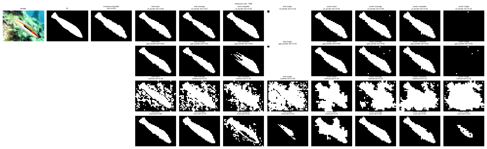

*All variants on `usod_test153`, raw 768-D, stride 14. Left: picture, ground truth, k-means with border rule. Then 8 columns (free and constrained trees × 4 linkages) and 4 rows (the four rules), each with its IoU. Average, Ward and complete linkage give clean masks; single linkage is nearly blank; the subtree rule (third row) is speckled.*

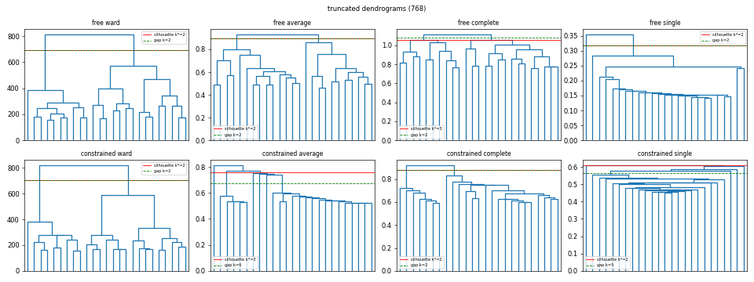

*The trees behind that picture (truncated to the 25 top branches). The red line is the cut chosen by the silhouette, the green dashed line the cut chosen by the gap rule. The constrained single-linkage tree is a staircase: that is chaining.*

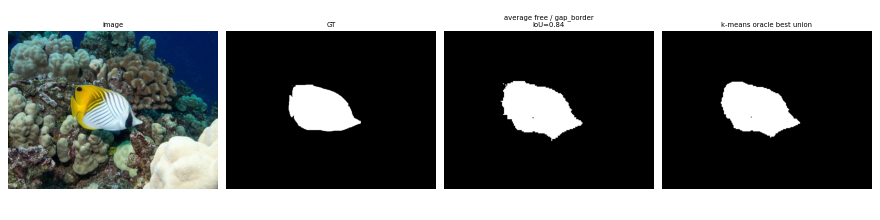

*A big win (`usod_test205`, 0.11 with the k-means border rule → 0.84). Panels: picture, ground truth, best dendrogram variant (stride 3, 768-D, free, average, gap cut), **k-means oracle best union** (chosen using the ground truth, so it looks similar; the realistic k-means mask is in the `compare/` figures).*

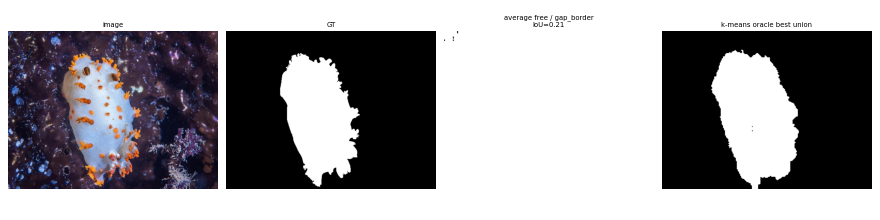

*A big loss (`usod_test40`, 0.84 → 0.21), explained in Sec. 19.8: the dendrogram mask is almost entirely white.*

### 19.10 Honest limitations

* **Best-of-64 on the evaluation images.** The best variant is chosen among 16 variants × 4 rules on the same images it is reported on, so its gain over k-means is somewhat optimistic. The same variant wins on USOD and SUIM-Saliency (a good sign), but there is no held-out test and a single run (no random seeds to vary; the sample of 3,000 patches uses a fixed seed).
* **Only 108 / 92 SUIM images**, and SUIM-Saliency is not verified to follow USOD's annotation convention (Sec. 5.2).
* **SUIM-not-water is close to a trivial guess** (all-foreground = 0.520), so it cannot support a claim either way.
* **k limited to 2-6**, as in the best k-means runs. The oracle would rise with more clusters, but the realistic scores might not.
* **The tree-walking rules use fixed, untuned constants.** Their weakness may be a design problem, not a limit of the idea.
* **Silhouette vs gap cut** was not tested separately (Sec. 19.6, finding 5).
* **Failure rate is real:** about one image in five gets clearly worse than with k-means (Sec. 19.8). Nothing here was tested on empty-water frames or on video.
* **Explanations in Sec. 19.7 marked "interpretation"** have not been verified by dedicated experiments (for example by inspecting cluster sizes of single-linkage trees).

### 19.11 How to reproduce

```bash
for S in 14 3; do
  .venv/bin/python src/dendrogram/dinov2_dendro.py --data USOD --gts usod --stride $S
  .venv/bin/python src/dendrogram/dinov2_dendro.py --data data/SUIM/TEST --gts suim_saliency suim_nonwater --tag suim --stride $S
done
for G in usod suim_saliency suim_nonwater; do .venv/bin/python src/dendrogram/summarize_dendro.py --gt $G --strides 14 3; done
# quick test: add --limit 5 --sample 5 --out-root /some/scratch/dir to src/dendrogram/dinov2_dendro.py
```

Measured run time (RTX A2000, file timestamps of the run): stride 14 took about 10 minutes (USOD 6.4, SUIM 3.6) and stride 3 about 62 minutes (USOD 44, SUIM 18), 73 minutes in total including the summaries; this covers all 16 variants and 4 rules.
Code: `src/dendrogram/dendro_cluster.py` (trees, cuts, rules, silhouette, metrics), `src/dendrogram/dinov2_dendro.py` (per-image driver, comparison figures, dendrogram plots), `src/dendrogram/summarize_dendro.py`
(tables, bootstrap and Wilcoxon statistics, best-variant panels). Results: `results/dendrogram/<dataset>/` (Sec. 16).

---

## 20. Changelog

| Date | Change |
|---|---|
| 2026-11-03 | v1.2: reorganised the repository into `src/`, `data/`, `results/`, `docs/`, `presentations/`, with code and results split per approach (`kmeans/`, `dendrogram/`, `analysis/`) and updated all scripts and paths; merged the SUIM + dendrogram work (SUIM test split with two derived GTs and blank-GT exclusions, Sec. 5.2; dendrogram study, Sec. 19: 16 variants x 4 selection rules x strides 14/3 on USOD, SUIM-Saliency, SUIM-not-water, with bootstrap CIs and Wilcoxon tests) with the 2026-10-22 analysis work (Sec. 10.8, `docs/ROADMAP.md`); updated TL;DR, roadmap, limitations, conclusion, layout, glossary, references |
| 2026-10-22 | v1.1: added `src/analysis/analyze_results.py` and Sec. 10.8 (bootstrap CIs, paired tests, failure categories, k\* and object-size analysis, galleries); corrected Sec. 10.6(b) and Sec. 11 failure-mode claims with the new statistics; added `docs/ROADMAP.md` |
| 2026-10-15 | v1.0: full report rewrite. Added problem statement, motivation, AUV applications, dataset sources, DINOv2 deep-dive, experiment history E0-E4, full results, figures and failure analysis, feasibility timings, roadmap, limitations, reproducibility, glossary, references |
| earlier | Initial README with the k=2 pipeline and the 2-4 cluster oracle section |
