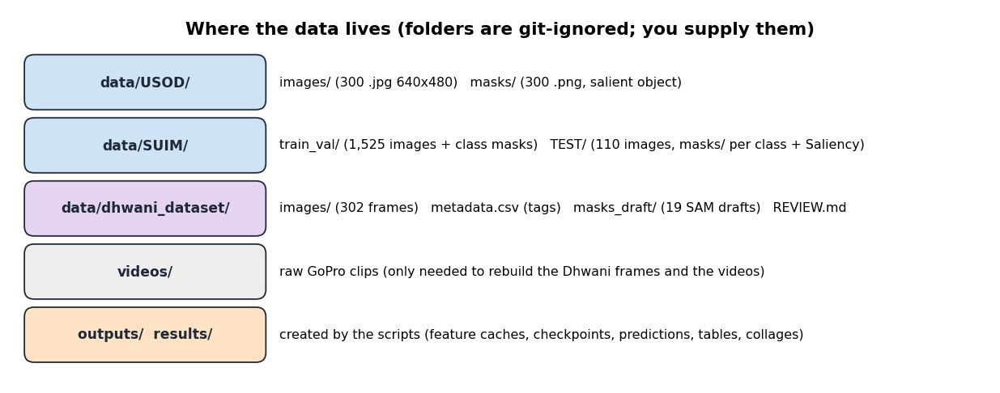

# Data (not in the repository)

The datasets are not redistributed and are git-ignored. Put them in this folder exactly as shown.



*What each folder holds.*

```
data/
├── USOD/
│   ├── images/   usod_test1.jpg ... usod_test300.jpg      (300 images, 640 x 480)
│   └── masks/    usod_test1.png ...                        (binary salient-object masks)
├── SUIM/
│   ├── train_val/  images/ + masks/                        (1,525 images, 8-class colour masks .bmp)
│   └── TEST/       images/ + masks/ (+ per-class folders FV HD PF RI RO SR WR and Saliency/)   (110 images)
└── dhwani_dataset/                                         (built by us, see below)
    ├── images/            302 frames, 1920 x 1080 JPEG
    ├── metadata.csv       clip, time stamp and scene tag of every frame
    ├── masks_draft/       SAM-drafted masks of the 19 fish frames
    ├── masks_draft_overlays/   review pictures (frame + hint box + draft outline)
    ├── review.csv, REVIEW.md   review instructions and decisions
    └── contact_sheets/    30 thumbnails per sheet, for checking the "no subject" assumption
```

| Dataset | Source | Notes |
|---|---|---|
| USOD | SVAM project page, IRVL lab: <https://irvlab.cs.umn.edu/visual-attention-modeling/svam> (Islam, Wang, Sattar, 2020) | 300 images with a binary salient-object mask. Some masks hold stray values (1-7, 247-248); we binarise with `mask > 128`. The licence was not verified: check the page before redistributing. Not to be confused with the larger USOD10K. |
| SUIM | <https://irvlab.cs.umn.edu/resources/suim-dataset> (Islam et al., IROS 2020) | 8 classes: BW water, HD divers, PF plants, WR wrecks, RO robots, RI reefs, FV fish, SR sand/rocks. Mask colour code is in the SUIM `INFO.txt`. |
| Dhwani | our own GoPro clips of an indoor underwater test tank | Not public. Rebuild with `python src/dataset/build_gopro_dataset.py` from clips placed in `videos/underwater_selected/`; tags are visual judgement. |

Splits (fixed seed, `src/supervised/common.py`): USOD 160 train / 40 validation / 100 test; SUIM 1,375 / 150 / 110 (the official test images); Dhwani is test-only.
Full recipe: [`../docs/REPRODUCE.md`](../docs/REPRODUCE.md).
