# Methods in plain language

Every method of the project, in the order we developed it. For each: the idea (with an analogy), exactly what the code does, the settings, and which script runs it.
Numbers are in [`results.md`](../results.md); the commands are in [`REPRODUCE.md`](REPRODUCE.md).

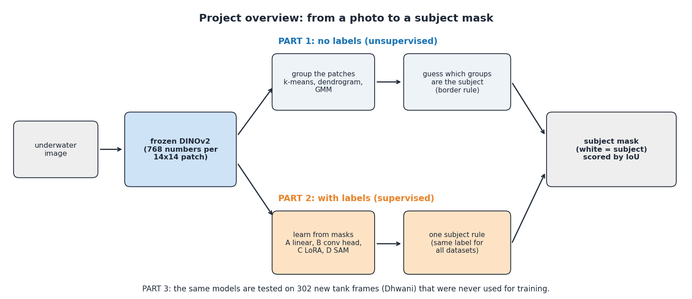

*Part 1 groups patches without labels and guesses the subject; Part 2 learns the subject from masks; Part 3 tests on new footage.*

## 0. Shared building blocks

**Image to patch features (all methods).** The image is resized to 448 x 588 pixels and passed once through **DINOv2 ViT-B/14**, a vision transformer pre-trained on 142 million images without labels. It cuts the image into 14 x 14 pixel squares (*patches*) and returns 768 numbers for each, a *fingerprint* that is similar for patches that look alike or mean the same thing (fur, water, metal).
With **stride 3** we run the unchanged model on 25 slightly shifted copies of the image and interleave the results, which gives a fingerprint every 3 pixels (a 145 x 192 grid) instead of every 14. Code: `src/kmeans/dinov2_cluster_union_stride.py` (`dense_features`).

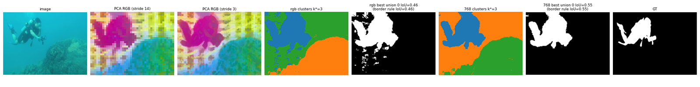

*Left to right: photo, the 768 numbers squeezed to three colours (PCA-RGB) with non-overlapping patches, and with stride 3. Diver, water and reef already get different colours, with no underwater training at all.*

**Ground truth and the score.** A *mask* is a black and white picture (white = subject). **IoU** (intersection over union) = overlap of our mask and the true mask divided by their combined area (1 = perfect). Masks are compared at the original image size. Ground-truth loading: `src/common/gt_utils.py`.

| Ground truth | Meaning |
|---|---|
| `usod` | the one salient object (binarised: mask > 128) |
| `suim_saliency` | SUIM's own salient-object mask (108 usable test images) |
| `suim_nonwater` | every SUIM pixel that is not water (92 test images that contain water) |
| `suim_subject` | the one-subject rule (Section 5) |
| `suim_subject2` | the strict rule: animals and objects only (Section 6) |

## 1. Review 1: first baselines

* **PCA mask.** Take the first principal component of the patch features (the single direction with most variation), threshold it at zero; the side that touches the image border is background.
* **k-means with k = 2.** Sort all patches into two piles by fingerprint similarity (**analogy:** sorting marbles into two bowls so each bowl holds similar marbles). The pile that touches the border is called water.
* Script: `src/kmeans/dinov2_seg.py`. Result: 0.42 and 0.49 IoU on USOD.

## 2. Review 2: k-means with 2 to 6 clusters, the border rule and the oracle

* **More groups.** A scene can have water, floor, reef and objects, so for each image we run k-means for k = 2 to 6 and choose k by the **silhouette score** (how well separated the groups are).
* **Border rule (no labels).** Groups whose patches touch the image border often are background; the rest is the subject.

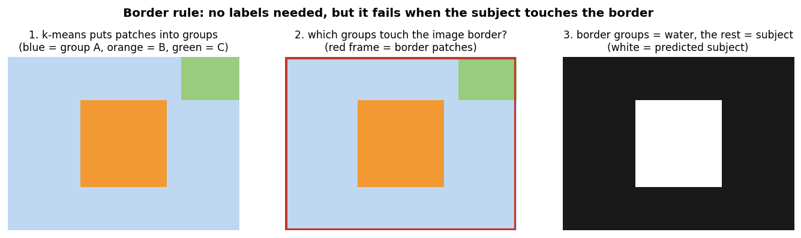

*The border rule on a toy 12 x 16 patch grid. It works when the subject sits in the middle and fails when it touches the border or when the background has several parts.*

* **Oracle (a measuring stick, not a method).** For each image, try every way of calling groups "subject" or "background" and keep the one that matches the true mask best. It shows what the groups could achieve: 0.70 on USOD, against 0.52 for the border rule. So the groups are good and **the choice of which groups are the subject is the weak step**.
* Scripts: `src/kmeans/dinov2_cluster_union.py` (k up to 4), `dinov2_cluster_union_stride.py` (stride, k up to 6, SUIM). `src/analysis/analyze_results.py` computes confidence intervals, paired tests and the failure analysis.

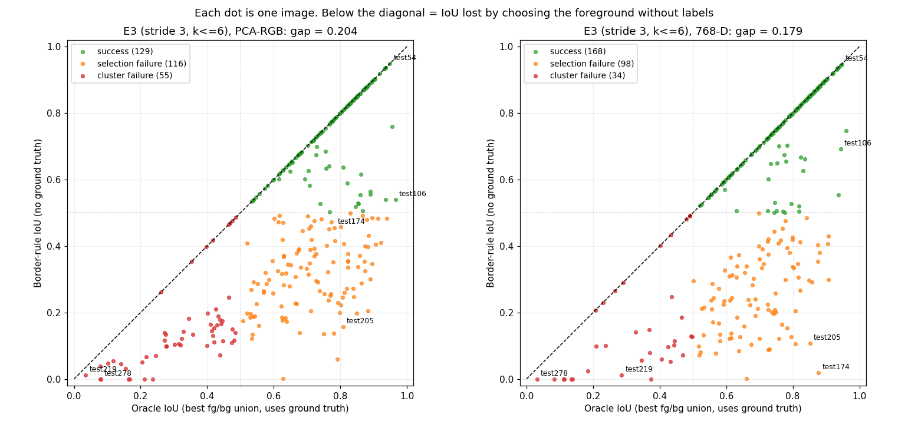

*Each dot is one image: IoU with the best choice of groups (oracle) against IoU of the border rule. The distance below the diagonal is what is lost by choosing the subject without labels.*

## 3. Dendrogram (hierarchical clustering)

* **Idea.** Start with every patch alone and repeatedly merge the two closest groups, like merging relatives into families and families into clans until there is one tree (the **dendrogram**). **Average linkage** measures the distance between groups as the average distance between their members.
* **Where to cut (the gap rule).** Every merge happens at a height (distance). We cut the tree where the jump between consecutive merge heights is largest, because that is where very different groups would be forced together. The border rule then picks the subject groups.

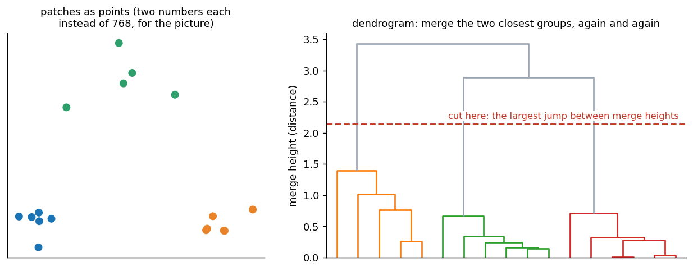

*Toy data: three natural groups; the cut (red dashed line) sits inside the largest jump.*

* **What we compared.** 16 tree variants (raw 768 numbers or PCA-RGB; free tree or constrained to touching patches; Ward, average, complete, single linkage) times 4 selection rules, at stride 14 and 3. The winner everywhere was **768 numbers, free tree, average linkage, gap cut**; single linkage collapses to one giant cluster and constrained average/complete fail.
* Honest note: the gain (0.52 to 0.65 on USOD) comes from a better *choice*; about one image in five gets worse. On SUIM "everything except water", predicting everything as foreground already scores 0.52, so no method shows real skill there.
* Scripts: `src/dendrogram/dendro_cluster.py` (trees, cuts, rules), `dinov2_dendro.py` (driver), `summarize_dendro.py` (tables, bootstrap and Wilcoxon tests).

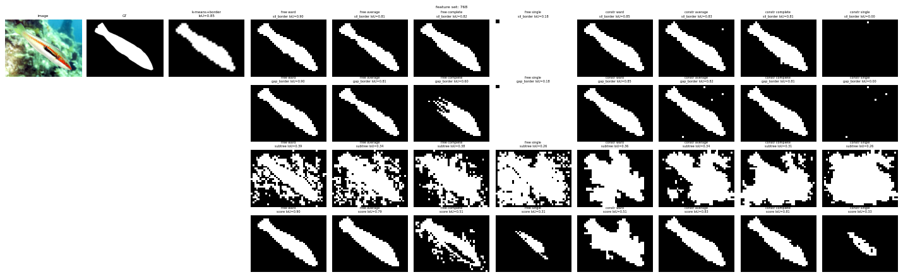

*One image (`usod_test153`): k-means versus dendrogram variants, IoU printed on each mask.*

## 4. Gaussian mixture models (GMM)

* **Idea.** k-means gives each patch one hard label and assumes round clusters of equal size. A GMM models each cluster as a bell-shaped cloud with its own centre, spread and weight, and gives each patch a **probability** for each cluster (the *responsibility*). **Analogy:** overlapping spotlights on a stage; a patch near the edge gets some light from two of them.
* **EM algorithm.** Fit by alternating two steps: *E-step* (compute each patch's responsibilities with the current clouds) and *M-step* (re-fit each cloud to the patches it is responsible for). **BIC** = fit minus a penalty for complexity, used to choose the number of clouds.

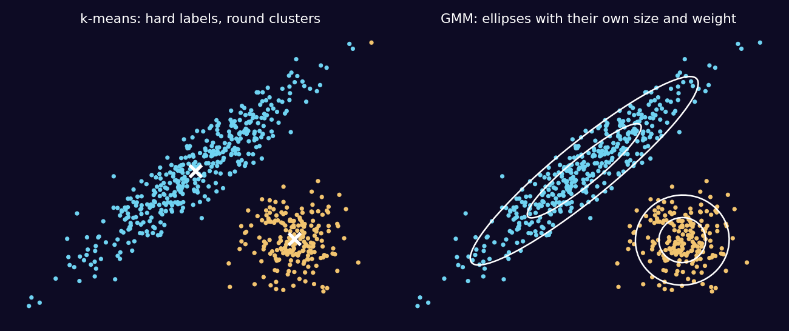

*Mixture density, responsibility, EM and BIC in one picture.*

* **Per-image GMM.** Same pipeline as k-means: patch features, PCA to 32 numbers, a mixture of 2 to 6 Gaussians (number chosen by silhouette), border rule. About 0.14 s per image.
* **Dataset-level GMM.** One mixture (8 components, full covariance, 64-D PCA) fitted once on 300 patches from every training image; each component is labelled foreground or background by how often its patches lie in the border ring of the image. A new image needs one pass (0.03 s), no fitting, so it also works on video frames.
* **Fair protocol.** The few design settings (covariance type, PCA size, rule for the number of components, smoothing) and the dataset-level fit use only the **source** dataset's training images; the test images are scored once, in-domain and across datasets.
* **BIC was the wrong rule.** It picked the maximum (6 components) in almost every image, because DINOv2 features are far from Gaussian; silhouette worked better.

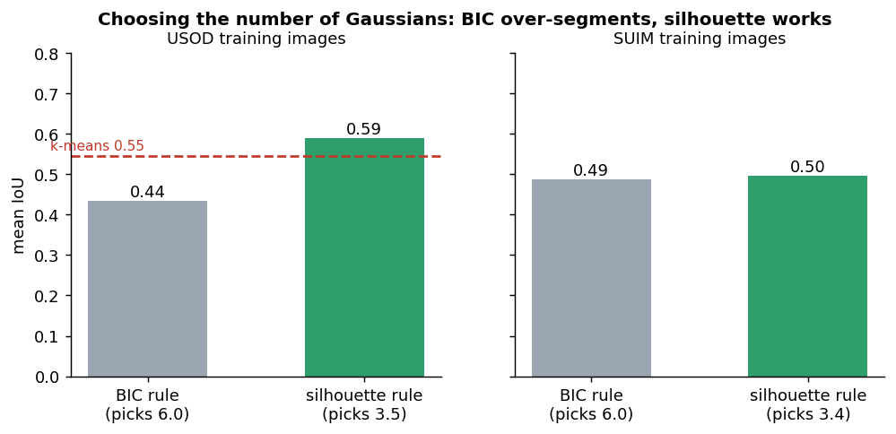

*Mean IoU on training images when the number of Gaussians is picked by BIC or by silhouette.*

* Scripts: `src/gmm/gmm_common.py`, `gmm_dev.py`, `gmm_fit_global.py`, `gmm_eval.py`, `compare_gmm.py`.

## 5. Supervised stages A to D: what we add on top of DINOv2

**Why.** The unsupervised methods are limited by the choice of the subject. A labelled mask tells a model directly which patches are the subject. **Why keep DINOv2 frozen:** it has 86 million weights learned from a huge image collection, and we have fewer than 2,000 labelled images, so retraining it would overfit (**analogy:** keep the experienced translator and teach only your own vocabulary).

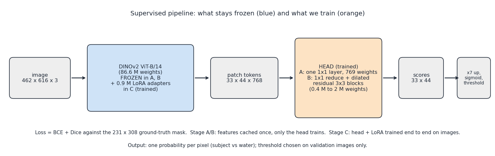

*Blue = frozen, orange = trained. Output: one probability per pixel; the threshold is chosen on validation images only.*

| Stage | What is trained | Size | Idea |
|---|---|---|---|
| **A** linear probe | one 1 x 1 layer on the frozen patch features | 769 weights (768 + bias) | a single scoring rule per patch: weighted sum plus sigmoid |
| **B** conv head | 1 x 1 reduce + three residual dilated 3 x 3 blocks | about 2 M weights | each patch also looks at neighbours (up to 15 x 15) |
| **C** LoRA | the head of B plus small corrections inside DINOv2 | 906,432 weights, about 1% of the backbone | tune the backbone slightly, end to end |
| **D** SAM | nothing (rule chosen on validation) | 0 | replace blobby masks with SAM's sharp outlines when that looks better; it gave no gain |

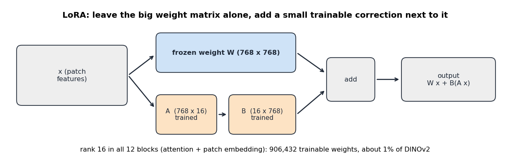

*LoRA keeps the big weight matrix W frozen and adds a small trainable correction B(Ax) of rank 16 next to it (like sticky notes on a textbook).*

**Training set-up.** Input 462 x 616 pixels (33 x 44 patches), predictions at 231 x 308, loss = **BCE + Dice** (BCE checks every patch; Dice checks overlap of the whole mask, so a small object is not ignored). Features of stages A and B are cached once, so those heads train in minutes. Stage C: 3,000 steps (about 14 minutes), augmentation by flips, random crops, brightness/contrast/saturation and blue-green colour shifts, model selection on validation only.

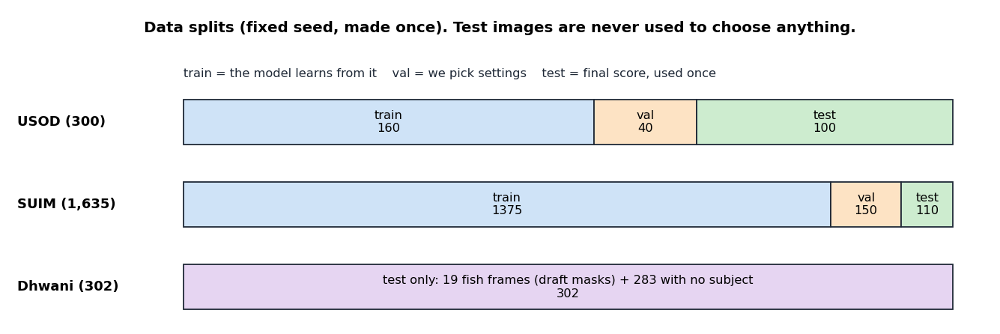

*Fixed-seed splits. Validation picks settings; test images are used once for the final number.*

* Scripts: `src/supervised/common.py` (splits, head, losses, metrics), `features.py`, `train_head.py` (A, B), `finetune.py` (C), `sam_refine.py` (D), `compare.py`.
* Worked example with real numbers: one image through stage A.

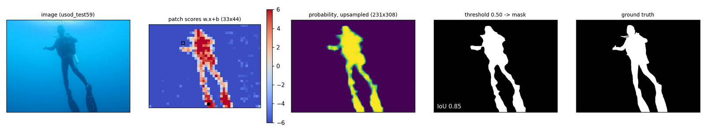

*One USOD test image through the linear probe: patch scores, mask, ground truth.*

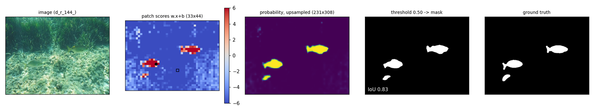

*The same for a SUIM test image.*

## 6. The label problem and the one subject rule

* **Cross-dataset test.** Train on one dataset only, test on the other (`--train usod --tag x1`, `--train suim --tag x2`). A model trained on 160 USOD images reaches 0.79 on SUIM's saliency masks, but a SUIM-trained model gets only 0.36 on USOD: SUIM marks everything that is not water, USOD only the salient object, so the SUIM model marks 74 percent of USOD pixels while the truth is 22 percent. **Analogy:** two graders with different marking schemes. The features transfer; the label definitions do not.
* **The rule** (`labels.py`, `gt_utils.suim_subject`): 1. animals, divers, robots and wrecks are the subject; 2. if there is only reef and water, the reef is the subject; 3. otherwise there is no subject and the correct mask is empty. It agrees with SUIM's own saliency masks at IoU 0.99.
* **Strict rule** (`subject2`): reef, plants, sand and tank walls are background; only animals and objects count. Used for the tank study, together with **underwater augmentation** (`uw_aug.py`: haze, darkening, colour cast, contrast loss, blur; strengths fixed before training) and **no-subject crops** (`--neg 0.15`, 15 percent of crops contain no subject).

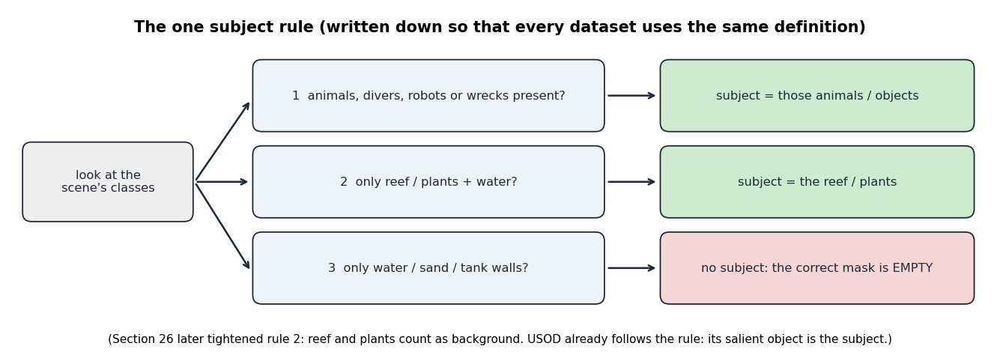

*The three branches of the rule.*

* **False-alarm test** (`false_alarm.py`): SUIM has no water-only images, so we cut crops with no subject pixels; a false alarm is more than 1 percent of the crop predicted as foreground. Other checks: `seeds.py` (five seeds), `tta.py` (test-time augmentation: flip and two scales, an optional small gain), `hard_cases.py` (size-weighted loss and multi-layer features were tried and not adopted).

## 7. The Dhwani tank frames

* **Dataset.** 302 frames from six GoPro clips of an indoor test tank (murky green water, perforated panels, steel frames, floor debris, a school of fish), picked by `build_gopro_dataset.py`: in-water time windows tagged by eye (fish, floor, structure, waterline, empty), candidates every 0.5 s, a quality filter, then diversity by farthest-point sampling on DINOv2 embeddings; empty water is capped at 30 percent. Never used for training or tuning.
* **Ground truth** (`sam_draft.py`, `tank_eval.py`): 19 fish frames got masks drafted by SAM from hand-placed boxes (not from any of our models; **drafts, not yet reviewed, so tank numbers are provisional**); the other 283 frames contain no animal or object, so the correct mask is empty.
* **Scored** (`tank_eval.py`): fish IoU on the 19 frames, and the **false-alarm rate** on the 283 frames (a mask drawn where nothing is). Videos of every method on six 30 s segments: `make_videos.py`.

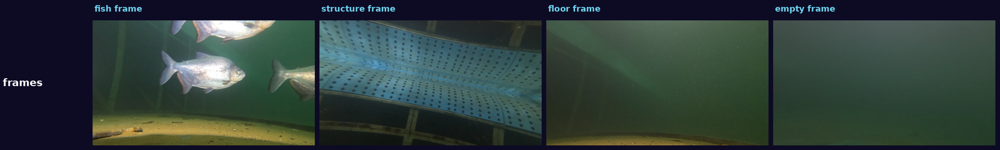

*Median frame of each tag: fish, structure, floor, empty water.*

## 8. Things that were tried and not adopted

| Tried | Result |
|---|---|
| Overlapping windows (stride 3) for clustering | smoother maps, almost no change in IoU, 25 times slower |
| PCA-RGB (3 numbers) instead of 768 | worse in every comparison |
| BIC to choose the GMM size | over-segments; silhouette is better |
| SAM refinement (stage D) | no gain over stage C |
| Minimum-area rule against false alarms | removes most false alarms but deletes small subjects; not adopted |
| Size-weighted loss, last-four-layer features | no validation gain |
| SVAM-Net baseline | never run: executing its downloaded upstream code was not permitted in this project |
