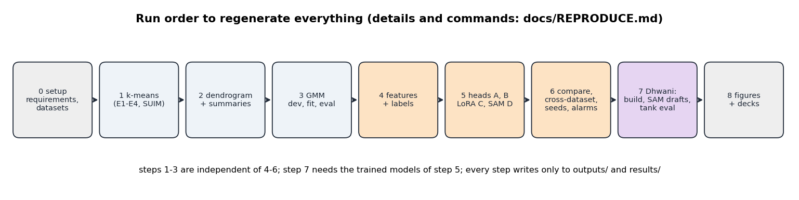
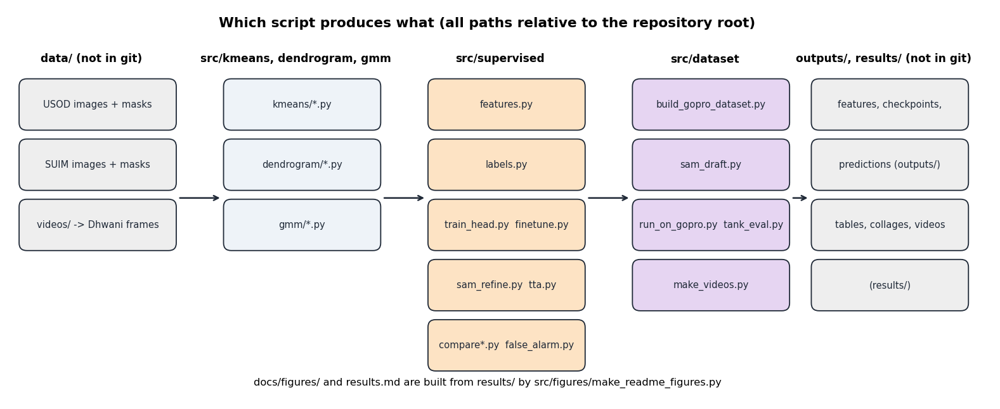

# How to regenerate every result

This file is the recipe. Follow it from top to bottom on a fresh checkout and you get the same tables and figures as in [`results.md`](../results.md).
The datasets and all outputs are **not** in the repository, so step 0 (get the data) and the run times matter.



*The nine steps. Steps 1 to 3 (no labels) and steps 4 to 6 (with labels) are independent of each other; step 7 needs the models of step 5.*



*Inputs on the left, code in the middle, outputs on the right. Everything a script writes goes to `outputs/` (large caches, models) or `results/` (tables, pictures).*

## 0. Setup

| Item | Value used in this project |
|---|---|
| OS / GPU | Linux, one NVIDIA RTX A2000 with 12 GB (any GPU with 8 GB or more should work; CPU-only is too slow for DINOv2 on 300+ images) |
| Python | 3.10 |
| Packages | `pip install -r requirements.txt` (pinned versions of everything below) |
| DINOv2 weights | downloaded automatically by `torch.hub` (facebookresearch/dinov2, `dinov2_vitb14`, about 330 MB) on first use |
| SAM weights | `facebook/sam-vit-base`, downloaded by `transformers` on first use (steps 5 and 7) |
| Disk | about 15 GB for `outputs/` (features 4.3 GB, checkpoints, predictions) and about 2 GB for `results/` |

```bash
python3 -m venv .venv && source .venv/bin/activate
pip install -r requirements.txt
```

**Datasets** (put them exactly here; the layout is described in [`data/README.md`](../data/README.md)):

| Dataset | Where to get it | Goes to |
|---|---|---|
| USOD (300 images, binary salient-object masks) | SVAM project page of the IRVL lab, University of Minnesota: <https://irvlab.cs.umn.edu/visual-attention-modeling/svam> | `data/USOD/images/`, `data/USOD/masks/` |
| SUIM (1,525 train/val + 110 test images, class masks) | <https://irvlab.cs.umn.edu/resources/suim-dataset> | `data/SUIM/train_val/`, `data/SUIM/TEST/` |
| Dhwani tank frames (302 frames) | built by us from our own GoPro clips; **not public**. You need the clips in `videos/underwater_selected/` | `data/dhwani_dataset/` (step 7) |

Run every command **from the repository root**. Scripts find their paths relative to the repository, so the working directory does not matter for most of them; the commands below use it anyway.

A quick test for any script of steps 1 and 2: add `--limit 10` (k-means) or `--limit 5 --sample 5` (dendrogram) to run on a handful of images first.

## 1. k-means (training-free baseline)

```bash
python src/kmeans/dinov2_seg.py                                                  # Review 1 baselines: PCA mask and k-means k=2 (about 3 min)
python src/kmeans/dinov2_cluster_union.py                                        # k = 2..4, oracle union (about 11 min)
python src/kmeans/dinov2_cluster_union_stride.py --stride 3  --kmax 6            # overlapping windows, k up to 6 (about 30 min)
python src/kmeans/dinov2_cluster_union_stride.py --stride 14 --kmax 6 \
        --out results/kmeans/usod/cluster_union_stride14_k6                      # control run (about 10 min)
# SUIM (110 test images), two derived ground truths
python src/kmeans/dinov2_cluster_union_stride.py --data data/SUIM/TEST --gt suim_saliency --stride 3 --kmax 6 \
        --out results/kmeans/suim_saliency/cluster_union_stride3_k6
python src/kmeans/dinov2_cluster_union_stride.py --data data/SUIM/TEST --gt suim_nonwater --min-water-frac 0.02 --stride 3 --kmax 6 \
        --out results/kmeans/suim/cluster_union_stride3_k6
python src/analysis/analyze_results.py --export-json                             # statistics and figures from the CSVs (CPU, 10 s)
```
Writes `results/kmeans/**/metrics*.csv` and `results/analysis/`. **Expected:** USOD border rule 0.523, oracle 0.702 (stride 3, k up to 6, raw 768 numbers).

## 2. Dendrogram

```bash
for S in 14 3; do
  python src/dendrogram/dinov2_dendro.py --data USOD --gts usod --stride $S
  python src/dendrogram/dinov2_dendro.py --data data/SUIM/TEST --gts suim_saliency suim_nonwater --tag suim --stride $S
done
for G in usod suim_saliency suim_nonwater; do python src/dendrogram/summarize_dendro.py --gt $G --strides 14 3; done
```
About 10 min for stride 14 and 1 h for stride 3 (16 tree variants times 4 selection rules). Writes `results/dendrogram/` (with a cache of the trees used later by `baseline_masks.py`). **Expected:** USOD 0.646, SUIM saliency 0.552 (average linkage, gap rule, stride 3).

## 3. Gaussian mixtures

```bash
python src/gmm/gmm_dev.py usod && python src/gmm/gmm_dev.py suim              # choose settings on training images only (32 settings each)
python src/gmm/gmm_fit_global.py usod && python src/gmm/gmm_fit_global.py suim # dataset-level mixture
python src/gmm/gmm_eval.py usod && python src/gmm/gmm_eval.py suim            # score all test images once
python src/gmm/compare_gmm.py                                                  # tables, bars, per-image collages
```
Writes `results/gmm/`. **Expected:** USOD test 0.543 (per-image) and 0.592 (dataset-level); SUIM not-water 0.512 and 0.628.

## 4. Features and labels (supervised, part 1)

```bash
cd src/supervised
python features.py            # cache frozen DINOv2 patch features of all images (about 1 min, 4.3 GB)
python labels.py              # one-subject-rule label (Section 23 of the story)
python labels.py subject2     # strict rule: animals and objects only
```

## 5. Train the heads A, B, C (and D)

```bash
cd src/supervised
# two-output model (USOD channel + SUIM channel): the first supervised result
python train_head.py A                 # about 5 min
python train_head.py B                 # about 20 min
python finetune.py 3000                # Stage C, LoRA, about 14 min
python sam_refine.py                   # Stage D, SAM, about 3 min plus tuning
python compare.py                      # tables and figures in results/comparison/

# cross-dataset: train on one dataset only
python train_head.py A --train usod --tag x1 ; python train_head.py B --train usod --tag x1 ; python finetune.py 3000 --train usod --tag x1
python train_head.py A --train suim --tag x2 ; python train_head.py B --train suim --tag x2 ; python finetune.py 3000 --train suim --tag x2
python cross_compare.py

# one subject rule: pooled model, and cross-dataset again
python train_head.py A --label subject --tag pool ; python train_head.py B --label subject --tag pool ; python finetune.py 3000 --label subject --tag pool
python train_head.py A --label subject --train usod --tag x1 ; python train_head.py B --label subject --train usod --tag x1 ; python finetune.py 3000 --label subject --train usod --tag x1
python train_head.py A --label subject --train suim --tag x2 ; python train_head.py B --label subject --train suim --tag x2 ; python finetune.py 3000 --label subject --train suim --tag x2
python compare_v2.py && python false_alarm.py

# seeds (5 for A and B, 3 for C) and optional extras
python train_head.py A --label subject --tag pool --seed 1     # repeat for seeds 1-4 and for B; finetune.py ... --seed 1 for C (seeds 1-2)
python seeds.py
python tta.py pool && python hard_cases.py report              # test-time augmentation, hard-case table

# strict rule with underwater augmentation (used on the tank frames)
python train_head.py A --label subject2 --tag pool2 ; python train_head.py B --label subject2 --tag pool2
python finetune.py 3000 --label subject2 --tag pool2 --aug underwater --neg 0.15
python eval_v3.py
```
Hyper-parameters are chosen on the validation split only and saved; each script writes its configuration to `results/**/config.json`.
**Expected:** USOD test A 0.803, B 0.821, C 0.869, D 0.868; SUIM not-water 0.883, 0.905, 0.924, 0.924. Unified model C: 0.84 on USOD and 0.84 on SUIM.

## 6. Figures for the supervised part

```bash
python src/supervised/worked_example.py        # one image through stage A with real numbers
python src/supervised/pipeline_figure.py       # pipeline block diagram
python src/supervised/export_examples.py       # one PNG per image: all methods side by side
```

## 7. Dhwani tank frames

```bash
python src/dataset/build_gopro_dataset.py      # picks 302 frames from the six clips (needs videos/underwater_selected/)
python src/dataset/sam_draft.py                # draft masks for 19 fish frames from hand-placed boxes (SAM)
python src/dataset/run_on_gopro.py sup && python src/dataset/run_on_gopro.py base      # all models on all frames
python src/dataset/tank_eval.py pool2          # score against the draft masks and the "no subject" rule
python src/dataset/make_videos.py frames && python src/dataset/make_videos.py sup && python src/dataset/make_videos.py base && python src/dataset/make_videos.py render
```
Hand-placed boxes for the SAM drafts are written in `src/dataset/sam_draft.py` (960 x 540 view). **Review the draft masks** (`data/dhwani_dataset/masks_draft_overlays/`) before trusting the tank numbers. **Expected:** fish IoU 0.18 (k-means), 0.47 (dendrogram), 0.81 (earlier salient channel), 0.48 (unified C), 0.25 (strict-rule C).

## 8. Figures for the documentation and the decks

```bash
python presentations/build_figures_review3.py   # photo figures + numbers.json (needs steps 1-7)
python src/figures/make_readme_figures.py       # every picture in docs/figures/
pip install python-pptx && python presentations/build_deck_review3.py   # optional: the Review 3 slides (needs the base deck, not in git)
```

## Determinism and checks

* `random_state=0` for k-means and silhouette sampling; a NumPy generator with seed 0 for the 5,000-patch subsample; data splits use a fixed seed (stored in `src/supervised/common.py`). GPU half precision can still change the last digit between machines.
* Quick consistency checks that were used: `dinov2_cluster_union_stride.py --stride 14 --kmax 4 --limit 10` reproduces the early results exactly; `run_on_gopro.py sanity` runs the supervised and baseline code on USOD images and must reproduce the stored IoUs (within 0.002).
* Approximate total time on the machine above: about 3 h for steps 1 to 3, about 2 h for steps 4 to 6, about 1 h for step 7.
