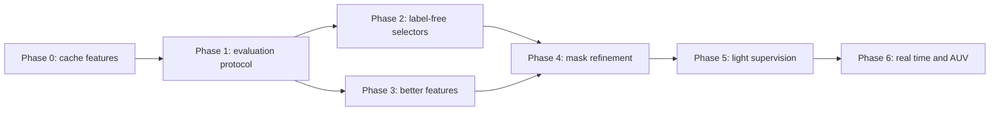

# GPU experiment roadmap

Plan for the next round of experiments, to be run on a machine with a CUDA GPU (the reference machine in the README is an
RTX A2000 12 GB). Every phase reuses the evaluation of the existing scripts (IoU / F / MAE on USOD, 300 images) and is
summarised with `analyze_results.py` (bootstrap CIs and paired Wilcoxon tests), so new numbers are directly comparable with
README Sec. 10.

**Starting point (README Sec. 10.8).** Stride 3, 768-D: oracle 0.702, border rule 0.523. Of 300 images, 168 succeed,
98 are *selection failures* (the right clusters exist but the border rule picks the wrong ones; mostly when k\* ≥ 3) and
34 are *cluster failures* (mostly objects under 10% of the image). The PCA-RGB maps of failure images show a grid-like
background artifact.

Order of work and targets:

| Phase | Goal | Success criterion |
|---|---|---|
| 0-2 | Fix the selection problem without training | Label-free IoU ≥ 0.60 (from 0.52) |
| 3-4 | Fix the cluster failures (small / thin objects, artifacts) | Oracle ≥ 0.75; cluster failures ≤ 20 |
| 5 | Remove the selection problem with a tiny trained head | 5-fold CV IoU ≥ 0.75; comparison with SVAM-Net |
| 6 | Make it usable on the vehicle | ≥ 10 FPS on a Jetson; measured false-alarm rate on empty water |

---

## Phase 0: infrastructure (do first)

The backbone takes about 25 ms per image; scikit-learn PCA and k-means dominate the run time (README Sec. 12). Extracting
features once makes every later clustering/selection experiment run in minutes, even on CPU.

1. **`extract_features.py`**: for each `--model` (`dinov2_vits14`, `dinov2_vitb14`, `dinov2_vitl14`, `dinov2_vitg14` and the
   `_reg` variants) and `--size` (448×588 default, also 224×294 and 644×868), save per image to
   `features/<model>_<H>x<W>/<image>.npz` (fp16):
   * `patch` (`x_norm_patchtokens`, gh×gw×D), `cls` (`x_norm_clstoken`),
   * `attn_cls`: last-block CLS→patch attention per head (gh×gw×heads), obtained with a forward hook on
     `model.blocks[-1].attn` that recomputes `softmax(q kᵀ / √d)` from the `qkv` projection,
   * `keys`: last-block key vectors per patch (used by TokenCut),
   * optionally `inter`: `model.get_intermediate_layers(x, n=4, reshape=True)` for multi-layer features.

   Size estimate: ViT-B at 448×588 is 1,344 × 768 × 2 bytes ≈ 2 MB per image for `patch`, about 1.5 GB for all arrays over 300 images.
2. **`--features` flag** in `dinov2_cluster_union_stride.py` (and new scripts) to read the cache instead of running the model.
3. **GPU clustering**: replace scikit-learn with torch: `torch.pca_lowrank` for PCA, a batched Lloyd's k-means with k-means++
   init on the GPU, and a sampled silhouette in torch. Check equivalence on 10 images against the current CSVs (IoU within 0.01).

## Phase 1: evaluation protocol

1. **Fixed splits**: `splits.json` with a 5-fold split of the 300 USOD images (seed 0). Anything that is trained or tuned
   (Phase 2 weights, Phase 5 probes) is reported as the mean over the 5 held-out folds.
2. **Seeds**: rerun the clustering with seeds 0-4 and report mean ± std of the mean IoU.
3. **Statistics**: extend `analyze_results.py` with `--extra-run name=path/to/metrics_union.csv` so new runs appear in all figures,
   with bootstrap CIs and paired Wilcoxon tests against the current best.
4. **AUV-relevant metrics** (new `eval_auv.py`):
   * image-level "object present": score = foreground fraction in the central ROI (middle third), report AUROC;
   * ROI overlap: IoU restricted to the central ROI;
   * **false alarms on empty water**: build a negative set from SUIM images whose mask is ≥ 98% background waterbody (BW), plus
     water-only crops from USOD; report false-positive rate at the threshold that gives 95% recall on USOD.

## Phase 2: label-free foreground selection (no training; biggest expected gain)

The selection failures (98 images) concentrate where silhouette picks k\* ≥ 3. Candidates, each a function
`select(labels, features, extras) -> fg mask` evaluated on cached features:

1. **Background prototype**: mean feature of the border ring patches (or k-medoids of the ring for multi-modal backgrounds);
   foreground score per patch = 1 − cosine similarity to the closest prototype. Threshold by Otsu, or label a cluster foreground
   if its mean score exceeds the global mean.
2. **Cluster scoring**: per cluster compute border fraction, distance of its centroid from the image centre, compactness
   (area / convex-hull area), relative size, and feature contrast to the background prototype. Combine with fixed weights
   first; then fit the 5 weights with logistic regression on the CV folds (weak supervision, report it separately).
3. **CLS attention saliency**: mean over heads of the last-block CLS→patch attention (from the cache). Choose clusters with
   above-average attention. Use the `_reg` models, whose attention maps are much cleaner.
4. **Spectral methods** (known strong training-free baselines for unsupervised saliency):
   * **TokenCut** (Wang et al., 2022): graph on patch keys with edges `1 if cos ≥ τ else ε` (τ≈0.2), second-smallest
     eigenvector of the normalised Laplacian, bipartition, pick the side containing the eigenvector's maximum absolute value.
   * **Deep Spectral Methods** (Melas-Kyriazi et al., 2022): eigenvectors of a feature-affinity Laplacian, foreground from the
     first non-trivial eigenvector.
5. **Simple fallbacks to test**: always use k=2 for selection while keeping k\* for the oracle; or choose k\* only among k where
   the border rule is unambiguous (exactly one cluster below the border fraction).

Deliverable: `select_foreground.py --method {border,prototype,score,attention,tokencut,dsm}` writing
`dinov2_results_usod/select_<method>/metrics_union.csv` with the same columns as now.

## Phase 3: better features

1. **Normalisation**: L2-normalise patch features before k-means (cosine k-means). Currently plain Euclidean on LayerNorm outputs.
2. **Backbones**: ViT-S/B/L/g, each with and without registers (`dinov2_vit{s,b,l,g}14_reg`). The grid artifact seen in the
   worst-case gallery (README Sec. 10.8) is the main reason to test registers early.
3. **Resolution instead of 25 shifted passes**: run at 644×868 (46×62 patches) or 896×1176 in one pass. With PyTorch SDPA this
   fits in 12 GB for ViT-B; it gives genuinely smaller patches for small objects, unlike stride 3.
4. **Multi-layer features**: concatenate (or average) the last 4 blocks from `get_intermediate_layers`; also cluster on `keys`.
5. **Underwater pre-processing ablation**: gray-world white balance, CLAHE on L of Lab, and a learned enhancer (FUnIE-GAN) before
   feature extraction. Report the effect on clusters and on selection separately.

## Phase 4: mask refinement

1. **Dense CRF** (`pydensecrf`) or a **bilateral solver** on the upsampled soft mask, with the RGB image as guidance.
2. **SAM / SAM 2 prompting**: from the coarse mask take the bounding box plus 1-3 positive points at the maxima of the distance
   transform (and negative points in the background prototype region); keep the SAM mask with the highest IoU to the coarse mask.
   Expected to help most on thin objects (e.g. `usod_test219`, starfish arms).
3. Report boundary F-measure in addition to IoU to show where refinement helps.

## Phase 5: light supervision

1. **Linear probe**: a 1×1 conv (768→1) on frozen patch features, BCE + Dice loss, trained per fold of the 5-fold split
   (240 train / 60 test). Upsample logits bilinearly. Also a 2-layer MLP head as a second variant.
2. **SUIM**: binary "not water" (all classes except BW) on 1,525 train images, test on SUIM test and on all 300 USOD images
   (cross-dataset). Then an 8-class head for semantic segmentation.
3. **Parameter-efficient fine-tuning**: LoRA on the attention projections of the last 4 blocks, or fine-tune the last block only.
4. **Trained baseline**: run SVAM-Net with the released checkpoints on USOD for a fair comparison with a method designed for
   underwater salient-object detection.

## Phase 6: real time and AUV

1. **Model and input**: ViT-S/14 at 224×294 (about 2 ms backbone on the A2000) with the Phase 5 probe head or GPU clustering.
2. **Export**: ONNX → TensorRT fp16 (then INT8 with calibration on USOD/SUIM) on a Jetson Orin; measure end-to-end FPS including
   pre-processing.
3. **Video**: warm-start k-means centroids from the previous frame, run the backbone every 2nd frame, exponential smoothing of
   masks; evaluate flicker (frame-to-frame IoU) on underwater video.
4. **"Object ahead" rule** (README Sec. 4.2): fraction of foreground in the central ROI above τ for N consecutive frames; report
   detection rate vs false-alarm rate on the Phase 1 negative set.
5. **Fusion** with forward sonar / DVL / depth: design only at first; use the mask's bearing and extent to gate sonar returns.

## Suggested first week on the GPU machine

1. Phase 0 cache for `dinov2_vitb14` and `dinov2_vitb14_reg` at 448×588 and 644×868.
2. Phase 2 methods 1, 3 and 4 on the cached features (minutes each), compared against the border rule with `analyze_results.py`.
3. Phase 3 items 1-3 (registers, cosine k-means, higher resolution), comparing oracle IoU and cluster-failure counts.
4. Phase 5 linear probe with 5-fold CV, as the "light supervision" reference point.
