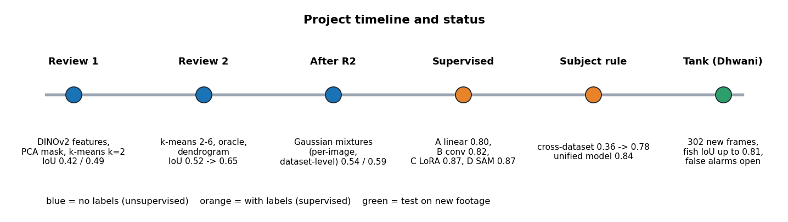

# Roadmap: what is done and what is open

Status on 2026-11-05.

*Blue = no labels, orange = with labels, green = test on new footage.*

## Done

| Phase | What | Where |
|---|---|---|
| Review 1 | DINOv2 features, PCA-RGB maps, PCA mask and k-means (k = 2) baselines | `src/kmeans/dinov2_seg.py` |
| Review 2 | k-means up to 6 clusters, border rule, oracle, failure analysis; dendrogram with the gap rule; SUIM added as a second dataset | `src/kmeans/`, `src/dendrogram/`, `src/analysis/` |
| After Review 2 | Gaussian mixture models (per-image and dataset-level) with a fair cross-dataset protocol | `src/gmm/` |
| Supervised | Stages A (linear probe), B (conv head), C (LoRA), D (SAM, no gain) | `src/supervised/` |
| Label problem | Cross-dataset tests; one subject rule; unified model; false alarms; seeds; test-time augmentation | `src/supervised/` |
| New footage | Dhwani tank dataset (302 frames), SAM-drafted fish masks, all methods scored, videos | `src/dataset/` |

Results: [`../results.md`](../results.md). How to rerun: [`REPRODUCE.md`](REPRODUCE.md).

## Open (in order of value)

1. **Review the 19 draft fish masks of the tank frames** and confirm that the other 283 frames contain no animal or object. Until then every tank number is provisional.
2. **False alarms on empty water** (41 to 76 percent of empty tank frames even for the supervised models). Ideas: an image-level "is there a subject?" decision, more no-subject training crops, a minimum-area and confidence rule, smoothing over time in video.
3. **More varied labelled underwater data**, or a few labelled tank frames for fine-tuning, so the model sees murky green water in training.
4. **Separate subjects** (instance masks) instead of one mask for everything.
5. **Real-time use on a vehicle:** timings on an embedded GPU, a smaller backbone (ViT-S/14) or smaller input, GPU clustering, temporal reuse. The measured desktop timings (RTX A2000): backbone about 17 ms at 448 x 588; the clustering on the CPU dominates (up to 400 ms); a linear probe needs no clustering at all.
6. **Baselines not run:** SVAM-Net (its upstream code was not executed in this project).

## Applications once it works

The mask can tell an underwater vehicle that "something is in front of me": size of the mask, position in the frame and its change over time can drive a slow-down or avoid decision, ideally fused with sonar or depth. This is a proposal, not tested.
