# Results

All results of the project, from the first baselines to the tank test. The numbers come from the result tables the scripts write
(`results/**/summary.csv`, `report.md`, `figures_r3/numbers.json`); the recipe to regenerate them is [`docs/REPRODUCE.md`](docs/REPRODUCE.md),
and the methods are explained in [`docs/METHODS.md`](docs/METHODS.md) and the [README](README.md).
The result folders themselves are not in the repository.

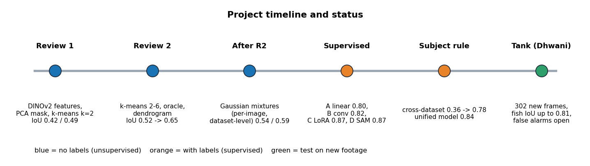

*The project in six steps. Blue: no labels. Orange: with labels. Green: new footage.*

## How to read the numbers

* **IoU** = overlap of our mask and the true mask divided by their combined area. 1.0 is perfect, 0 is no overlap. "Mean IoU" is the average over images.
* **Test images** were never used to choose a setting, a threshold or a checkpoint. Settings come from training or validation images only.
* **Three test sets:** *USOD* (300 images, one salient object; some tables use all 300, others the 100 test images, and the table says which), *SUIM* (110 test images, two ground truths: "saliency" = salient objects, 108 usable images, and "not-water" = everything that is not water, 92 usable images) and *Dhwani* (302 tank frames, new footage).
* **Oracle** = the best possible choice of groups, made with the true mask. It is a ceiling for a clustering method, not a method.
* **In-domain** = trained or tuned on the same kind of images; **cross-dataset** = trained or tuned on one dataset, tested on the other.
* **False alarm** = a mask drawn on a frame or crop that contains no subject.

## 1. Headline numbers

| Phase | Result (mean IoU, held-out images) |
|---|---|
| Review 1: PCA mask / k-means, k = 2 (USOD, 300 images) | 0.42 / 0.49 |
| Review 2: k-means up to 6 clusters, no labels (USOD, 300) | 0.52 (oracle 0.70) |
| Review 2: dendrogram, gap rule, no labels (USOD, 300) | **0.65** |
| Gaussian mixtures (USOD test / SUIM not-water test) | per-image 0.54 / 0.51; dataset-level 0.59 / **0.63** |
| Supervised A / B / C / D (USOD test) | 0.80 / 0.82 / **0.87** / 0.87 |
| Supervised A / B / C / D (SUIM not-water test) | 0.88 / 0.90 / **0.92** / 0.92 |
| Cross-dataset, USOD-trained, SUIM saliency | **0.79** (best no-label method: 0.55) |
| Cross-dataset, SUIM-trained, USOD (two different label definitions) | 0.36 |
| Same, after the one subject rule | **0.78** |
| Unified model C (one output), USOD test / SUIM test | 0.84 / 0.84 |
| Tank frames: fish IoU, best model (earlier salient channel) | 0.81 (provisional) |
| Tank frames: false alarms on empty frames, best strict-rule model | 41% (provisional) |

## 2. Unsupervised methods

### 2.1 k-means (Review 1 and 2)

First baselines on the 300 USOD images (single run, k = 2, border rule):

| Method | Mean IoU | Median IoU | Images with IoU > 0.5 | Images with IoU < 0.2 |
|---|---|---|---|---|
| PCA mask (first principal component) | 0.418 | 0.421 | 130 | 97 |
| k-means, k = 2 | 0.490 | 0.593 | 162 | 87 |

Clustering with up to 6 groups; "oracle" chooses the groups with the answer, "border rule" without (300 USOD images):

| Run | Features | Oracle IoU | Border-rule IoU | Mean k chosen |
|---|---|---|---|---|
| stride 14, k up to 4 | PCA-RGB (3 numbers) | 0.662 | 0.456 | 3.78 |
| stride 14, k up to 4 | 768 numbers | 0.676 | 0.560 | 2.94 |
| stride 14, k up to 6 | PCA-RGB | 0.668 | 0.448 | 4.05 |
| stride 14, k up to 6 | 768 numbers | 0.703 | 0.531 | 3.84 |
| **stride 3, k up to 6** | PCA-RGB | 0.671 | 0.467 | 4.06 |
| **stride 3, k up to 6** | 768 numbers | 0.702 | **0.523** | 3.82 |

* The raw 768 numbers beat the 3-number reduction in every row.
* The gap between oracle (0.70) and border rule (0.52) shows the clusters are mostly right; **choosing which clusters are the subject is the weak step**.
* Overlapping windows (stride 3) make the colour maps smoother but change the oracle IoU by at most 0.003 on average.
* The border rule matches the oracle when two clusters are chosen (0.75 vs 0.76) and collapses when 3 to 6 must be merged (0.36 to 0.49). Of the 34 images where even the oracle fails, 30 show an object under 10 percent of the image.

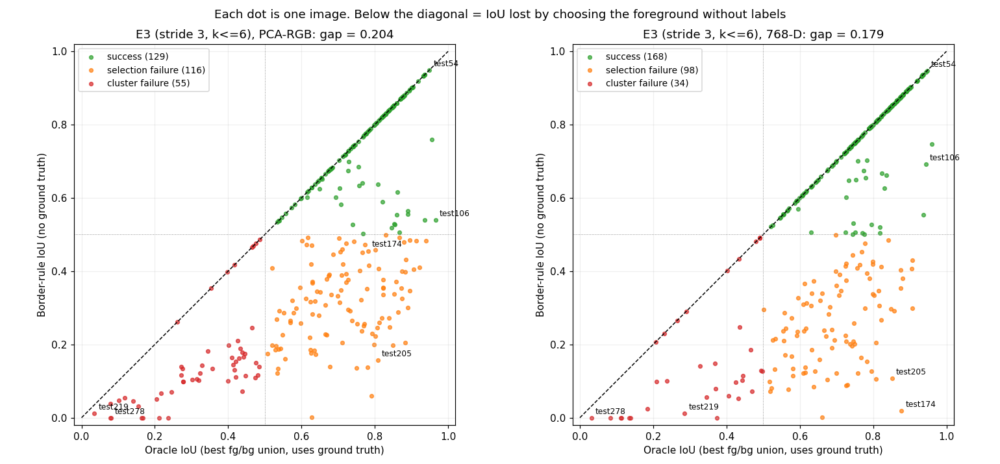

*Each dot is one image: IoU with the best choice of groups (oracle, x axis) against IoU of the border rule (y axis). Distance below the diagonal = IoU lost by choosing the subject without labels. Orange = selection failure, red = the clusters themselves are bad.*

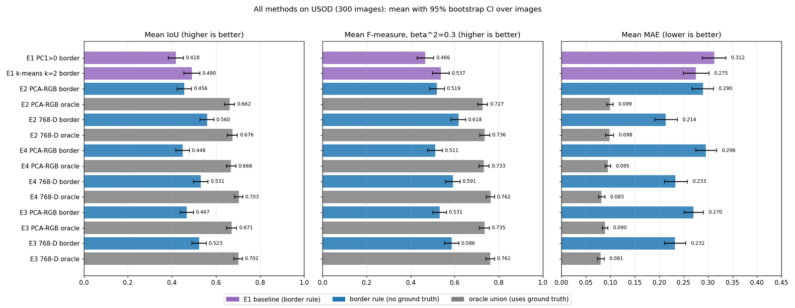

*Mean IoU, F-measure and error (MAE) of every k-means run on the 300 USOD images, with 95 percent confidence intervals (blue = no labels, grey = oracle).*

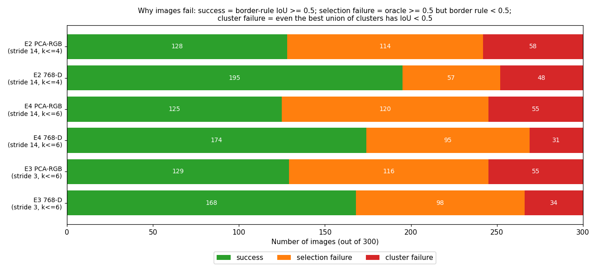

*Number of images (of 300) where the border rule works (green), where only the choice fails (orange: oracle at least 0.5, border rule below 0.5), and where even the best union of clusters fails (red). Stride 3, 768 numbers: 168 / 98 / 34.*

On SUIM (110 test images), same code (mean IoU, oracle / border rule, 768 numbers, stride 3, k up to 6): saliency masks 0.595 / 0.429; not-water 0.774 / 0.475. Predicting *everything* as foreground scores 0.224 on USOD, 0.199 on SUIM saliency and **0.520 on SUIM not-water**, so scores near 0.5 there show little skill.

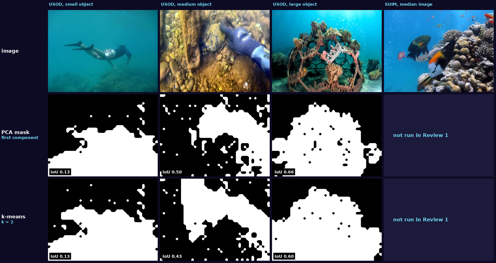

*Same four test images for every method: original on top, masks below with the IoU printed on each. Review 1: PCA mask and k-means with k = 2.*

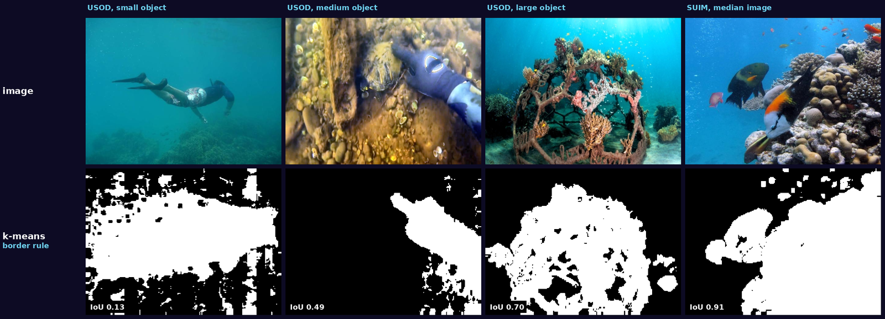

*k-means, up to 6 groups, border rule.*

### 2.2 Dendrogram (Review 2)

Best label-free variant (768 numbers, free tree, average linkage, gap cut), against the k-means border rule:

| Dataset | Stride | Dendrogram IoU | k-means IoU | Gain (95% interval) | Oracle of the same clusters |
|---|---|---|---|---|---|
| USOD (300) | 14 | 0.646 | 0.531 | +0.115 (+0.085, +0.145) | 0.709 |
| USOD (300) | 3 | **0.646** | 0.523 | +0.123 (+0.095, +0.151) | 0.711 |
| SUIM saliency (108) | 14 | 0.537 | 0.424 | +0.113 (+0.074, +0.155) | 0.626 |
| SUIM saliency (108) | 3 | **0.552** | 0.429 | +0.122 (+0.084, +0.163) | 0.642 |
| SUIM not-water (92) | 14 | 0.548 | 0.505 | +0.043 (+0.008, +0.080) | 0.770 |
| SUIM not-water (92) | 3 | 0.521 | 0.475 | +0.046 (-0.009, +0.097) | 0.521 |

* On USOD and SUIM saliency the gain is clear (about +0.12). The oracle moves much less (+0.01 and +0.05), so what improved is the *choice* of the subject, not the clusters.
* It is **not** a uniform win: about 52 percent of USOD images improve and 20 percent get worse (51/22 percent at stride 14).
* Other linkages are weaker (USOD, stride 3, silhouette cut: average 0.630, Ward 0.571, complete 0.568, single 0.211).
* On SUIM not-water there is no meaningful gain; the stride-3 winner (single linkage) collapses to one giant cluster, which already scores 0.52.

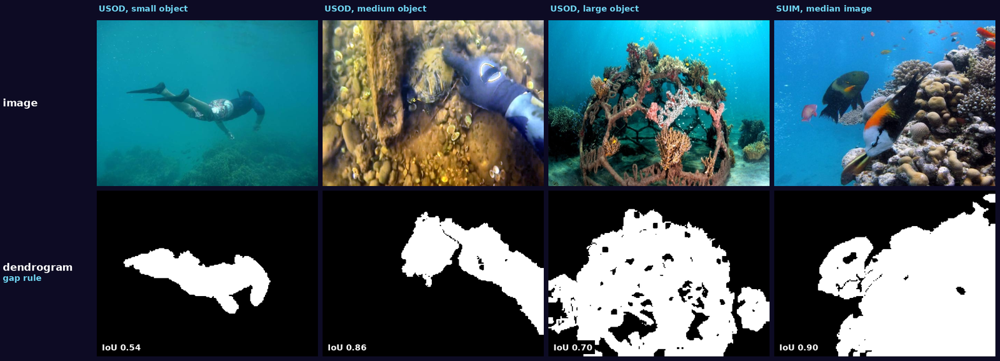

*Dendrogram, average linkage, gap rule, on the same four images.*

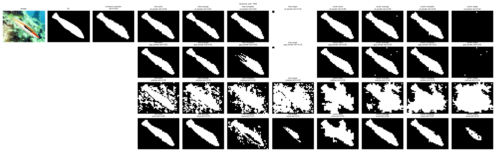

*One image where the dendrogram beats k-means (`usod_test153`).*

### 2.3 Gaussian mixture models

Development on the **training** images of the source dataset (mean IoU, USOD):

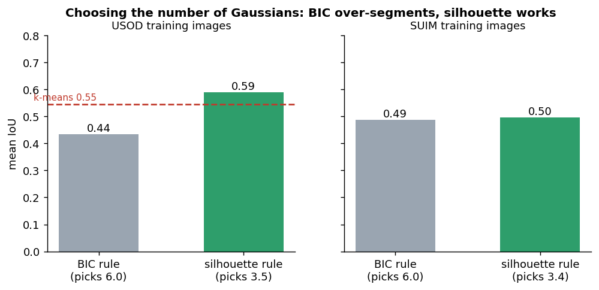

*Choosing the number of components by BIC picks 6 almost always (mean 6.0) and scores 0.44 on USOD training images; silhouette (mean 3.5 components) scores 0.59. k-means on the same USOD images: 0.55.*

Chosen settings: USOD source = diagonal covariance, 32 PCA numbers, silhouette, smoothing on; SUIM source = spherical covariance, 32 PCA numbers, silhouette, smoothing on.

Test images, each scored once (mean IoU):

| Setting | k-means | Dendrogram | **GMM per-image** | **GMM dataset-level** | Oracle (k-means / GMM) |
|---|---|---|---|---|---|
| In-domain USOD (100 test) | 0.503 | **0.643** | 0.543 | 0.592 | 0.693 / 0.645 |
| SUIM settings applied to USOD (all 300) | 0.523 | **0.646** | 0.512 | 0.400 | 0.702 / - |
| In-domain SUIM not-water (92) | 0.475 | 0.442 | 0.512 | **0.628** | 0.774 / 0.764 |
| In-domain SUIM saliency (108) | 0.429 | **0.552** | 0.406 | 0.413 | 0.595 / 0.595 |
| USOD settings applied to SUIM, not-water | 0.475 | 0.442 | 0.470 | 0.455 | 0.774 / - |
| USOD settings applied to SUIM, saliency | 0.429 | **0.552** | 0.440 | 0.527 | 0.595 / - |

* In-domain, the mixtures beat k-means: per-image +0.04 on USOD and +0.04 on SUIM not-water; the dataset-level mixture +0.09 on USOD and **+0.15 on SUIM not-water** (the best label-free result there).
* The dendrogram stays best on USOD (0.643) and SUIM saliency (0.552).
* Across datasets the gain disappears: the SUIM-fitted dataset-level mixture drops to 0.400 on USOD. It learns SUIM's definition of foreground (the label definition problem, Section 4).
* The component quality equals k-means (GMM oracle 0.645 / 0.764 against 0.693 / 0.774): again the selector is the weak step.
* Cost: per-image fit about 0.14 s on top of the 0.7 s feature extraction; dataset-level 0.03 s per image with no fitting.

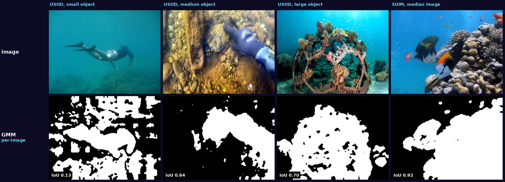

*Per-image mixture on the four example images.*

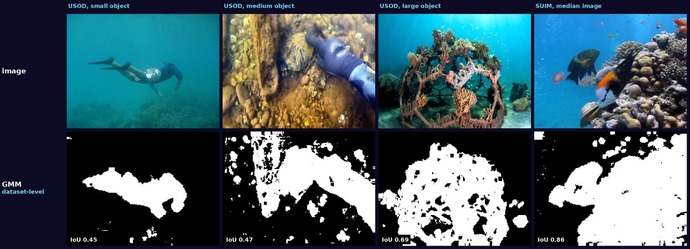

*Dataset-level mixture.*

### 2.4 Comparison of all unsupervised methods

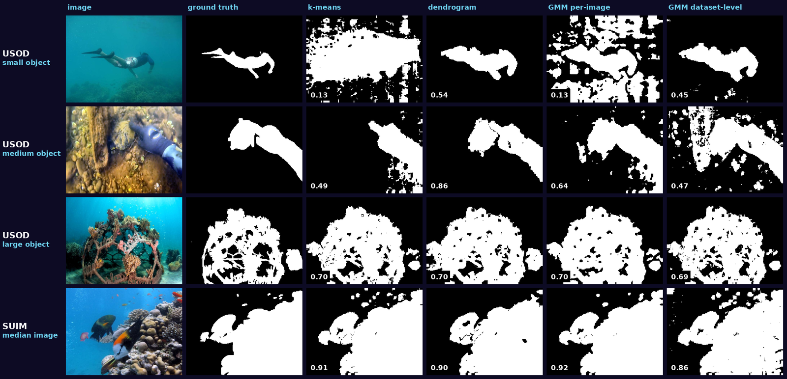

*Same four images, every unsupervised method (rows: original, ground truth, k-means, dendrogram, GMM per-image, GMM dataset-level). The dendrogram usually gives the cleanest object; k-means and the per-image mixture often paint the background; the dataset-level mixture is good on the SUIM image and noisy on USOD.*

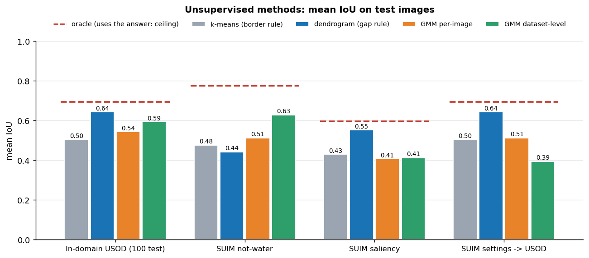

*Mean IoU per method and setting; the dashed lines are the oracle ceiling.*

**Conclusion of Part 1:** the best label-free method is the dendrogram (USOD 0.64, SUIM saliency 0.55), the dataset-level mixture on SUIM not-water (0.63). All stay far below the oracle (0.60 to 0.77); no method keeps its in-domain gain across datasets.

## 3. Supervised methods (frozen DINOv2 + trained part)

Test images only (USOD 100, SUIM not-water 92). Mean IoU with 95 percent bootstrap interval; label-free methods for reference.

| Method | USOD test | SUIM not-water test |
|---|---|---|
| k-means, border rule | 0.503 [0.445, 0.561] | 0.475 [0.426, 0.523] |
| dendrogram, gap rule | 0.643 [0.594, 0.690] | 0.442 [0.386, 0.495] |
| k-means oracle | 0.693 [0.655, 0.729] | 0.774 [0.742, 0.802] |
| **A** linear probe (769 weights) | 0.803 [0.775, 0.830] | 0.883 [0.855, 0.904] |
| **B** conv head (about 2 M weights) | 0.821 [0.788, 0.852] | 0.905 [0.874, 0.928] |
| **C** + LoRA (906,432 weights) | **0.869** [0.842, 0.893] | **0.924** [0.901, 0.943] |
| **D** + SAM refinement | 0.868 [0.841, 0.892] | 0.924 [0.901, 0.943] |

* **Biggest step:** from the best label-free method to the linear probe (+0.16 USOD, +0.44 SUIM). The features already contain the answer; a single layer only has to learn which patches are the subject. The probe even beats the k-means oracle.
* B (look at neighbours) and C (adapt DINOv2 with LoRA) each add a few points; the LoRA gain is clear on USOD and small on SUIM.
* **SAM (D) adds nothing**: on validation every acceptance rule was at best equal to C. The ground-truth masks are blobby annotations, so sharper edges do not match them better.
* Images with IoU below 0.2 (USOD): 11 percent for the dendrogram, 0 percent for A to D.
* Training times (RTX A2000): features 1 min; A about 5 min; B about 20 min including tuning; C about 14 min (3,000 steps); D about 3 min plus tuning.

**By object size (USOD test, mean IoU):**

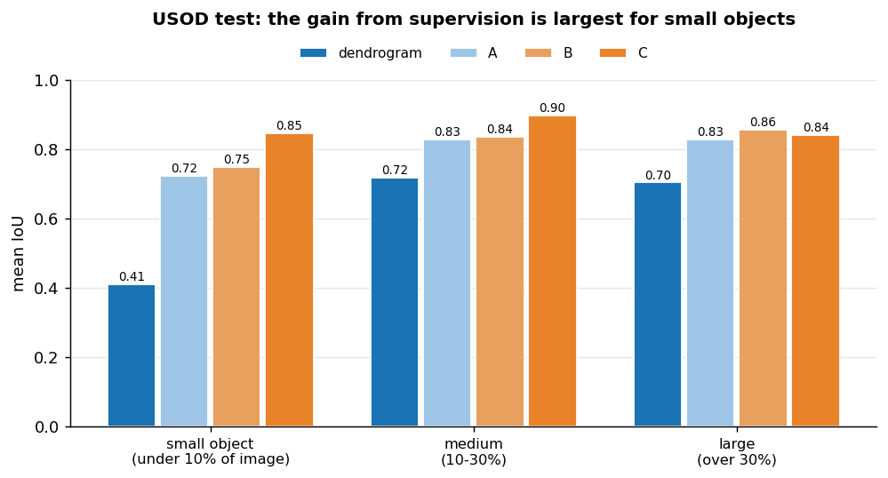

*Small objects (under 10 percent of the image) gain most: dendrogram 0.41, A 0.72, B 0.75, C 0.85. For large objects (over 30 percent) all stages are close and B is as good as C (0.86 and 0.84).*

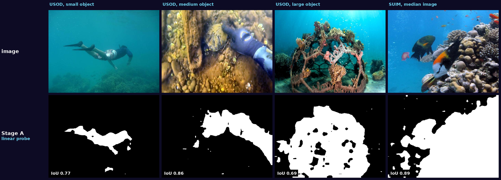

*Stage A, linear probe (USOD channel for the three USOD images, SUIM channel for the SUIM image).*

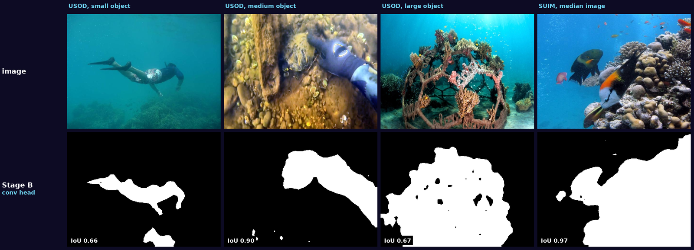

*Stage B, small convolutional head.*

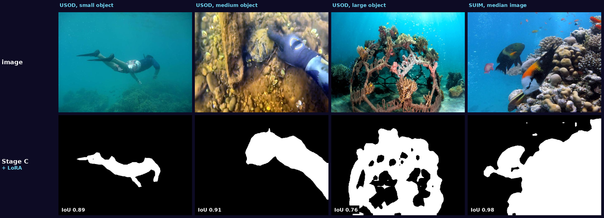

*Stage C, with LoRA.*

*Stage D, SAM refinement: identical to C.*

### Comparison of all supervised stages

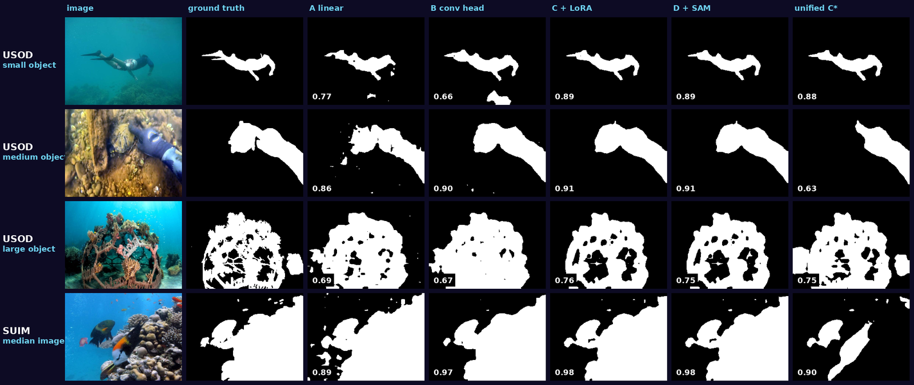

*Same four images for every stage (rows: original, ground truth, A, B, C, D, and the unified model of Section 4, whose ground truth for the SUIM image differs).*

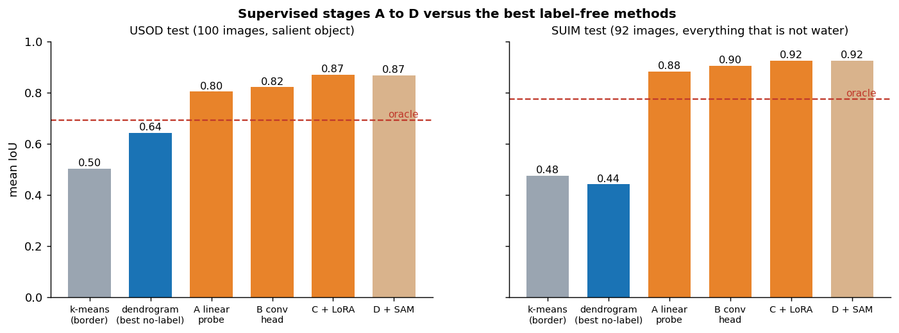

*Mean IoU per stage against the best label-free methods; dashed line = k-means oracle.*

## 4. The label problem and the one subject rule

### 4.1 Cross-dataset test

Train on one dataset only; every choice used its validation images only.

| Setting (mean IoU) | k-means | dendrogram | k-means oracle | A | B | C |
|---|---|---|---|---|---|---|
| Train USOD, test SUIM, **saliency** masks (108) | 0.43 | 0.55 | 0.60 | 0.71 | 0.75 | **0.79** |
| Train USOD, test SUIM, not-water masks (92) | 0.48 | 0.44 | 0.77 | 0.44 | 0.45 | 0.48 |
| Train SUIM, test USOD (300) | 0.52 | 0.65 | 0.70 | 0.35 | 0.36 | 0.36 |

* **It works when the label meaning matches:** a model trained on only 160 USOD images reaches 0.79 on SUIM saliency masks, against 0.55 for the best label-free method.
* **It fails when it does not:** SUIM marks everything that is not water, USOD only the salient object. The SUIM-trained model marks about 74 percent of the pixels of USOD images as foreground, while the true share is 22 percent (IoU 0.36). The head learns the annotation convention of its training set; the DINOv2 features themselves transfer.

### 4.2 One subject rule

Rule: animals, divers, robots and wrecks are the subject; if there is only reef and water the reef is the subject; otherwise there is no subject (empty mask). It agrees with SUIM's own saliency masks at IoU 0.99.

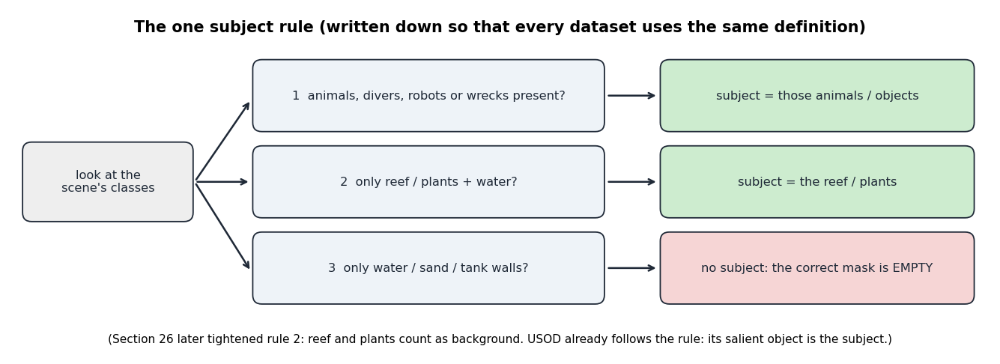

*The three branches of the rule.*

Results with one label for both datasets (mean IoU, test images):

| Setting | k-means | dendrogram | A | B | C |
|---|---|---|---|---|---|
| Pooled model, USOD test (100) | 0.50 | 0.64 | 0.81 | 0.85 | 0.84 |
| Pooled model, SUIM test (110) | 0.44 | 0.56 | 0.76 | 0.82 | **0.84** |
| Train USOD only, test SUIM (110) | 0.44 | 0.56 | 0.70 | 0.75 | **0.77** |
| Train SUIM only, test all USOD (300) | 0.52 | 0.65 | 0.74 | 0.78 | **0.78** |

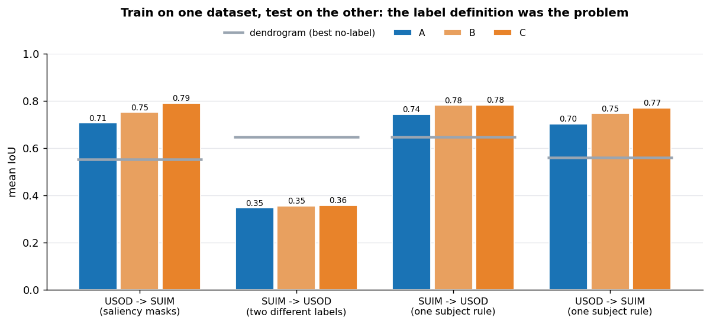

*Left two groups: the earlier labels; right two groups: one subject rule. SUIM to USOD rises from 0.36 to 0.78.*

* With one rule, SUIM to USOD rises from 0.36 to **0.78**, beating the best label-free method (+0.14).
* Cost: the pooled model is a little below the two-channel model of Section 3 (0.84 against 0.87 on USOD), because the two datasets still disagree on some images.
* **Seeds** (5 seeds for A and B, 3 for C; split fixed): USOD test A 0.813 ± 0.004, B 0.848 ± 0.006, C 0.853 ± 0.010; SUIM test A 0.763 ± 0.002, B 0.819 ± 0.002, C 0.832 ± 0.009. The ordering A < B < C is stable.
* **False alarms on empty crops** (SUIM has no water-only images, so negatives are crops with no subject pixels, 52 test crops; a false alarm is more than 1 percent of the crop predicted as foreground):

| Model | False-alarm rate |
|---|---|
| k-means (border rule) | 100% (it always outputs a foreground) |
| A | 19% |
| B | 19% |
| **C** | **10%** |

* A minimum-area rule removes most remaining false alarms (C: 0 percent) but deletes small subjects (USOD 0.84 to 0.81, SUIM 0.84 to 0.77), so it is not used.
* Test-time augmentation (flip and two scales) adds +0.003 to +0.007 IoU at four times the inference cost (optional). Size-weighted loss and last-four-layer features gave no validation gain.

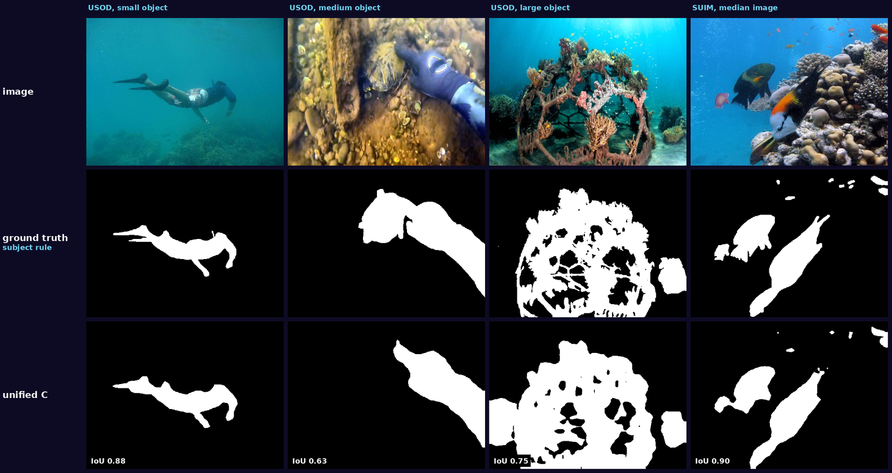

*Unified model C on the four example images. On the SUIM image only the fish are the subject; the reef is background (ground-truth row).*

## 5. The Dhwani tank frames (new footage)

302 frames from six GoPro clips of an indoor test tank; scene tags: fish 20, floor 37, structure 110, waterline 55, empty water 80 (before the review of the fish frames). **Test-only.** Ground truth: 19 fish frames have SAM-drafted masks (**not yet reviewed, so everything below is provisional**), the other 283 frames contain no animal or object.

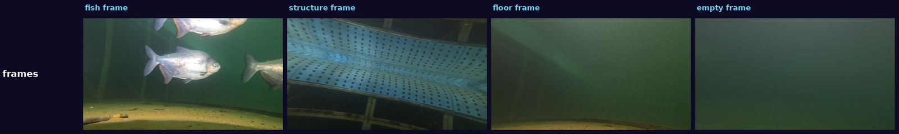

*The median frame of each tag: fish, structure, floor, empty water.*

| Model | Fish IoU (19 frames) | Recall / precision | Frames with a false alarm (of 283) | "Severe" false alarm (over 20% of the frame) | Mean predicted share of empty frames |
|---|---|---|---|---|---|
| k-means (border rule) | 0.18 | 0.47 / 0.18 | 100% | 99% | 54% |
| dendrogram (gap rule) | 0.47 | 0.71 / 0.48 | 94% | 74% | 61% |
| earlier C, salient channel | **0.81** | 0.98 / 0.82 | 53% | 27% | 14% |
| unified A / B / C (one subject rule) | 0.57 / 0.58 / 0.48 | C: 0.99 / 0.48 | 84% / 88% / 76% | 55% / 62% / 55% | C: 43% |
| strict-rule A / B / C (+ augmentation, no-subject crops) | 0.59 / 0.37 / 0.25 | C: 0.99 / 0.25 | 73% / 77% / **41%** | 36% / 55% / **25%** | C: 17.5% |

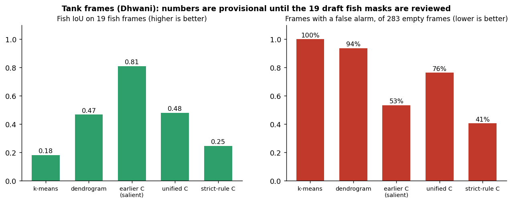

*Fish IoU (left, higher is better) and false-alarm rate on empty frames (right, lower is better).*

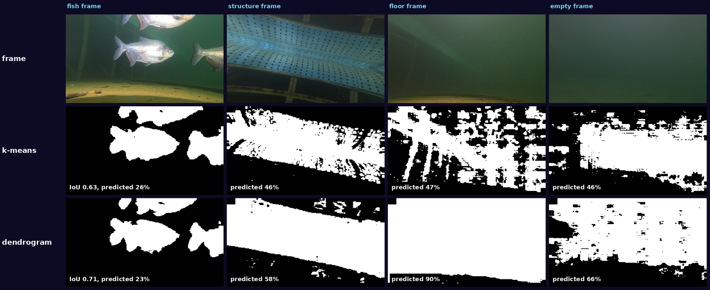

*k-means and dendrogram on four tank frames. They must output a foreground, so they mark something even on empty water.*

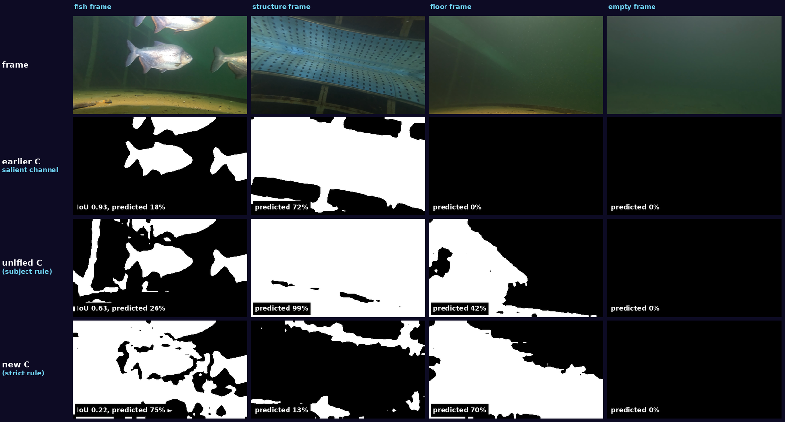

*Supervised models on the same frames.*

* **Unsupervised methods cannot say "nothing here":** k-means marks something in 100 percent of the no-subject frames, the dendrogram in 94 percent.
* **The supervised models find the fish** (recall 0.98 to 0.99) but are not selective. The earlier salient-channel model is best on fish (0.81) and still has a false alarm in 53 percent of the empty frames. The strict rule with augmentation halves the false alarms of Stage C (76 to 41 percent) but paints the murky water around the fish (precision 0.25, fish IoU 0.25).
* The least-adapted model (frozen features, small head, one clear label convention) is the most selective on a new site; pooling two label conventions and adapting the backbone made it worse on the tank.
* In-domain cost of the strict rule (same test images, new labels): USOD test C 0.826 against 0.842; SUIM test C 0.846 against 0.851.
* Not repeated for the strict rule: the cross-dataset tests, SUIM empty-crop false alarms and seeds. The tank frames were scored once and are not used to choose between variants.
* **Videos** of all 12 methods on six 30 s tank segments were rendered (locally; not in the repository). They show per-frame predictions with no temporal smoothing, so masks flicker slightly.

## 6. Run time and real-time feasibility

Measured on one desktop (RTX A2000, half precision); not tested on an embedded device.

| Step | Time |
|---|---|
| DINOv2 ViT-B/14 forward pass, 448 x 588 input | 17 ms (4 ms at 224 x 294; ViT-S/14 7 ms) |
| Deployable no-label path, PCA-RGB, k = 2, stride 14 | 169 ms in total (5.9 images/s) |
| Same with the 768 numbers | 385 ms in total (2.6 images/s); CPU clustering dominates |
| Stride 3 (25 passes) | far too slow for real time and no IoU gain |
| Gaussian mixtures after the features | per-image 0.14 s; dataset-level 0.03 s |

A linear probe on the frozen features needs no clustering and no foreground rule, which makes it the natural choice for real time.

## 7. Summary of what the results say

1. DINOv2 patch features already separate diver, water and reef without any underwater training.
2. Without labels the clusters are good (oracle 0.70) but choosing the subject is hard: the best label-free score is 0.65 (dendrogram) on USOD.
3. A small trained part on top of frozen DINOv2 lifts this to 0.80 to 0.92; LoRA mainly helps small objects; SAM does not help.
4. The head learns the annotation convention, so we wrote one subject rule; with it a USOD-trained model works on SUIM and the reverse (0.77 to 0.78).
5. On a new site (the tank) the models find the fish but raise false alarms on empty water (41 to 76 percent); more varied labelled data and an image-level "is there a subject?" decision are the next steps.

## 8. Limitations

* Two public datasets with one split each; the tank is the only truly new domain, and its ground truth is provisional (19 SAM-drafted masks, 283 frames assumed to have no subject).
* The SUIM subject label is derived from SUIM's own class masks, so SUIM scores follow SUIM's convention.
* The best dendrogram variant was chosen on the same images it is reported on, so its gain is slightly optimistic.
* The oracle uses the answer and is a ceiling, not a result.
* One run per setting except where seeds are listed; USOD validation has only 40 images.
* The SVAM-Net baseline was not run.
